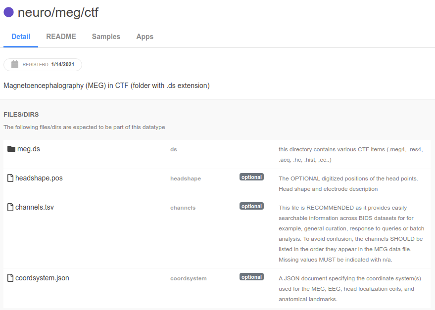
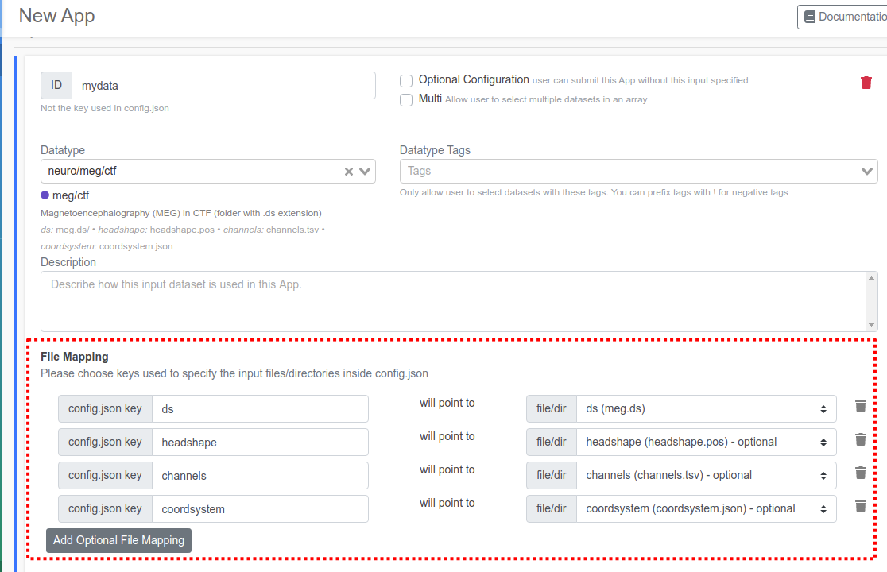

!!! note "Prerequisites"
    Read [App development / Introduction](/docs/apps/introduction) first.

    Install a text editor such as [VS Code](https://code.visualstudio.com){target=_blank} and a [git client](https://git-scm.com/downloads){target=_blank}. You also need [jq](https://jqlang.org/download/){target=_blank} and [nibabel](https://nipy.org/nibabel/){target=_blank}, explained below.

# HelloWorld

On this page you create a "HelloWorld" App for brainlife.io.

Start with a new [GitHub repository](https://docs.github.com/en/repositories/creating-and-managing-repositories/creating-a-new-repository){target=_blank}. Make it public so that brainlife.io can read it. You can give it any name; the brainlife.io team starts App names with `app-` (see [these Apps](https://github.com/search?q=org%3Abrainlife+app-){target=_blank}).

Here the App is called `app-helloworld` ([example repository](https://github.com/francopestilli/app-helloworld){target=_blank}). Clone your new repository to the computer where you will develop and test the App:

```
git clone git@github.com:francopestilli/app-helloworld.git
```
or, depending on your GitHub settings:
```
git clone https://github.com/francopestilli/app-helloworld.git
```

Go into the repository directory and create a file called `main`:

```
touch main
```

#### main

`main` is the script brainlife.io runs. It holds the batch scheduler directives for running on a cluster and reads the inputs from `config.json` with [`jq`](https://jqlang.org/){target=_blank}. Open `main` in your editor, paste the text below and save it.

```bash
#!/bin/bash

#SBATCH --nodes=1
#SBATCH --ntasks=1
#SBATCH --time=00:05:00

#parse config.json for input parameters (here, we are pulling "t1")
t1=$(jq -r .t1 config.json)
./app.py $t1
```

Make `main` executable:

```bash
chmod +x main
```

Then add the file to the repository, commit and push it to GitHub:

```bash
git add main
git commit -m "Add main"
git push
```

!!! note
    [`jq`](https://jqlang.org/){target=_blank} is a command-line tool that reads values from a JSON file. Install it with `apt-get install jq`, `yum install jq` or `brew install jq`, depending on your operating system. The compute resources where your App runs must also have common programs installed, including `bash`, `jq` and `singularity`.

!!! info "For Mac users"
    Install [Homebrew](https://brew.sh/){target=_blank} (it needs the Xcode command line tools), then run `brew install jq` in a terminal.

The first lines of `main` ask the batch scheduler (here Slurm) for one node, one task and five minutes:

```bash
#SBATCH --nodes=1
#SBATCH --ntasks=1
#SBATCH --time=00:05:00
```

The next lines read the value of `t1` from `config.json` with `jq` and pass it to the main part of the App, which you write below:

```bash
#parse config.json for input parameters
t1=$(jq -r .t1 config.json)
./app.py $t1
```

To test the App, create a test `config.json`.

#### config.json

```json
{
   "t1": "~/data/t1.nii.gz"
}
```

brainlife.io passes all inputs (parameters and paths to input data) to your App through `config.json`. brainlife.io writes this file into the App's working directory (where `main` is) when someone runs your App. To develop and test your App, write the file by hand, and make your code read all parameters and input paths from it.

There are several ways to read `config.json`. In bash, use [`jq`](https://jqlang.org/){target=_blank} as shown above.

In Python, use `json.load()`:

```
import json
with open('config.json') as f:
    config = json.load(f)
print("my path to t1w is ", config["t1"])
```

In MATLAB, use [`jsondecode`](https://www.mathworks.com/help/matlab/ref/jsondecode.html){target=_blank}:
```
config = jsondecode(fileread('config.json'));
disp(config.t1)
```

Set `t1` to the path of a test T1-weighted image in NIfTI format. If you do not have one, download a `neuro/anat/t1w` dataset from the Open Diffusion Data Derivatives publication ([doi:10.25663/bl.p.3](https://doi.org/10.25663/bl.p.3){target=_blank}), for example with the [CLI](/docs/cli/download/). A `neuro/anat/t1w` dataset contains the file `t1.nii.gz`. Put it in a folder such as `~/data/`:

```bash
mkdir -p ~/data
cp /path/to/downloaded/t1.nii.gz ~/data/
```

Add `config.json` to [.gitignore](https://docs.github.com/en/get-started/git-basics/ignoring-files){target=_blank}: brainlife.io creates it at run time, and you only need it now for testing.

!!! hint
    Keep a sample file called `config.json.sample` in the repository and link to it with `ln -s config.json.sample config.json` while you test. The sample also helps other people write their own `config.json` to run your App from the command line.

#### What files can I expect in `config.json`?

The example above takes the [`neuro/anat/t1w`](https://connects.brainlife.io/datatypes/58c33bcee13a50849b25879a){target=_blank} datatype. Other datatypes have other files.

When you register your App, you choose its configuration parameters and input datatypes. Browse the [Datatypes](https://connects.brainlife.io/datatypes?scope=public){target=_blank} catalog to see the files and directories of each datatype.

For example, the [`neuro/meg/ctf`](https://connects.brainlife.io/datatypes/6000714baacf9e22a6a691c8){target=_blank} datatype has a `meg.ds` directory and a few optional files.



When you register your App, you choose both the datatype of each input and the key that each of its files or directories gets in `config.json`.

The registration of your App might look like this:



The **File mapping** section decides which file or directory goes under which key in `config.json`. When someone runs your App, brainlife.io writes a `config.json` like this:

```
{
    "ds": "... a path to meg.ds directory",
    "headshape": "... a path to headshape.pos file",
    "channels": "... a path to channels.tsv",
    "coordsystem": "... a path to coordsystem.json"
}
```

In this datatype only the `meg.ds` directory is required. The other files may be missing, so your App must check that they exist.

If your App has 2 inputs of the same datatype, give their keys different names (for example "ds1" and "ds2") so your App can tell them apart.

#### app.py

`main` runs a Python script called `app.py`. Create it:

```bash
cd ~/git/app-helloworld
touch app.py
```

Paste this into `app.py`:

```
#!/usr/bin/env python

import sys
import nibabel as nib

#just dump input image header to output.txt
img=nib.load(sys.argv[1])
f=open("output.txt", "w")
f.write(str(img.header))
f.close()

```

Make `app.py` executable too:

```
chmod +x app.py
```

Then add, commit and push it:

```bash
git add app.py
git commit -m "Add app.py"
git push
```

Your App must write its output files into the current working directory, with the structure of the output datatype. For now, do not worry about the output datatype (assume `raw`).

Add your App's output files to .gitignore so they do not end up in the repository.

#### .gitignore

```
config.json
output.txt
```

!!! note
    .gitignore is a text file that tells git which files in the working directory to ignore. See [Ignoring files](https://docs.github.com/en/get-started/git-basics/ignoring-files){target=_blank}.

## Testing

Install [nibabel](https://nipy.org/nibabel/){target=_blank} (for example `pip install nibabel`), then run `main`:

```
./main
```

<!--
!!! hint
    If you are testing on HPC clusters, be sure to enter the interactive shell session before running your `main` by executing something like `qsub -I`
-->

It writes a file called `output.txt` with the NIfTI header of the image:

```
<class 'nibabel.nifti1.Nifti1Header'> object, endian='<'
sizeof_hdr      : 348
data_type       : 
db_name         : 
extents         : 0
session_error   : 0
regular         : r
dim_info        : 0
dim             : [  3 260 311 260   1   1   1   1]
...
...
...
qoffset_x       : 90.0
qoffset_y       : -126.0
qoffset_z       : -72.0
srow_x          : [ -0.69999999   0.           0.          90.        ]
srow_y          : [   0.            0.69999999    0.         -126.        ]
srow_z          : [  0.           0.           0.69999999 -72.        ]
intent_name     : 
magic           : n+1
```

## Push to GitHub

If everything looks right, push your files to GitHub:

```bash
git add .
git commit -m "Create my first brainlife.io App"
git push
```

You have created your first brainlife.io App. You have:

* Created a public GitHub repository.
* Written `main`, which reads `config.json` and runs the App.
* Written a test `config.json`.
* Written `app.py`, which runs the algorithm and writes the output.
* Tested the App and pushed it to GitHub.

!!! info
    See more examples in the [Apps maintained by the brainlife.io team](https://github.com/search?q=org%3Abrainlife+app-){target=_blank}.

To run your App on brainlife.io:

1. Describe it: add a `brainlife.app.json` manifest and a README based on the template, and check the manifest with `python tools/blapp.py validate` (see [Describe your App with a manifest](/docs/apps/register/#describe-your-app-with-a-manifest)).

2. [Register your App on brainlife.io.](/docs/apps/register/)

3. Enable your App on at least one compute resource. Register your own resource under **My Resources**, or [contact the brainlife.io team](/docs/contact/) to enable it on a shared test resource.

<!--
All input parameters are assumed to be text (char). You need to write your functions that are going to be MATLAB compiled with all the arguments as text. Arguments passing a number need to be given as text and within the function converted to integers values (str2num(), etc.). 
-->
