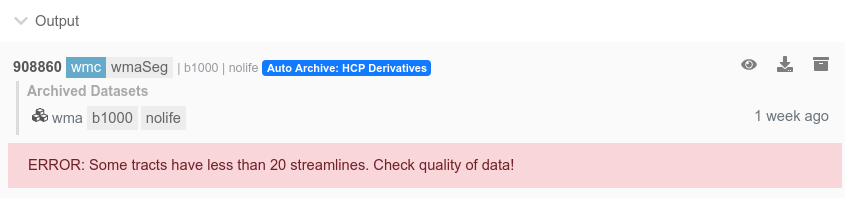

# `product.json`

Your App can write a file named `product.json` into its working directory to send information back to brainlife.io. It is the counterpart of `config.json`: `config.json` passes parameters from the user to the App, and `product.json` passes information from the App back to brainlife.io when the job finishes. Use it to tell the user something about the run, or to store small results that you can later collect across many subjects quickly.

!!! warning
    Keep `product.json` to a few kilobytes.

Use `product.json` to:

1. Show messages, graphs (Plotly) and images on brainlife.io.
2. Store a small amount of data that you can later collect across many output datasets.
3. Set annotations (dataset tags), metadata or datatype tags on the output datasets.

Each use is explained below.

## 1. Show messages and graphs on brainlife.io

<!--

### Images

```json
{
	"brainlife": [
		{
			"type": "image",
			"label": "xyz-image",
			"path": "./images/myimage.png"
		}
    ]
}
```
-->

`product.json` can hold any data. Items under the special key `"brainlife"` are shown on brainlife.io.

### Messages (errors and warnings)

To show an error or warning message, store it in this format:

```json
{
	"brainlife": [
		{"type": "error", "msg": "Some tracts have less than 20 streamlines. Check quality of data!"}
	]
}
```

The message is shown with the job's results: in the **Results** section of the process side panel (**3. Processing** → **Processes**) and in the process editor. (The screenshot below is from the previous brainlife.io interface.)



These message types are available:

```json
{
	"brainlife": [
		{"type": "error", "msg": "here is my error message"},
		{"type": "danger", "msg": "here is my danger message"},
		{"type": "info", "msg": "here is my info message"},
		{"type": "warning", "msg": "here is my warning message"},
		{"type": "success", "msg": "here is my success message"}
	]
}
```

### Graphs (Plotly)

To show a [Plotly](https://plotly.com/javascript/){target=_blank} graph:


```json
{
    "brainlife": [
        {
            "type": "plotly",
            "name": "my plotly test",
            "data": [
                {
                    "type": "bar",
                    "x": ["2014-06-11", "2014-06-12", "2014-06-13", "2014-06-14", "2014-06-15", "2014-06-16"],
                    "y": [10, 25, 30, 10, 15, 30]
                }
            ],
            "layout": { "xaxis": { "title": "date" }, "yaxis": { "title": "value" } }
        }
    ]
}
```

`data` is a list of [Plotly traces](https://plotly.com/javascript/reference/){target=_blank} and `layout` is a Plotly layout. `name` labels the graph.

### Images

To show an image, encode it as base64 and store it in `product.json`:


```json
{
    "brainlife": [
        { 
            "type": "image/png", 
            "name": "My image title",
            "base64": "............base64 encoded png............"
        }
    ]
}
```

## 2. Store small results

You can store any other data anywhere in `product.json`. For example:

```json
{
    "rmse": 123,
    "labels": ["apple", "orange"]
}
```

Some Apps produce outputs of many gigabytes. Collecting such outputs across many subjects could mean staging hundreds of gigabytes, which may not be possible or sensible. Instead, write a pre-computed summary into `product.json`. You can then query the datasets and read the `product.json` content of each one without downloading the datasets themselves. See the [CLI](/docs/cli/download/) and the warehouse API example in [Group analysis](/docs/cli/group/).

<!--
By storing all pre-aggregated information in `product.json`, you can create a Javascript-based visualizer that can simply query and consume information to visualize. The user can then dynamically update the query and play around with the data.

For developers who don't want to code in Javascript, we could provide more standard "App" way of accomplishing the same thing by staging product.json from each input dataset (rather than the actual dataset) and let it do the aggregation and generate some static images / graphs (or product.json / visjs!) 

Developers can also use Brainlife API to query for datasets and its product.json and run it via command line. Such App can live completely outside Brainlife UI.
-->


## 3. Set annotations, metadata and datatype tags

Set the `tags` key to add annotations (dataset tags) to the output datasets:

```json
{
    "tags": [ "tags_from_app" ]
}
```

!!! note
    If your App has several outputs, the tags are added to all of them. To set different tags for each output, see "Multiple output datasets" below.

You can also set (or override) dataset metadata:

```json
{
    "meta": {
        "subject": "12345",
        "SliceTiming": [0, 1, 2, 3]
    }
}
```

You can also override the datatype tags of the output dataset, although we do not recommend it:

```json
{
    "datatype_tags": [ "acpc_aligned" ]
}
```

!!! warning 
    brainlife.io expects each App to produce the datatype and datatype tags it is registered with. Overriding datatype tags can make your workflow inconsistent. Make sure any datatype tag you use is valid and listed under **Official tags** for the output datatype in the [Datatypes](https://connects.brainlife.io/datatypes?scope=public){target=_blank} catalog.

## Multiple output datasets

Many Apps produce more than one output dataset. By default, everything in `product.json` is copied to every output. To store different information for each output, use the output IDs registered for your App as keys at the root of `product.json`.

For example, suppose your App has 2 outputs, registered with the IDs "t1" and "mask".

Your App can then write a `product.json` like this:

```
{
    "t1": {
        "val1": 123,
        "val2": 456
    },
    "mask": {
        "val1": 567,
        "val2": 890
    }
}

```

When brainlife.io reads this `product.json`, it uses the "t1" object for the t1 output and the "mask" object for the mask output. Items at the root of `product.json` are merged into each output's data, so you can store information common to all outputs next to output-specific information.
