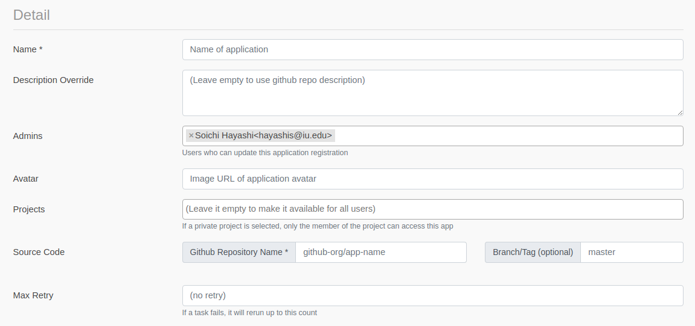
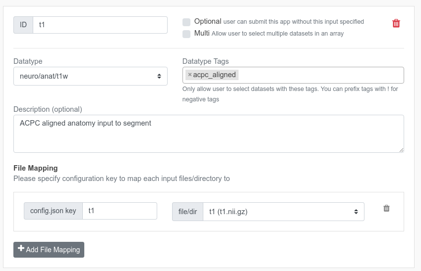
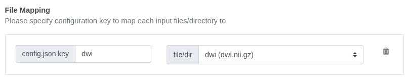
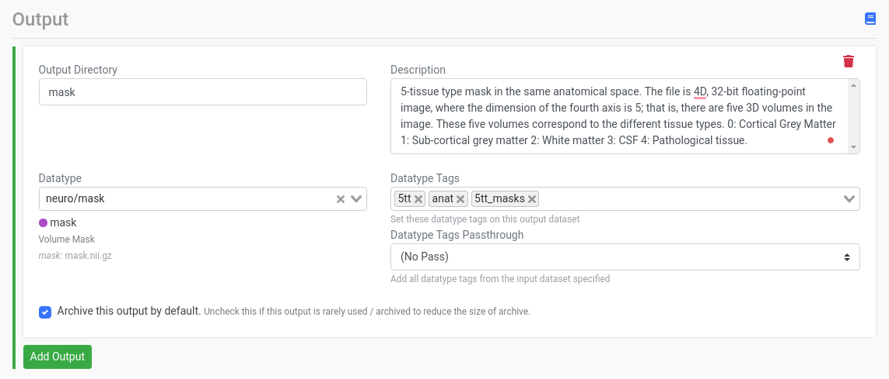
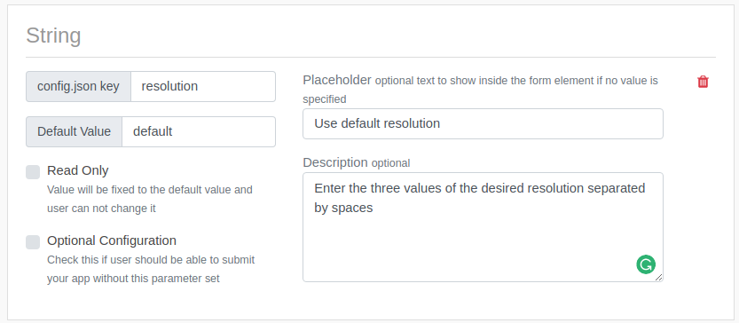
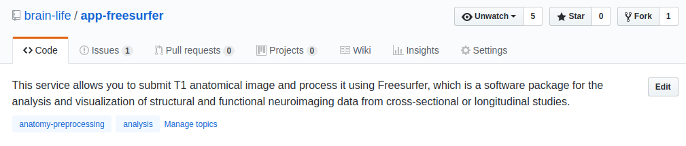
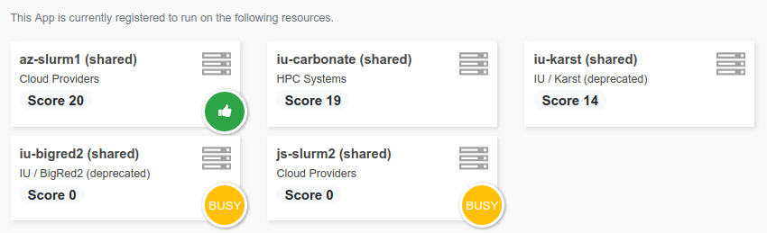

# Registering an App

Once your App is in a public GitHub repository, register it on brainlife.io so that you and other people can find it and run it.

Registering takes two steps: create the App, then fill in its settings (configuration parameters, inputs and outputs). Before you register, add a `brainlife.app.json` manifest and a README to the repository (see [Describe your App with a manifest](#describe-your-app-with-a-manifest)).

## Create the App

1. In the sidebar, select **My Apps**.
2. Select **App** (the button with a plus sign). The **Create app** dialog opens: "Register a processing app from a GitHub repository. Apps accept specific datatypes as input and produce resulting datatypes."
3. Enter a **Name** (for example "Freesurfer recon-all").
4. Enter the GitHub repository as `orgname/reponame` (for example `yourname/app-name`), not the full GitHub URL.
5. Choose the **Branch or tag** to run. If you choose `master` or `main`, the dialog warns "Avoid releasing an app from master or main." Register a version branch or tag instead (see [Versioning tips](/docs/apps/versioning/)).
6. Select **Create app**.

brainlife.io creates the App and opens its settings. To change the settings later, open the App page and select **Edit**.

The settings have four tabs: **Details**, **Configurations (n)**, **Inputs (n)** and **Outputs (n)**. Select **Save Changes** when you are done.

## Details



The **Details** tab has four sections.

**Details** ("Name, description, and avatar shown for this app.")

* **Name**: the App name shown in the catalog.
* **Description override**: leave it empty to use the GitHub repository description (see [README, description and topics](#readme-description-and-topics)).
* **Avatar**: the URL of an image for your App. Use a square image with an `https://` URL. Many Apps are registered, and the avatar helps people recognize yours.

**Access** ("Who can edit this app, and which projects can use it.")

* **Maintainers**: the people who can edit this App.
* **Projects**: by default an App is public, so anyone can find and run it. To make it available only to some projects ("Restrict access to selected projects"), add those projects here. Only members of those projects can then use the App. This is useful while you are still developing the App, or if it only works on data from one project.

**Source code** ("GitHub repository and branch or tag for this app.")

* **Repository** and **Github Branch or Tag**: the repository and the branch or tag that brainlife.io runs.

brainlife.io records the branch used for each job, so people can reproduce an output with the same version of your code. If you register `master` or `main` and keep changing it, people cannot reproduce results exactly. When the App is ready, create a release branch (for example `1.0`) and register that. See [Versioning tips](/docs/apps/versioning/).

**Deprecated** ("Point users to a replacement, hide this app from listings, or delete it.")

* **Replacement app**: the App that replaces this one.
* **Mark as removed**: hide the App from listings.
* **Delete app**: delete the App. This cannot be undone.

## Inputs

The **Inputs** tab ("Input datasets, datatypes, file mappings, and optional filters.") lists the input data your App expects. Select **Add Input** to add one.



For each input, set:

* **ID**: an identifier for the input (it is not the key used in `config.json`). Your App can use this ID to find information about the input at run time in `config.json` (under `._inputs`).
* **Datatype**: the datatype of the input.
* **Description**: how your App uses this input.
* **Datatype tags**: tags that the input datasets must have. "Prefix tags with ! to exclude datasets with those tags." Users can only select datasets that match. See [Datatypes](/docs/user/datatypes/).

!!! hint
    If you do not know which datatype to use, ask in the #datatype channel on the brainlife.io Slack.

### File mapping

After you choose the datatype, decide how each of its files appears in `config.json`. A datatype is made of files and directories. Under **File mapping**, enter a **config.json key** for each file or directory your App uses. Use **Add optional file mapping** to map more of the datatype's files.

For example, the `neuro/dwi` datatype has the files `dwi`, `bvecs` and `bvals`. If your App only uses the `dwi` file and you want its path under the key `dwi`, map it like this:



When someone runs your App, brainlife.io writes a `config.json` like this:

```json
{
    "dwi": "../path/to/dwi.nii.gz"
}
```

Your App reads `config.json` and uses the value of `dwi` as the path to the input image.

!!! note
    To use all 3 files of `neuro/dwi`, create 3 file mappings: `dwi`, `bvecs` and `bvals`.

**Object subsetting (experimental)**: if your App only uses part of an input, list the file paths it needs, one per line (`*` matches any characters; paths are relative to the root of the datatype). Leave it blank to transfer the whole input. Listing only what you need reduces scratch disk use and transfer time.

### Options

* **Optional**: "User can submit this App without this input specified". Leave it unchecked for a required input. If the input is optional and the user does not provide it, `config.json` has none of the keys from its file mapping.
* **Multi**: "Allow user to select multiple datasets in an array". The selected datasets are placed in a JSON array, even if the user selects only one. For example, the `config.json` above becomes:

```json
{
    "dwi": [
	"../path/to/dwi.nii.gz"
    ]
}
```

!!! note
    If an input has more than one file mapping, the order of the datasets in each array is the same across all mappings.

## Outputs

The **Outputs** tab ("Output directories, datatypes, tags, and archive settings.") lists the datasets your App produces. Select **Add Output** to add one. You choose the datatype (discuss new datatypes in the #datatype Slack channel), and your App must write the files with the names and structure that the datatype defines.



For each output, set:

* **Output Directory**: the directory, inside the working directory, where your App writes this output. In the example above, the App writes a directory called `mask` with the file `mask.nii.gz` inside it.
* **Datatype**: the datatype of the output.
* **Description**: "Describe what this output is, and what the user can do with it". Write as much as is useful.
* **Datatype tags**: tags that describe the output more precisely. For example, the screenshot shows an App that outputs `anat/t1w` with the tag `acpc_aligned`. An App that only works with ACPC-aligned `anat/t1w` can require the same tag on its input.
* **Datatype tags/metadata passthrough**: "Take all datatype tags and metadata associated with the specified app input, and apply it to this output". Some Apps work as a *filter*: they take a dataset and produce another of the same datatype, and should *add* tags rather than replace them. Choose the input to copy tags and metadata from. For example, if the input has the tag `defaced`, the output has both `acpc_aligned` and `defaced`.
* **Archive this output by default**: "Uncheck this if this output is rarely used to reduce the size of archive."

### The `raw` datatype

Your App may produce output that no other App is meant to use, at least at first. Use the `raw` datatype to output and archive such data. Avoid `raw` as an input datatype: if you need another App's `raw` output as your input, the other developer and you should define a new datatype so that both Apps can work together through it.

Ask in the #datatype channel on brainlife.slack.com to register a new datatype, or to find other developers interested in it.

## Configurations

The **Configurations** tab ("Configuration parameters shown when users run this app.") lists the parameters users can set. Select **Add String**, **Add Number**, **Add Boolean** or **Add Enum** to add one. An enum lets users choose from a list of options (**Add option**; each option has a **Label**, **Description** and **Value**).



For each parameter, set:

* **config.json key**: the key under which the value appears in `config.json`.
* **Description**: shown next to the parameter. Give enough detail for both new and experienced users.
* **Placeholder** (string and number): text shown inside the field when it is empty, for example the expected format or a sample value.
* **Min** and **Max** (number): the allowed range.
* **Default value**.
* Options: "This is an optional Input", "This is an advanced option" (shown under the advanced configuration section), "This is read-only" (fixed to the default value), and for strings "This is a multi-line input".

!!! note
    **For new users**

    brainlife.io is for both new and experienced users. For new users, describe each parameter and how to choose a good value (link to a web page or to your README).

    Make as many parameters optional as you can, and detect good values at run time when the user does not set them.

    **For experienced users**

    Your App should not be a black box for experienced users. Let them set or override any parameter, so they stay in control of how the algorithm works.

Select **Save Changes**, then open the App page and check that everything looks right.

## README, description and topics

brainlife.io reuses information from your GitHub repository.

* **Description and topics**

    The GitHub repository description is shown as the App description (unless you set **Description override**). Write a description that says what the App does and what users can do with its output.

    GitHub topics are shown as the App's **Tags** and help people find your App. Reuse topics that other Apps already use.

    

    !!! note
        Avoid using many topics, and avoid topics that no other App uses.

* **README.md**

    The App page shows the README of your repository under **About**. You can include images, LaTeX equations and any standard [Markdown](https://github.com/adam-p/markdown-here/wiki/Markdown-Cheatsheet){target=_blank}.

    Start from the [brainlife App README template](https://github.com/brainlife/abcd-spec/blob/master/templates/README.md){target=_blank}, which follows the layout of the [FreeSurfer App](https://github.com/brainlife/app-freesurfer){target=_blank}: badges, an "At a glance" block, versions, how to run the App, outputs, troubleshooting, citations, authors, funding and license. The "At a glance" block is generated from your manifest (see below).

    Include:

    * What your App does and how (tools and libraries used).
    * What your App produces and what users can do with it.
    * Diagrams or sample output images.
    * How the algorithm works.
    * The compute it needs (how long it runs, minimum memory and CPU cores).
    * How others can contribute (do you accept pull requests?).
    * Papers to cite and a list of contributors.

    !!! note
        brainlife.io is for both new and experienced neuroscience researchers. Write for both.

## Describe your App with a manifest

New Apps should add a `brainlife.app.json` file at the root of each App branch. The manifest describes what the App does, so that people and AI agents can find an App, connect its inputs, set its parameters and predict what a run needs without reading its scripts. It is defined in [ABCD specification version 2 (draft)](https://github.com/brainlife/abcd-spec#app-manifest-brainlifeappjson-spec-v2-draft){target=_blank}.

!!! note
    The manifest only describes your App. Adding it does not change how your App runs, and brainlife.io does not read it yet: the App page and `config.json` still come from the settings you enter on brainlife.io. Keep the two consistent.

The manifest must validate against [`schema/brainlife-app-2.0.schema.json`](https://github.com/brainlife/abcd-spec/blob/master/schema/brainlife-app-2.0.schema.json){target=_blank}. Its main fields:

| Field | What it holds |
|---|---|
| `summary` | One sentence (up to 350 characters): the GitHub description and the brainlife.io tagline |
| `description` | What the App does, when to use it and when not to |
| `inputs[]`, `outputs[]` | Datatype by name (for example `neuro/anat/t1w`), datatype tags, a description, and for inputs the `config.json` keys that receive the files |
| `parameters[]` | Typed (`string`, `integer`, `number`, `boolean`, `enum`), with description, default, units, range and options |
| `runtime` | Container image, suggested resources and required licences |
| `software`, `citations`, `failure_modes`, `topics`, `doi` | Tools and versions, papers to cite, known errors and their fixes, search topics, the App DOI |

A complete example is [`examples/freesurfer-7.3.2.brainlife.app.json`](https://github.com/brainlife/abcd-spec/blob/master/examples/freesurfer-7.3.2.brainlife.app.json){target=_blank}.

To check your manifest, clone the [abcd-spec](https://github.com/brainlife/abcd-spec){target=_blank} repository and run:

```bash
pip install jsonschema
python tools/blapp.py validate /path/to/your-app/brainlife.app.json
```

Other commands in the same repository:

```bash
# Draft a manifest from an App's brainlife.io registry record (one App as returned by GET /api/warehouse/app)
python tools/blapp.py generate record.json --main main > brainlife.app.json
# Check a manifest against the registry record as well
python tools/blapp.py validate brainlife.app.json --registry record.json
# Show the GitHub About panel the manifest implies
python tools/blapp.py about brainlife.app.json
# Fill the "At a glance" block of a README made from the template
python tools/readme.py brainlife.app.json README.md
```

## Enable the App on compute resources

After you register your App, it must be enabled on the compute resources where it will run. A resource can be a VM, an HPC cluster or a public or private cloud. Only the administrators of a resource can enable Apps on it: on the resource page they keep the list of enabled Apps ("Only apps listed here are submitted to this resource."). Contact the administrator of each resource where you want your App to run.

!!! note
    If you do not know who administers a resource, [contact the brainlife.io team](/docs/contact/).

If you have your own compute resources, you can register them under **My Resources** and enable your App there to test it. See [Registering a resource](/docs/resources/register/). On a private resource, only you (and the projects you share it with) can run the Apps enabled there. For everyone to be able to run your App, it must be enabled on the brainlife.io public resources.

Once your App is enabled, the resources appear under **Computing Resources** on the App page.



!!! note
    Most Apps run their software inside a container. The next step is to containerize your App, as explained in [Containerizing an App](/docs/apps/container/).
