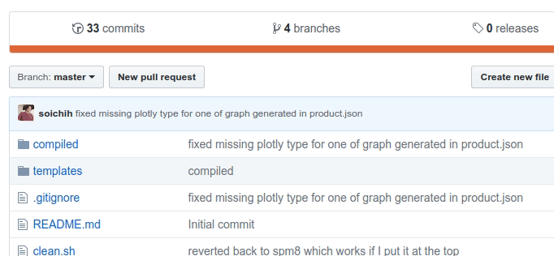
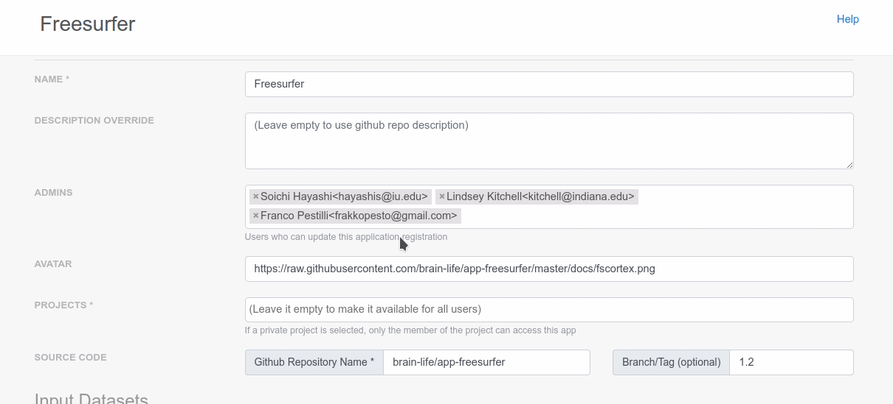

# Versioning tips

brainlife.io does not require a particular git branching scheme, and you can follow your group's own practice. These are the guidelines we suggest.

## Work on the default branch

Develop on the repository's default branch (`main` or `master`). Pull from the remote often to reduce merge conflicts. Use local branches for each feature, but do not push them. When a feature or fix is tested on your local branch, merge it into your local default branch and push it.

## Test before you push

You can test an App on your computer by running `main`, or on an HPC system with the `start` script if the [ABCD default hooks](/docs/resources/register/#abcd-default-hooks) are on your PATH. Do not commit and push changes to GitHub just to test them on brainlife.io.

## Create a branch for each release

When all changes are made and tested, create a release branch from the default branch. You can create one in the GitHub web interface.

Then point your App on brainlife.io to the new branch: open the App, select **Edit**, and on the **Details** tab set **Github Branch or Tag** under **Source code**. When you register a new App, the **Create app** dialog warns "Avoid releasing an app from master or main."

You can use tags instead of branches, but a tag cannot take a quick bug fix later. A tag only points to one commit, which a commit ID also does. We recommend a branch for each release.

## Fix bugs on release branches

If you find a critical bug after you create a release branch, fix it on the default branch first and test it (on your computer and on brainlife.io). Then apply the same fix to every affected release branch, for example with [cherry-pick](https://git-scm.com/docs/git-cherry-pick){target=_blank}, since you probably do not want to merge every other change made since the branch was created. Change release branches only for critical bug fixes, so that your App stays reproducible.

If your repository has a `brainlife.app.json` manifest, keep the copy on each release branch up to date. Its `version` field is the name of that branch.

## Use semantic versioning

If you do not know semantic versioning, read [semver.org](https://semver.org/){target=_blank}.

Name branches with the major and minor version (like "2.3"), without the patch number: the patch number goes up with each bug fix, and you do not need a new branch for each fix. If you make changes that are not backward compatible, consider registering a new App with a new major version, so that people can still run the previous version.
