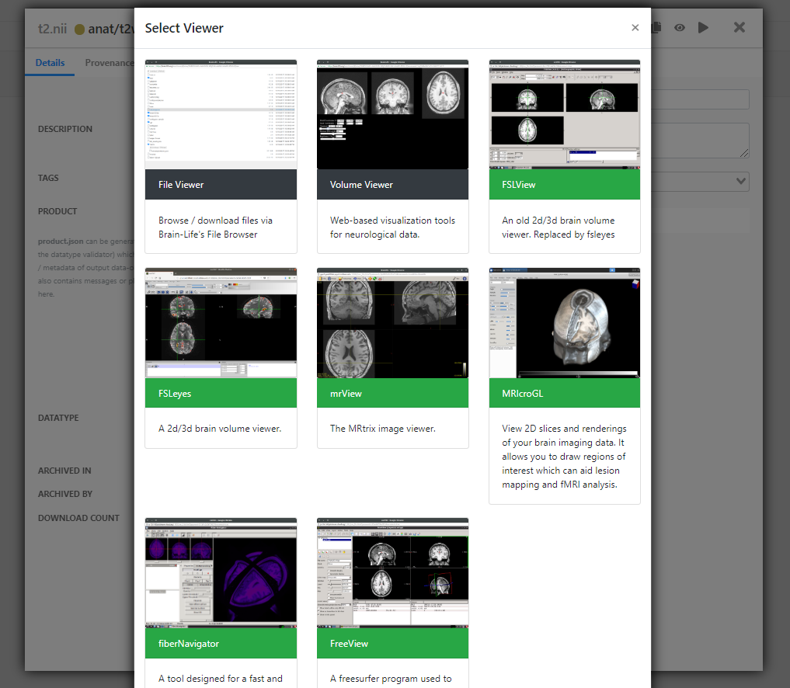

# brainlife.io architecture

## Overview

brainlife.io is built from a set of [microservices](https://microservices.io/){target=_blank}. The two main ones are the Warehouse, which manages projects, data, Apps and publications, and Amaretti, brainlife.io's workflow service, which runs jobs on compute resources.

The services talk to each other through REST APIs and an AMQP message bus. All web traffic reaches them through an nginx proxy. Monitoring and operations services are not shown in the diagram. Jobs run on shared compute resources (TACC, Jetstream2 and ACCESS) and on resources that users register themselves.

### Amaretti (jobs)

[Amaretti](/docs/technical/amaretti) orchestrates the jobs (tasks) that run Apps across compute resources. It works on top of each resource's own batch scheduler (such as Slurm or PBS): it picks a resource for each job, stages the inputs, starts and monitors the job, copies working directories between resources with `rsync`, and cleans up scratch space. See [Amaretti](/docs/technical/amaretti) and the [Amaretti REST API](/docs/technical/api).

### Authentication

The [authentication service](https://github.com/brainlife/auth){target=_blank} stores user accounts, handles sign-up and sign-in, and issues JWT tokens that the other services check without a session ([stateless authentication](https://www.jbspeakr.cc/purpose-jwt-stateless-authentication/){target=_blank}).

### AMQP and events

The [event service](https://github.com/brainlife/event){target=_blank} lets the web app and the CLI subscribe to an event stream over a WebSocket. Services publish events such as job (task) status changes and dataset updates. Other services subscribe to these events with a valid token to receive them in real time, or queue them for event handlers.

### Warehouse

The [Warehouse](https://github.com/brainlife/warehouse){target=_blank} provides most of brainlife.io's features. The web app and the CLI call the Warehouse API for most requests. The Warehouse organizes datasets in projects, runs pipeline automations, asks Amaretti to run jobs and to move data between compute resources, and stages and archives datasets.

The web app is written in [React](https://react.dev/){target=_blank}.

#### Modular processing

App developers can register [datatypes](/docs/user/datatypes/). Apps exchange data through datatypes, which keeps them modular: each App does one kind of processing (alignment, tracking, statistics, and so on), more code is reused, and developers can focus on what is new in their App. For example, a statistician writing a statistical method does not need to handle preprocessing, and a developer writing a tractography App does not need to write the analysis of the streamlines, which tract profile Apps already do. For users, modular Apps make it easier to build a workflow from interchangeable parts and to try a newer version or a different algorithm for one step.

Combining Apps freely also makes incompatibilities more likely. For example, an App may take `anat/t1w` input but only work well on ACPC-aligned images. To reduce this risk, datasets carry [datatype tags](/docs/user/datatypes/). An App can require certain datatype tags on its inputs, so users cannot run it on incompatible datasets.

Apps process one subject at a time. To run an App on many subjects, brainlife.io submits one job per subject. Amaretti can then send each job to an HPC or high-throughput system, and to several resources at once when they are available. One job per subject also isolates errors: a problem with one subject does not stop the others. The more subjects you process, the more likely it is that a few never complete (for example because of data problems).

#### Processing many subjects: pipelines

Modular processing creates many jobs. For example, a workflow of 10 Apps across 200 subjects means 2000 (10 x 200) jobs to submit and monitor.

The [pipeline](/docs/user/pipeline/) handles this. A pipeline is the set of *automations* in a project (**3. Processing** → **Pipeline**). Each automation runs one App for every subject (and session) that has the inputs and does not yet have the output. Automations keep running until you turn them off, and you can add them one at a time while earlier ones are running. This works like [stream processing](https://medium.com/@gowthamy/big-data-battle-batch-processing-vs-stream-processing-5d94600d8103){target=_blank} of the project's datasets. Compared with workflow systems such as Pegasus WMS, Nipype or HTCondor DAGMan, where you define the whole workflow in a programming language or special syntax and submit it at once, this approach has some advantages:

* It recovers from problems more easily, including ones you did not foresee. A failed job can be handled on its own, or you can add an automation for a subset of subjects to work around a problem while the other automations keep running.
* When new datasets appear (uploaded, made by a process or by another automation), the automations find them and submit jobs as needed. You set up an automation once; nothing needs to be resubmitted for new data.
* You set it up in the web app, with no programming or special syntax. You can add complexity step by step instead of planning the whole workflow before you start.

And some disadvantages:

* With many automations, the whole workflow is hard to see at once. (Automation groups, **+ Automation Group**, help organize them.)
* Each automation applies to each subject separately. It cannot combine data across subjects, for example to aggregate outputs. Use [Analysis](/docs/user/groupanalysis/) notebooks for that.
* Because automations do not form a declared graph (DAG), a set of automations could in principle loop.

### CLI

The [brainlife.io CLI](https://github.com/brainlife/cli){target=_blank} is mostly used to upload and download data between brainlife.io and your computer. It can also run Apps, wait for jobs and query projects, datatypes, resources, publications and Apps. It is written in Node.js and distributed through npm. Unlike the web app, you install it yourself and keep it up to date. See [Installing the CLI](/docs/cli/install/).

### Visualization

You can look at datasets in your browser: every output opens in NiiVue or Neuroglancer. [NiiVue](https://niivue.com){target=_blank} shows volumes, surfaces and streamlines, and [Neuroglancer](https://github.com/google/neuroglancer){target=_blank} shows large electron and light microscopy volumes. These viewers run in your browser and load the data through the brainlife.io API.

Some datatypes can also open in familiar desktop tools, such as FSLeyes or mrview, run in a container on a brainlife.io server and streamed to your browser ([abcd-novnc](https://github.com/brainlife/abcd-novnc){target=_blank}). You only need a web browser; you do not install the tools or download the data. See [Visualizing datatypes and datasets](/docs/user/datatypes/).

