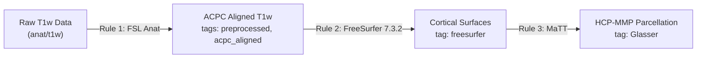
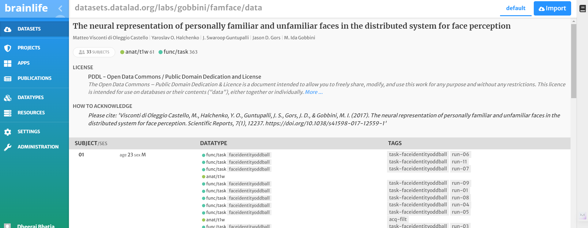
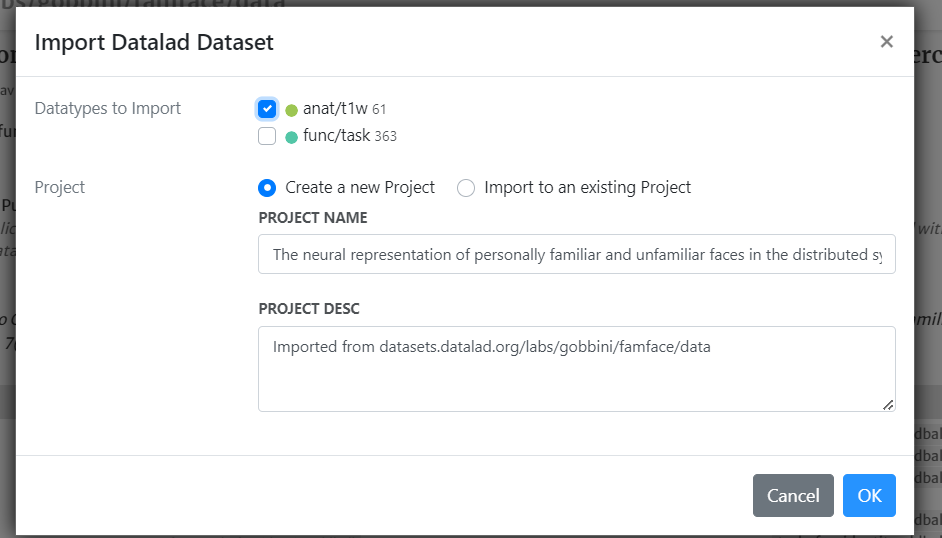
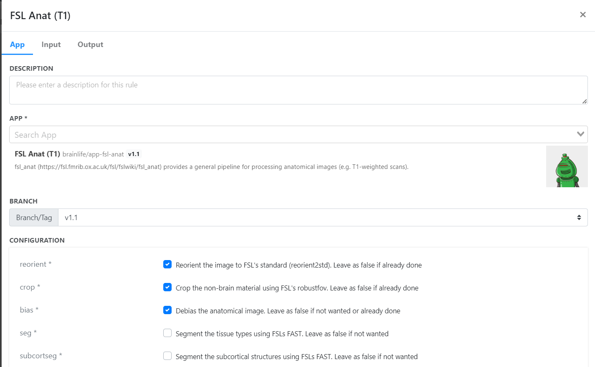
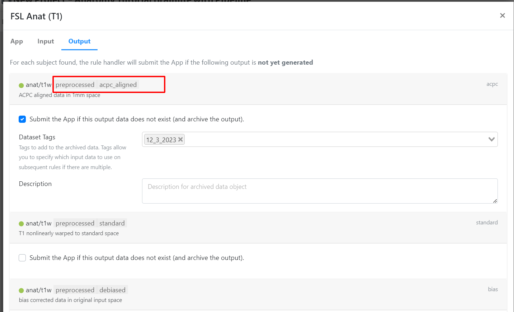
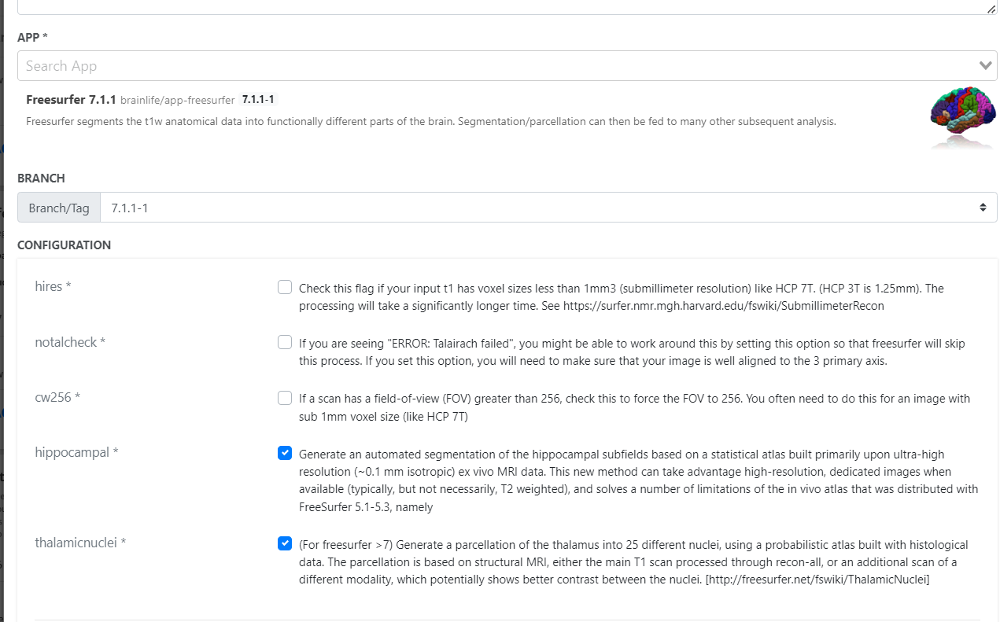
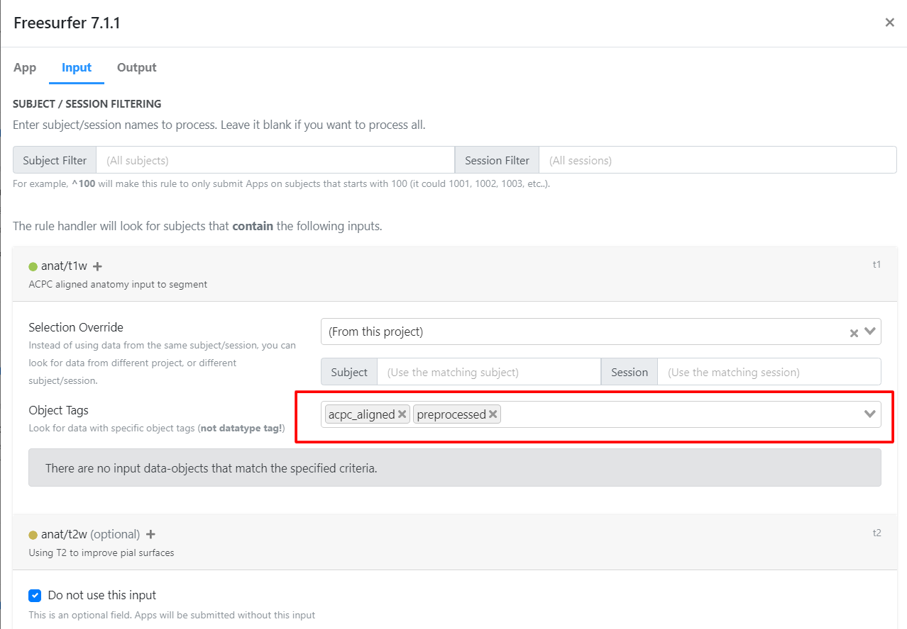
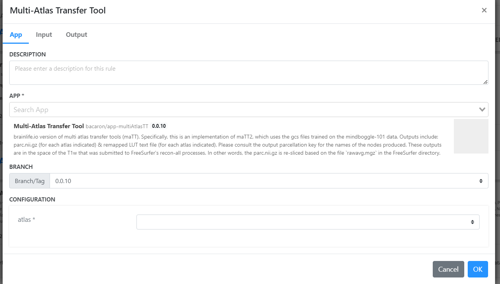
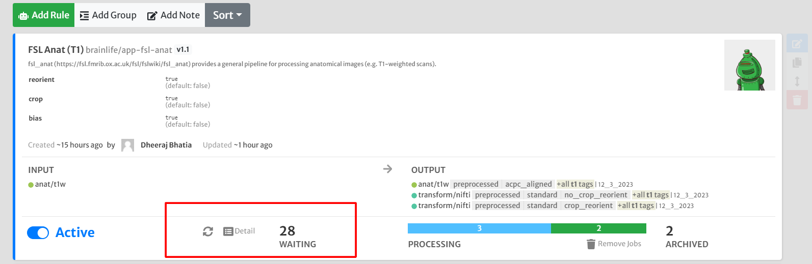
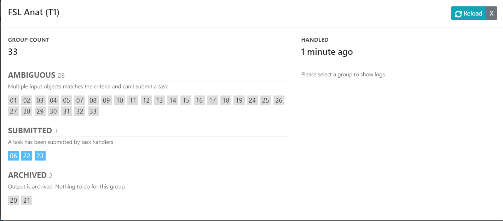

## Pipeline Automation: Anatomical (T1w) Preprocessing

Welcome to this tutorial on creating **automated pipelines** on Brainlife. In earlier tutorials, you learned how to manually stage datasets and submit apps one by one. While manual execution is ideal for exploratory testing on a single subject, managing large cohorts (dozens, hundreds, or thousands of subjects) requires automation.

**Brainlife Pipelines** allow you to chain applications together declaratively. By defining **pipeline rules**, any dataset matching your specified datatype and tags will automatically trigger downstream apps in the cloud as soon as prerequisite outputs become available.

In this tutorial, you will build an automated T1w anatomical pipeline that chains:
1. **FSL Anat (T1w)**: Brain extraction, bias correction, and ACPC alignment.
2. **FreeSurfer 7.3.2**: Cortical surface reconstruction and subcortical parcellation.
3. **Multi-Atlas Transfer Tool (MaTT)**: Mapping the Glasser HCP-MMP cortical atlas.

> [!NOTE] Prerequisites
> Before building automated pipelines, you should be familiar with project navigation and manual app submission described in the [Introduction to Brainlife](/docs/tutorial/introduction-to-brainlife/) tutorial.

---

## How Pipelines Work: The Power of Tags

Brainlife pipelines evaluate rules reactively:
- **Input matching**: Each rule monitors your project's data archive for objects matching a specific datatype (e.g., `anat/t1w`) and dataset tags (e.g., `acpc_aligned`).
- **Triggering execution**: Whenever a matching dataset is uploaded or produced by an upstream app, the rule automatically instantiates a new process and submits the App with your preconfigured parameters.
- **Output tagging & chaining**: The rule assigns specific tags to its outputs (e.g., `preprocessed`, `freesurfer`). Downstream rules listening for those tags will automatically detect the new outputs and begin execution.

---

## Step 1: Import the Tutorial Dataset

1. In Brainlife, create a new private project or open your existing tutorial project.
2. Navigate to the [Sample Dataset Project](https://brainlife.io/dataset/datasets.datalad.org/labs/gobbini/famface/data).
3. Click the **2. Data** tab.
4. Filter by datatype `anat/t1w`.

> [!WARNING] Select Only T1w Data
> For this tutorial, select only `anat/t1w` objects. Do not select DWI or fMRI series.

5. Check the boxes next to 2–3 subjects, click **Stage to process** (or copy to your project), select your target project, and confirm.

---

## Step 2: Configure Pipeline Rules

Navigate to your target project and click the **3. Processing** tab, then select the **Pipeline** sub-view.

### Rule 1: Preprocessing and Alignment (FSL Anat)

1. In the Pipeline canvas, click **Add Rule**.
2. **App Selection**: Search for **FSL Anat (T1)** (`5e3c87ae9362b7166cf9c7f4`) and click the card.
3. **Configuration**:
   - Check **crop**, **reorient**, and **bias**.
   - Set template to `MNI152_1MM`.
4. **Input Tags**: Leave blank to match any incoming raw `anat/t1w` data.
5. **Output Tags**:
   - Specify output tags: `preprocessed` and `acpc_aligned`. These tags allow downstream rules to distinguish aligned T1w scans from raw scans.
6. Click **Submit Rule**.

---

### Rule 2: Cortical Surface Reconstruction (FreeSurfer 7.3.2)

1. Click **Add Rule** to create your second pipeline stage.
2. **App Selection**: Search for **Freesurfer 7.3.2** (`5fe1056057aacd480f2f8e48`).
3. **Configuration**:
   - Enable **hippocampal** and **thalamicnuclei** subsegmentation.
   - Set Output Dataset Tag to `freesurfer`.
4. **Input Tags**:
   - In the **Input** tab, require the tags `acpc_aligned` and `preprocessed`. This ensures FreeSurfer will only run on the output of Rule 1, avoiding unaligned raw images.
5. Click **Submit Rule**.

---

### Rule 3: Multi-Atlas Transfer Tool (MaTT)

1. Click **Add Rule** to create the final stage.
2. **App Selection**: Search for **Multi-Atlas Transfer Tool (MaTT)** (`6016dcdc321a4aafce6decd5`).
3. **Configuration**:
   - Select `hcp-mmp-b` (Glasser 180-node atlas) as the target space/atlas.
   - Set Output Dataset Tag to `Glasser`.
4. **Input Tags**:
   - FreeSurfer produces a unique datatype (`fs` / `freesurfer`), so MaTT can automatically bind to the outputs tagged `freesurfer`.
5. Click **Submit Rule**.

---

## Step 3: Activate and Monitor the Pipeline

1. Ensure the toggle switch on each of your pipeline rules is set to **Active**.
2. Switch to the **Summary** or **Processes** view under the **3. Processing** tab.
3. Brainlife will automatically detect your staged T1w subjects, generate the execution graph, and submit jobs to available high-performance compute clusters.
4. Click the refresh button or open the details drawer to view live task statuses, resource utilization, and execution logs.

---

## Summary and Key Takeaways

1. **Automation**: Once rules are configured, simply uploading or staging new subjects into your project automatically triggers the entire pipeline from beginning to end without manual intervention.
2. **Quality Control**: Use tags to enforce rigorous validation checkpoints (e.g., only running tractography on datasets with verified QA tags).
3. **Reproducibility**: Pipeline rules are versioned and can be exported, shared with collaborators, or published alongside datasets with a citable DOI.
