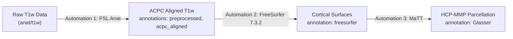
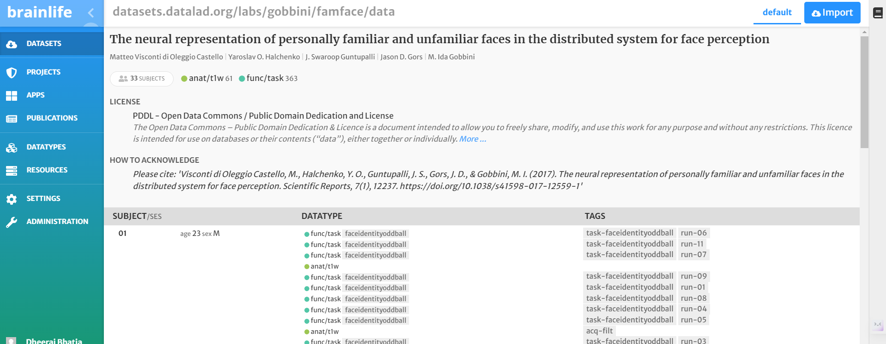
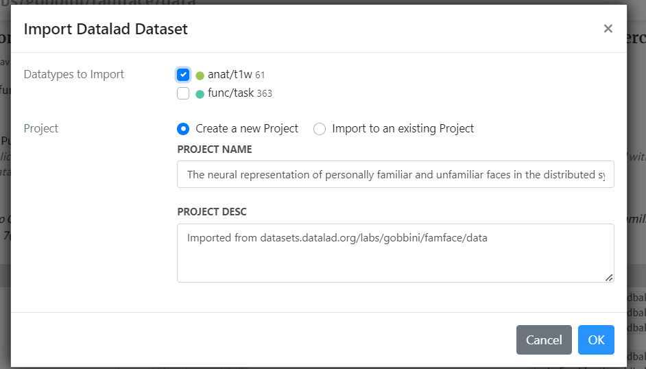
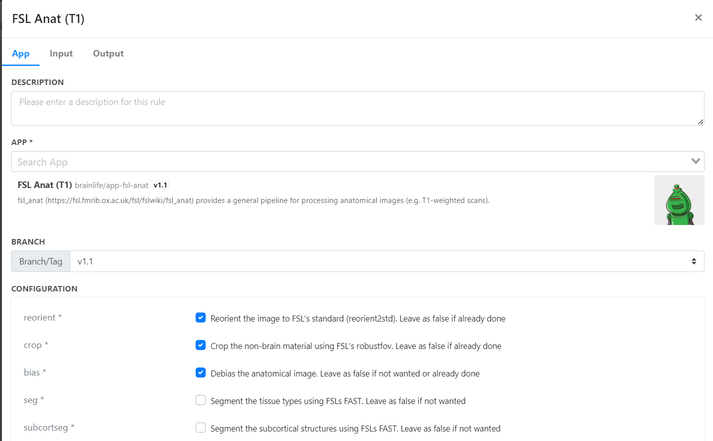
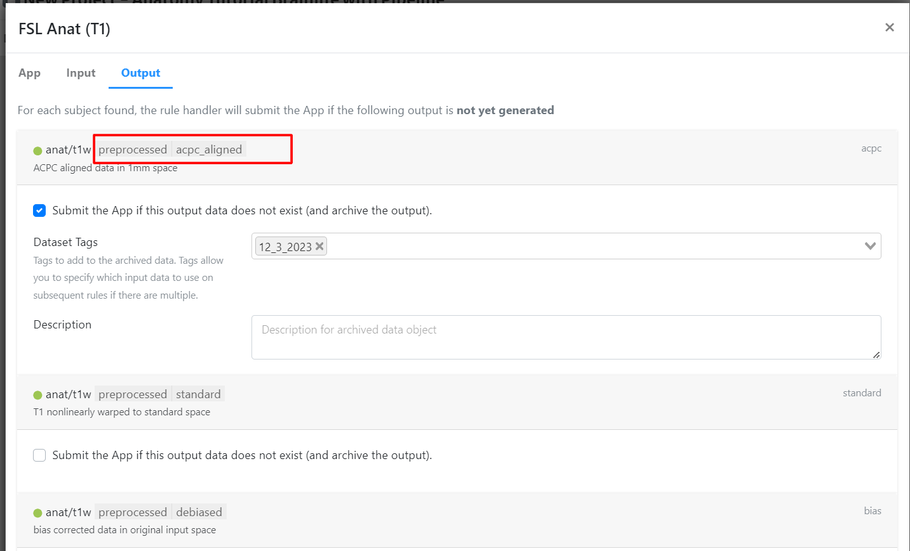
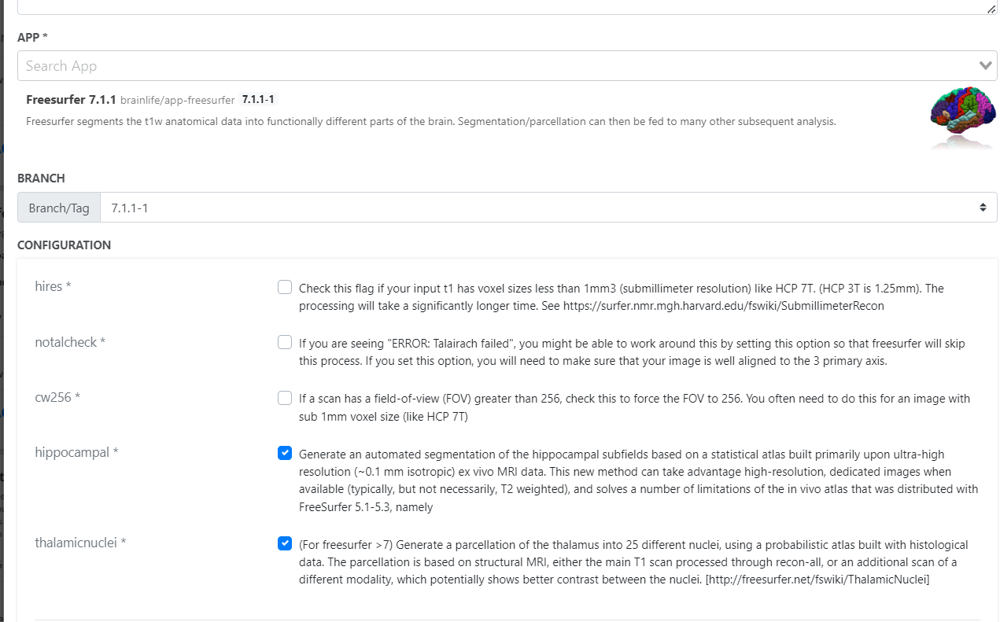
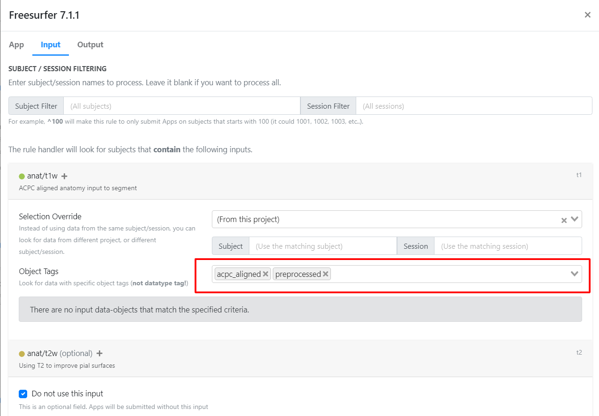
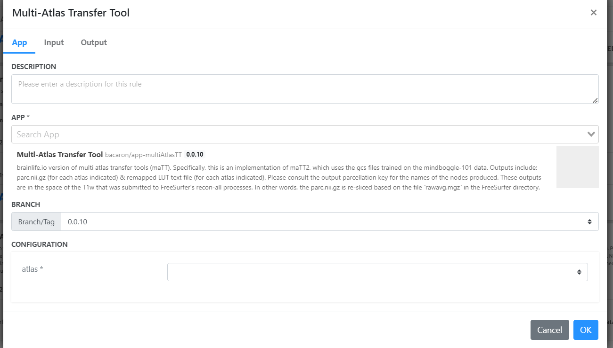
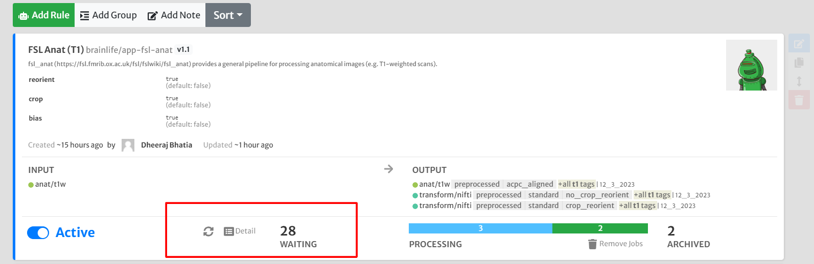
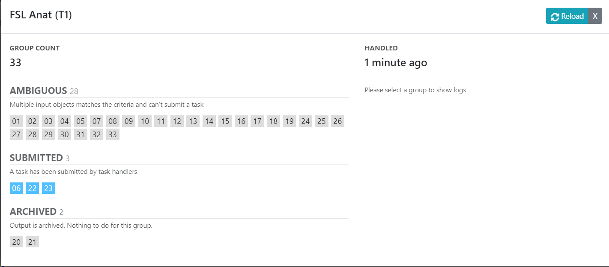

## Pipeline Automation: Anatomical (T1w) Preprocessing

This tutorial shows you how to automate processing on brainlife.io. In earlier tutorials you added datasets to a process and ran Apps one at a time. That works well for testing on one subject, but large cohorts (dozens, hundreds or thousands of subjects) need automation.

A project's **pipeline** is its set of **automations**. An automation runs an App for every subject (and session) that has the inputs and does not yet have the output. When an upstream automation archives its outputs, the next automation finds them and runs.

In this tutorial you build an anatomical T1w pipeline that chains:
1. **FSL Anat (T1w)**: brain extraction, bias correction and ACPC alignment.
2. **FreeSurfer 7.3.2**: cortical surface reconstruction and subcortical parcellation.
3. **Multi-Atlas Transfer Tool (MaTT)**: maps the Glasser HCP-MMP cortical atlas.

> [!NOTE] Prerequisites
> Before you build a pipeline, make sure you know how to navigate a project and run an App by hand, as described in the [Introduction to brainlife.io](/docs/tutorial/introduction-to-brainlife/) tutorial.

---

## How Automations Work: Datatypes, Datatype Tags and Annotations

Automations react to the datasets in your project:
- **Input matching**: each automation looks in your project for datasets of a given datatype (for example `anat/t1w`). Filters on datatype tags and **Annotations** (for example `acpc_aligned`) pick the right dataset when a subject has more than one match.
- **Running**: when a subject has a matching input and lacks the output, the automation creates a process and runs the App with the settings you chose.
- **Output annotations and chaining**: the automation archives its outputs with the **Annotations** you set (for example `preprocessed`, `freesurfer`). A downstream automation that filters on those annotations finds the new outputs and runs.

---

## Step 1: Import the Tutorial Dataset

1. Create a new private project, or open your existing tutorial project.
2. Open the [Sample Dataset](https://brainlife.io/dataset/datasets.datalad.org/labs/gobbini/famface/data).
3. Open its data list.
4. Filter by datatype `anat/t1w`.

> [!WARNING] Select Only T1w Data
> For this tutorial, select only `anat/t1w` datasets. Do not select DWI or fMRI datasets.

5. Select the checkboxes next to 2–3 subjects, select **Copy to project**, choose your tutorial project, and confirm.

---

## Step 2: Add Automations to the Pipeline

Open your tutorial project and go to **3. Processing** → **Pipeline**.

Each automation is added in four steps: **Select App**, **Configure App Settings**, **Configure Inputs** and **Configure Outputs**. Select **Next** to move between steps and **Complete** to save.

### Automation 1: Preprocessing and alignment (FSL Anat)

1. Select **+ Automation**.
2. **Select App**: search for **FSL Anat (T1)** (`5e3c87ae9362b7166cf9c7f4`) and select it.
3. **Configure App Settings**:
   - Turn on **crop**, **reorient** and **bias**.
   - Set the template to `MNI152_1MM`.
4. **Configure Inputs**: leave the filters empty so the automation uses any raw `anat/t1w` dataset.
5. **Configure Outputs**:
   - Tick "Archive this output".
   - Under **Annotations**, add `preprocessed` and `acpc_aligned`. These annotations let later automations tell aligned T1w scans from raw scans.
6. Select **Complete**.

---

### Automation 2: Cortical surface reconstruction (FreeSurfer 7.3.2)

1. Select **+ Automation**.
2. **Select App**: search for **Freesurfer 7.3.2** (`5fe1056057aacd480f2f8e48`).
3. **Configure App Settings**: turn on **hippocampal** and **thalamicnuclei** segmentation.
4. **Configure Inputs**: filter the T1w input on the annotations `acpc_aligned` and `preprocessed`. FreeSurfer then runs only on the output of automation 1, never on the unaligned raw image.
5. **Configure Outputs**: tick "Archive this output" and add the annotation `freesurfer`.
6. Select **Complete**.

---

### Automation 3: Multi-Atlas Transfer Tool (MaTT)

1. Select **+ Automation**.
2. **Select App**: search for **Multi-Atlas Transfer Tool (MaTT)** (`6016dcdc321a4aafce6decd5`).
3. **Configure App Settings**: select `hcp-mmp-b` (the Glasser 180-node atlas) as the atlas.
4. **Configure Inputs**: FreeSurfer produces its own datatype (`freesurfer`), so MaTT finds the FreeSurfer outputs without extra filters.
5. **Configure Outputs**: tick "Archive this output" and add the annotation `Glasser`.
6. Select **Complete**.

---

## Step 3: Activate and Monitor the Pipeline

1. Make sure each automation is set to **Active**. Open an automation (**View details**) to see and change its switch.
2. Go to **3. Processing** → **Summary** or **Processes**.
3. The automations find your T1w subjects, create processes and send the jobs to available compute resources.
4. Select a process to see its status and logs. On **Summary**, resolve anything listed under **Needs Action** (for example an ambiguous input).

---

## Summary and Key Takeaways

1. **Automation**: once your automations are set up, every new subject you add to the project runs through the whole pipeline without manual steps.
2. **Quality control**: use annotations as checkpoints (for example, run tractography only on datasets annotated as passing QA).
3. **Reproducibility**: every output records its provenance, and you can publish your data and the Apps you used with a citable DOI.
