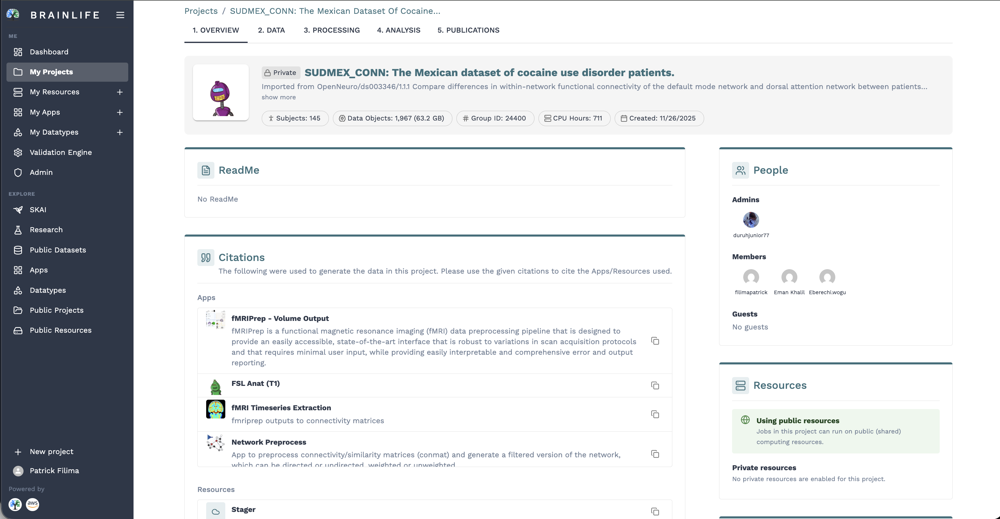
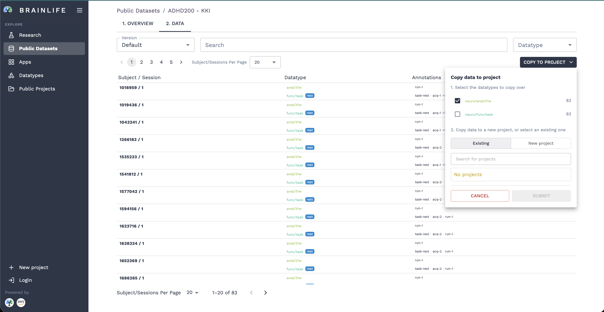
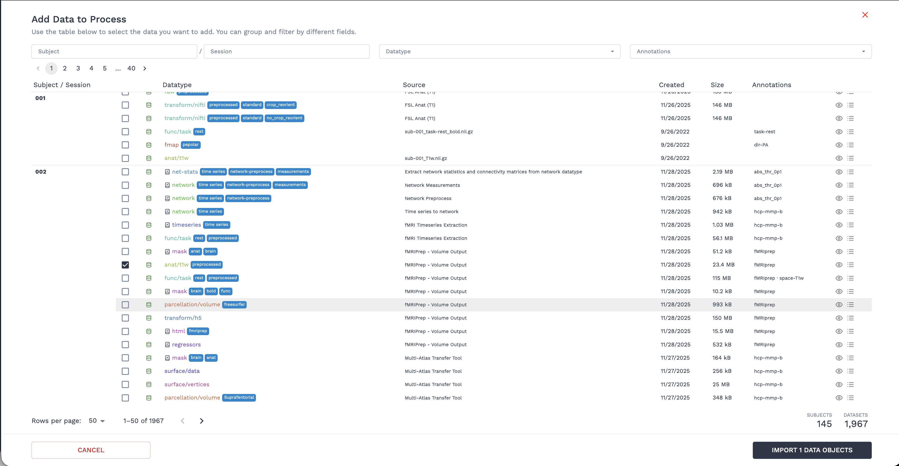
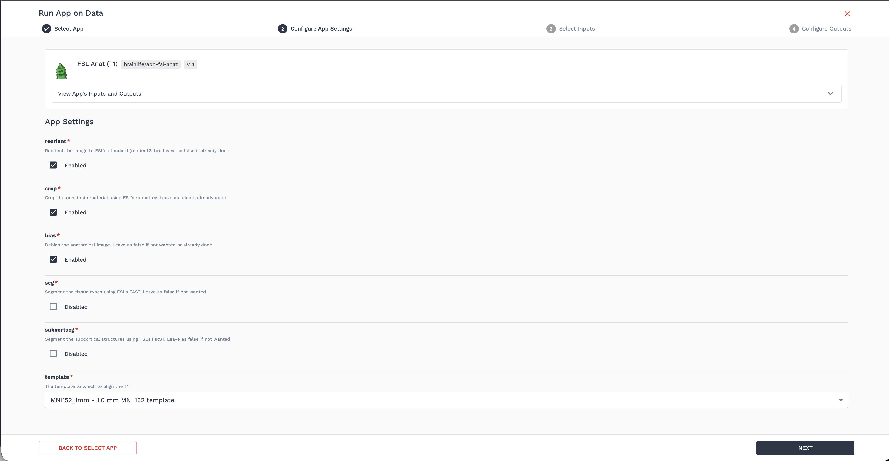
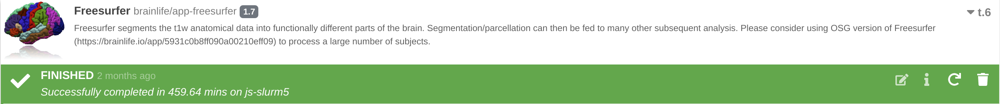
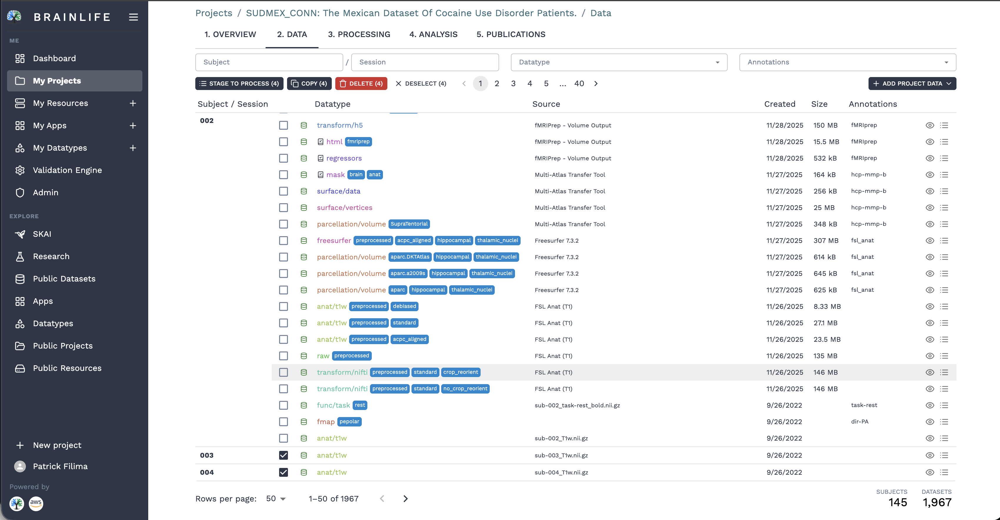
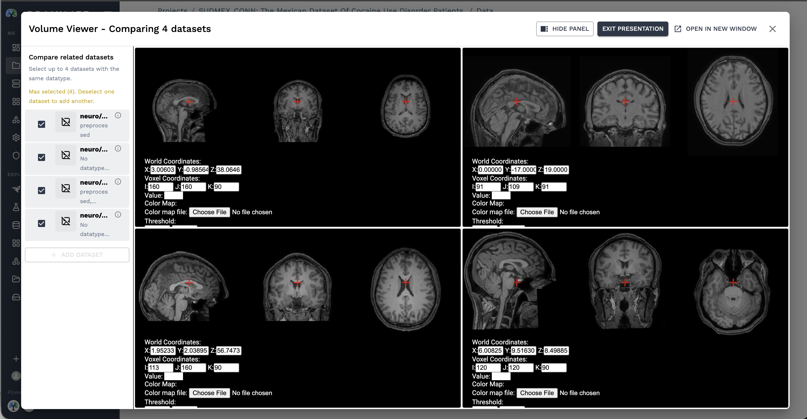

# Introduction to Brainlife Connects

Welcome to **Brainlife Connects** ([connects.brainlife.io](https://connects.brainlife.io/){target=_blank})! Brainlife is a free, cloud-based platform for reproducible neuroimaging data management, high-performance computing pipelines, interactive data analysis, and open-science publication.

This tutorial guides you through the foundational steps of using Brainlife:
1. [Creating an account](#a-create-an-account)
2. [Creating a research project](#b-create-a-project)
3. [Adding data to your project](#c-add-data-to-your-project)
4. [Launching an App & processing data](#d-launch-an-app-and-process-data)
5. [Visualizing results in your browser](#e-visualize-results-in-your-browser)
6. [Archiving and data provenance](#f-archiving-and-data-provenance)

---

## A. Create an Account

To begin using Brainlife, create a free user account:

1. Visit the [Brainlife authentication page](https://brainlife.io/auth/){target=_blank}.
2. Select your preferred login method:
    * **Single Sign-On (SSO)**: Sign in instantly using **Google**, **GitHub**, **ORCID**, **Apple**, or your university/academic institution via institutional login.
    * **Email & Password**: Fill out the [Sign Up form](https://brainlife.io/auth/#!/signup){target=_blank} with your name, email, and password.
3. Review and accept the Brainlife Acceptable Use and Privacy Policy, then submit.

!!! tip "Linking Accounts"
    You can connect multiple authentication providers (such as ORCID and Google) to a single Brainlife profile under **Settings > Account > Connected Accounts**.

---

## B. Create a Project

Projects are secure collaborative workspaces on Brainlife where you organize datasets, launch automated pipelines, run cloud Jupyter notebooks, and publish citable findings.

To create your first project:

1. From the left sidebar navigation, click **My Projects** (under the **Me** section).
2. Click the **`New Project`** button in the upper-right corner.
3. In the creation dialog:
    * **Title**: Enter a clear name for your project (e.g. *Introduction Tutorial Project*).
    * **Description**: Provide a brief summary of your study goals or data.
4. Click **Create project**.

### The Five Project Tabs

Once your project is created, you will see the five standard Brainlife Connects workspace tabs:

* **1. Overview**: Study documentation (ReadMe), collaborator management (Admins, Members, Guests), automated App citations, and authorized computing clusters.
* **2. Data**: Interactive inventory of all neuroimaging data objects, metadata search filters, file inspectors, and data staging tools.
* **3. Processing**: Execution center containing three sub-views: **Summary** (job health and execution metrics), **Pipeline** (graphical automation rules), and **Processes** (running and finished compute jobs).
* **4. Analysis**: Built-in cloud JupyterLab environment (`brainlife/ga-python` and `brainlife/ga-octave`) to run group statistics and visualizations directly against your project data.
* **5. Publications**: Tools to snapshot and permanently publish open datasets and workflows with citable DOIs.

---

## C. Add Data to Your Project

To run neuroimaging pipelines, you need data objects in your project. You can import open data from public repositories or upload your own scans.

For this tutorial, we will copy a demo anatomical T1-weighted (`neuro/anat/t1w`) scan:

1. Click on the **2. Data** tab in your project.
2. Click the **Add Project Data** button in the upper-right corner.

3. Choose one of the following methods:
    * **Copy Data from Public Datasets**: Browse thousands of open neuroimaging datasets from **OpenNeuro**, **DANDI**, **EMBER**, or the **Brainlife Dataset Library**, and import individual modalities with a single click without downloading anything to your local computer.
    * **Copy from another Project**: Select an open demo project (such as *Brainlife Demo Data*) and select a subject's `neuro/anat/t1w` dataset.
    * **Upload Data**: If using your own imaging files, convert them to BIDS using [ezBIDS](/using_ezBIDS/) or upload directly via the Brainlife CLI (`bl data upload` or `bl bids upload`).

Once selected, click **Submit**. Your new dataset will appear in the **Data** table with the green `anat/t1w` datatype badge.

---

## D. Launch an App and Process Data

Now that you have anatomical data in your project, let's process it using an automated neuroimaging App. In this example, we will run **[FSL Anat (T1w)](https://brainlife.io/app/5e3c87ae9362b7166cf9c7f4){target=_blank}** to perform ACPC alignment, bias field correction, and skull stripping.

### Step 1: Stage Data to a Process

1. In the **2. Data** tab, select the checkbox next to your `anat/t1w` dataset.
2. Click the **Stage to process** button at the top of the data table (or click the List icon on the row).
3. In the dialog, enter a process name (e.g. `Anatomical Preprocessing`) and click **Submit**.

### Step 2: Select and Configure the App

1. Navigate to the **3. Processing** tab and select the **Processes** view.
2. Select your newly created process, then click **Submit App**.
3. In the App search catalog, type `FSL Anat (T1)` and select the App card.
4. Review the inputs and configuration parameters:
    * **t1**: The staged `anat/t1w` dataset should auto-populate as the input.
    * **crop**: Checked (`true` to remove neck and non-brain tissue).
    * **reorient**: Checked (`true` to match standard MNI orientation).
5. Click **Submit**.

### Step 3: Monitor Execution

Once submitted, a task card will appear under your process:
* **Blue Header / Waiting**: The job is queued and waiting for an available High-Performance Computing (HPC) cluster.
* **Blue Header / Running**: The containerized pipeline is actively executing on the supercomputer.
* **Green Header / Finished**: The pipeline finished successfully, and output data objects have been generated!

---

## E. Visualize Results in Your Browser

Brainlife features built-in WebGL-based visualization tools powered by **NiiVue**, enabling you to inspect 3D volumes, cortical surfaces, and tractography streamlines directly in your web browser without downloading multi-gigabyte files.

To inspect the preprocessed output:

1. On the completed task card in the **Processes** view (or in the **2. Data** tab), click the **Eye (View)** icon next to the preprocessed output.
2. Select the **NiiVue Volume Viewer** or appropriate surface visualizer.

3. An interactive 3D viewer will launch inside your browser, allowing you to scroll through axial, sagittal, and coronal orthogonal slices, adjust contrast, and check registration alignment in real time.

---

## F. Archiving and Data Provenance

One of Brainlife's core strengths is automated, immutable **Data Provenance**:

* When an App finishes running, its output data objects are **automatically archived** and registered into your project's **2. Data** tab.
* Click any dataset row to open the **Dataset Inspector**:
  * **Provenance Graph**: Visually traces every preceding step—which raw data, specific App version, GitHub commit, compute cluster, and parameter settings produced this exact file.
  * **Datatype Tags**: Automatically assigned tags (e.g. `acpc_aligned`, `preprocessed`) signify the processing state so downstream Apps can reliably consume the dataset.

---

## Next Steps

Congratulations! You have successfully created an account and project, imported imaging data, executed a containerized neuroimaging pipeline on cloud HPC resources, and visualized the 3D results.

Explore our hands-on modality tutorials to continue:

* **[Anatomical Preprocessing (T1w)](/docs/tutorial/t1w-preprocessing)**: Complete FreeSurfer surface reconstruction, multi-atlas transfer (maTT), and regional statistics.
* **[Diffusion MRI Preprocessing](/docs/tutorial/diffusion-preprocessing)**: Denoising, Gibbs ringing, motion correction, and eddy current removal with MRtrix3 and QSIPrep.
* **[Diffusion Tractography](/docs/tutorial/diffusion-tractography)**: Whole-brain streamline tractography, white matter tract segmentation, and tractometry profiles.
* **[Functional MRI Preprocessing](/docs/tutorial/fmri-preprocessing-tutorial)**: Motion estimation, susceptibility distortion correction, and surface registration using fMRIPrep.
* **[Pipeline Automation](/docs/tutorial/anat-t1-pipeline-tutorial)**: Automate batch processing across hundreds of subjects using rule-based pipelines.
* **[Interactive Group Analysis](/docs/user/groupanalysis)**: Conduct project-level statistics and plot group figures with cloud Jupyter Notebooks.
