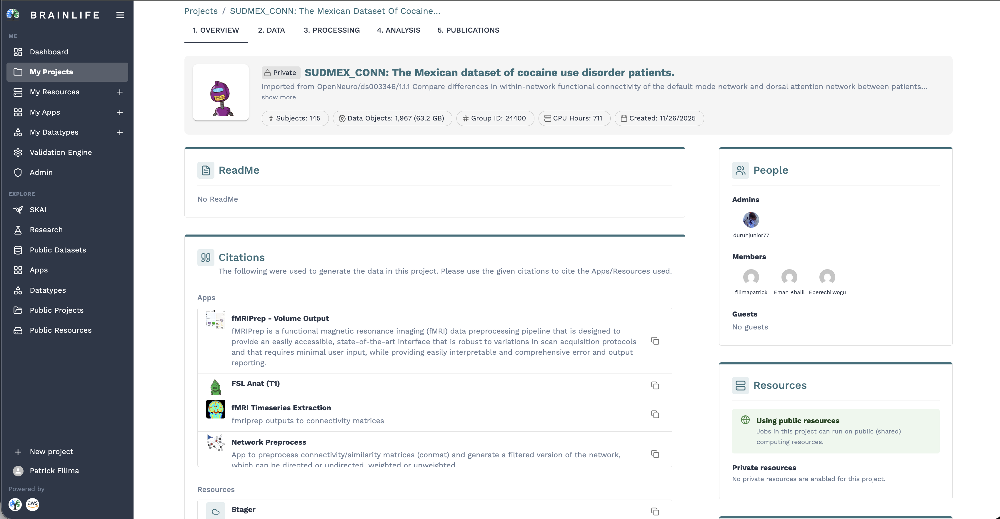
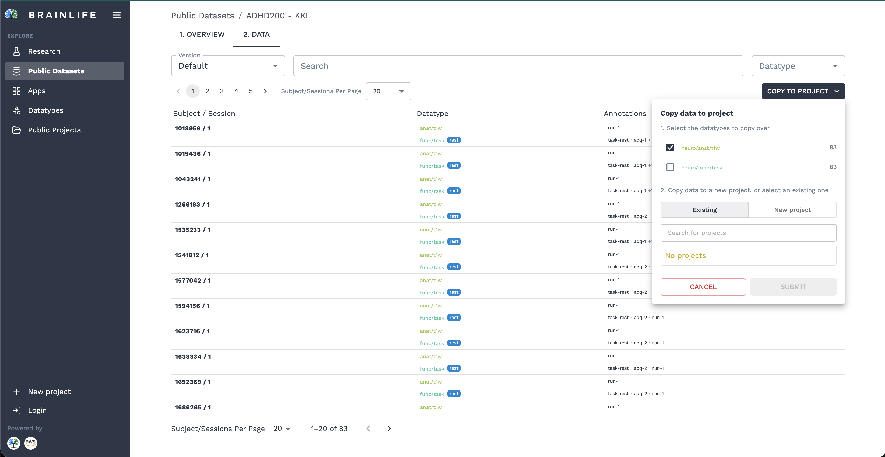
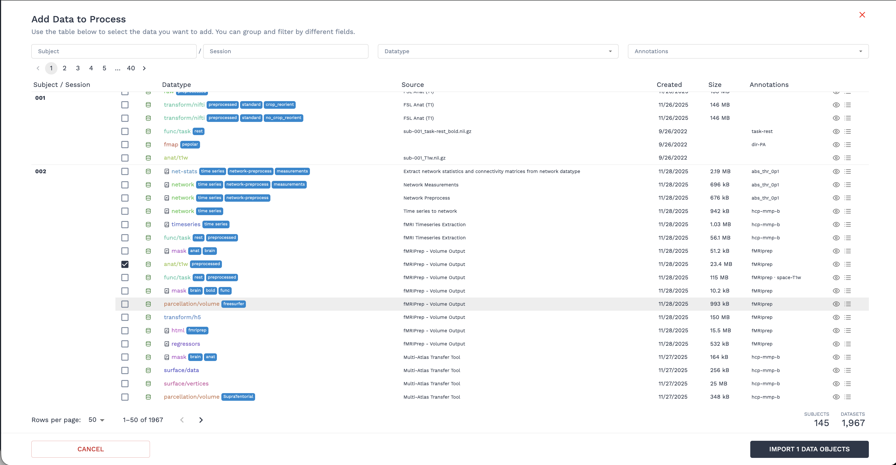
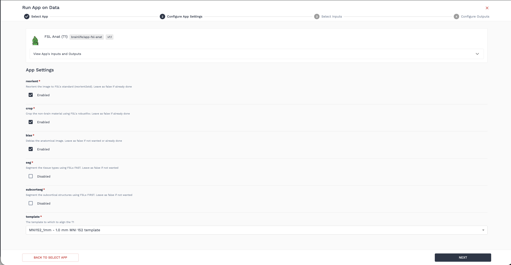
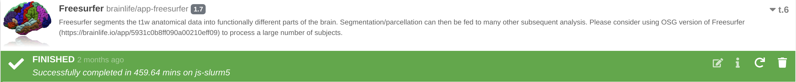
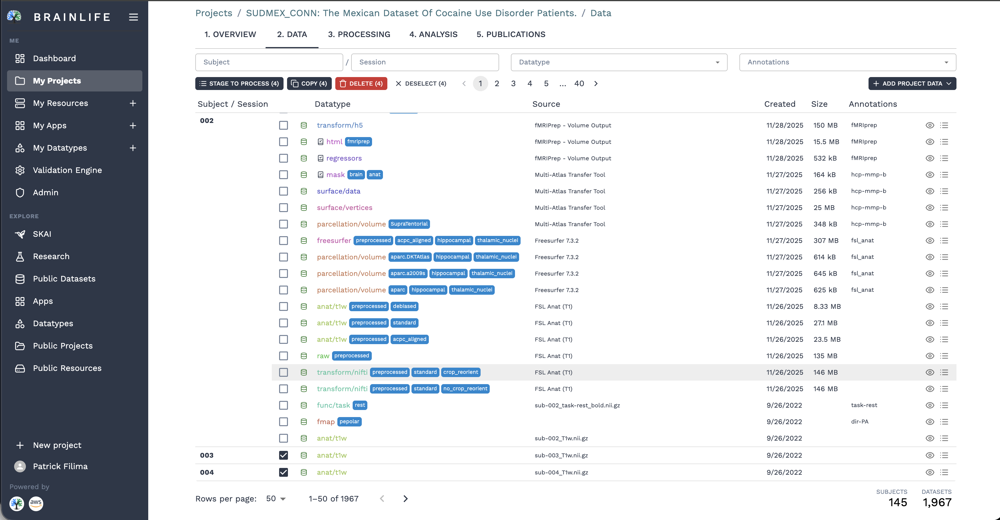
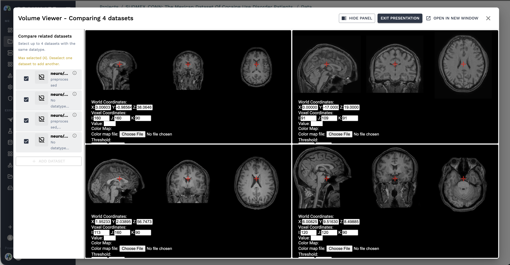

# Introduction to brainlife.io

Welcome to **brainlife.io** ([connects.brainlife.io](https://connects.brainlife.io/){target=_blank}). brainlife.io is a free, open platform for brain data across scales: you bring data into a project, run reproducible analyses as Apps on shared supercomputers, look at the results in your browser, and publish them with a DOI.

This tutorial walks you through the first steps:
1. [Create an account](#a-create-an-account)
2. [Create a project](#b-create-a-project)
3. [Add data to your project](#c-add-data-to-your-project)
4. [Run an App on your data](#d-launch-an-app-and-process-data)
5. [Visualize results in your browser](#e-visualize-results-in-your-browser)
6. [Archive outputs and check provenance](#f-archiving-and-data-provenance)

---

## A. Create an Account

To use brainlife.io, create a free account:

1. Visit the [brainlife.io sign-in page](https://brainlife.io/auth/){target=_blank}, or select **Sign in** on brainlife.io.
2. Choose how to sign in:
    * **Single Sign-On (SSO)**: sign in with **Google**, **GitHub**, **ORCID**, **Apple**, or your university through institutional login.
    * **Email & Password**: fill out the [Sign Up form](https://brainlife.io/auth/#!/signup){target=_blank} with your name, email and password.
3. Review and accept the brainlife.io Acceptable Use and Privacy Policy, then submit.

After you sign in, you land on your **Dashboard**.

!!! tip "Linking Accounts"
    You can connect several sign-in providers (such as ORCID and Google) to one brainlife.io account under **Settings > Account > Connected Accounts** on the sign-in service.

---

## B. Create a Project

A project is your workspace: it holds your data, processing, notebooks and publications, and you can share it with a team.

To create your first project:

1. In the sidebar, select **My Projects**.
2. Select **Project** (the plus button).
3. In **Create project**:
    * **Title**: enter a clear name (for example, *Introduction Tutorial Project*).
    * **Description**: summarize your study goals or data.
4. Select **Create project**.

### The five project tabs

Your new project has five numbered tabs:

* **1. Overview**: the project ReadMe (**About**), people (Admins, Members, Guests), citations for the Apps you used, and the resources the project can use.
* **2. Data**: the **Project Data** table of all datasets in the project, with filters for **Datatype**, **Subject**, **Session** and **Annotations**.
* **3. Processing**: three sub-tabs: **Summary** (what needs your attention and how jobs are doing), **Processes** (the Apps you run by hand) and **Pipeline** (automations that run Apps for you).
* **4. Analysis**: Jupyter notebooks (`brainlife/ga-python` and `brainlife/ga-octave`) that run against your project data.
* **5. Publications**: publications that describe and share your results, each with a DOI.

---

## C. Add Data to Your Project

To run Apps, your project needs datasets. A dataset is the files of one datatype for one subject (and session). You can copy open data from public archives or from another project.

In this tutorial you copy a demo anatomical T1-weighted (`neuro/anat/t1w`) scan:

1. Open the **2. Data** tab of your project.
2. Open the **Project Data** menu.

3. Choose a source:
    * "Copy Data from Public Datasets": browse open datasets from **OpenNeuro**, **DANDI**, **EMBER**, **BossDB** or the brainlife.io **Dataset Library**, and copy what you need into your project without downloading anything to your computer.
    * "Copy Data From another Project": open a public demo project (such as *brainlife.io Demo Data*), select a subject's `neuro/anat/t1w` dataset and copy it to your project.
    * Your own data: "Upload Data From local Files" and "Upload Data from ezBIDS" show "Currently unavailable" in the menu. To bring in your own scans, convert them to BIDS with [ezBIDS](/using_ezBIDS/) or upload them with the brainlife.io CLI (`bl data upload` or `bl bids upload`).

When the copy finishes, the dataset appears in the **Project Data** table with the `anat/t1w` datatype.

---

## D. Launch an App and Process Data

With anatomical data in your project, you can process it with an App. In this example you run **[FSL Anat (T1w)](https://brainlife.io/app/5e3c87ae9362b7166cf9c7f4){target=_blank}** for ACPC alignment, bias field correction and skull stripping.

### Step 1: Add data to a process

1. On **2. Data**, select the checkbox next to your `anat/t1w` dataset.
2. Select **Stage to process** above the table (or the **Add to process** icon on the row).
3. In **Add to process**, choose "Create a new process", enter a name (for example, `Anatomical Preprocessing`), and select **Add and open editor**.

### Step 2: Select and configure the App

The process editor opens with your dataset on the canvas.

1. Select **Add App**.
2. **Select App**: search for `FSL Anat (T1)` and select it.
3. **Configure App Settings**: review the parameters:
    * **crop**: on (`true`, removes the neck and other non-brain tissue).
    * **reorient**: on (`true`, matches the standard MNI orientation).
4. **Select Inputs**: for **t1**, choose the `anat/t1w` dataset you added.
5. **Configure Outputs**: keep **Archive Output** on to save the result as a dataset in your project.
6. Select **Add App**.

You can also start a process from **3. Processing** → **Processes** → **New Custom Process**.

### Step 3: Monitor the job

Follow the job in **3. Processing** → **Processes**. Each job shows its status: requested (waiting for a compute resource), running, finished or failed. Select the process to open its side panel, where **Run & logs** shows the logs and **Results** shows the outputs. If a job fails, open the logs and select **Retry**.

---

## E. Visualize Results in Your Browser

brainlife.io opens outputs in browser viewers such as **NiiVue**, so you can look at volumes, cortical surfaces and tractography streamlines without downloading large files.

To look at the preprocessed output:

1. In the process side panel (**Results**), or on **2. Data**, select **Visualize** next to the output.
2. Choose a viewer, such as the NiiVue volume viewer or a surface viewer.

3. The viewer opens in your browser. Scroll through axial, sagittal and coronal slices, adjust contrast, and check the alignment.

---

## F. Archiving and Data Provenance

brainlife.io records the **provenance** of every dataset: which App, configuration and inputs produced it.

* When an App finishes, outputs with **Archive Output** turned on are saved as datasets in your project's **2. Data** tab.
* Select any dataset to open the dataset viewer:
  * **Provenance (history)**: traces every step that produced the dataset: the input data, the App and version, and the parameter settings.
  * **Datatype tags**: tags such as `acpc_aligned` or `preprocessed` describe the processing state, so later Apps can use the dataset correctly.

---

## Next Steps

You have created an account and a project, added data, run an App on a shared compute resource, and visualized the result.

Continue with the hands-on tutorials:

* **[Anatomical Preprocessing (T1w)](/docs/tutorial/t1w-preprocessing)**: FreeSurfer surface reconstruction, multi-atlas transfer (maTT) and regional statistics.
* **[Diffusion MRI Preprocessing](/docs/tutorial/diffusion-preprocessing)**: denoising, Gibbs ringing removal, and motion and eddy current correction with MRtrix3 and QSIPrep.
* **[Diffusion Tractography](/docs/tutorial/diffusion-tractography)**: whole-brain tractography, white matter tract segmentation and tract profiles.
* **[Functional MRI Preprocessing](/docs/tutorial/fmri-preprocessing-tutorial)**: motion estimation, susceptibility distortion correction and surface registration with fMRIPrep.
* **[Pipeline Automation](/docs/tutorial/anat-t1-pipeline-tutorial)**: process many subjects at once with automations.
* **[Group Analysis](/docs/user/groupanalysis)**: project-level statistics and group figures in Jupyter notebooks.
