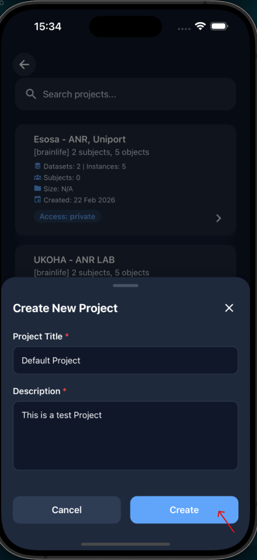
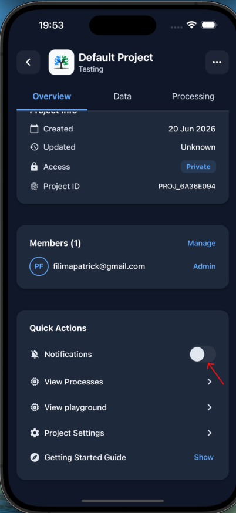
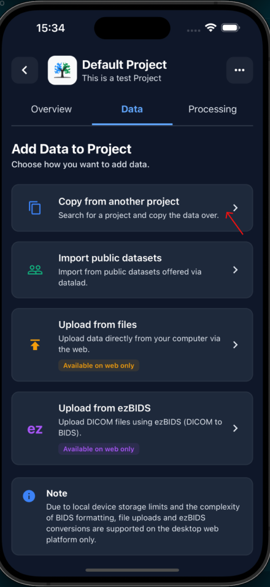
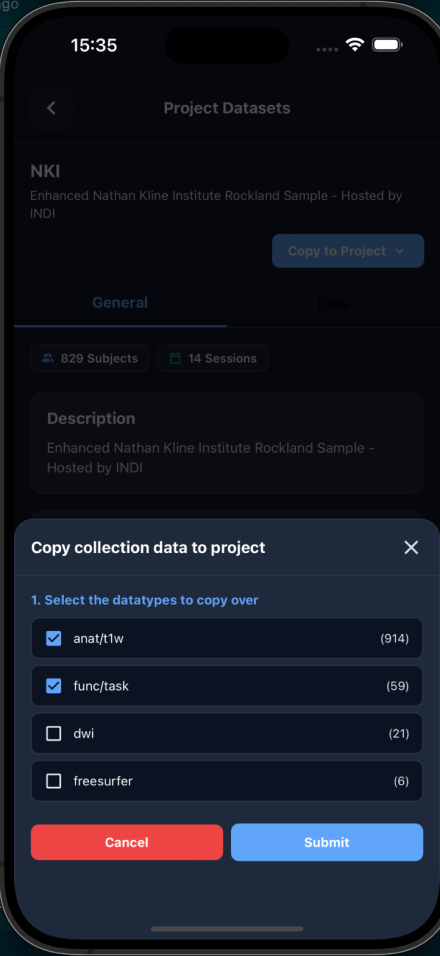
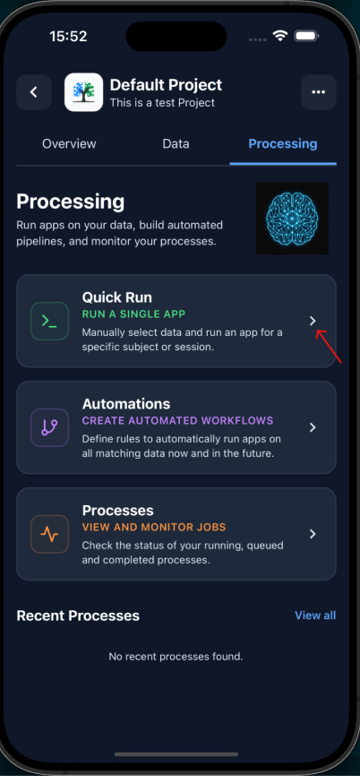
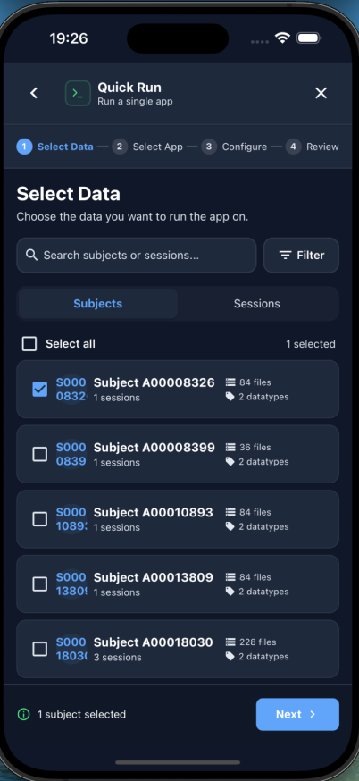
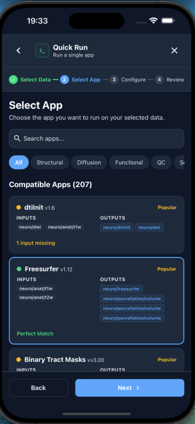
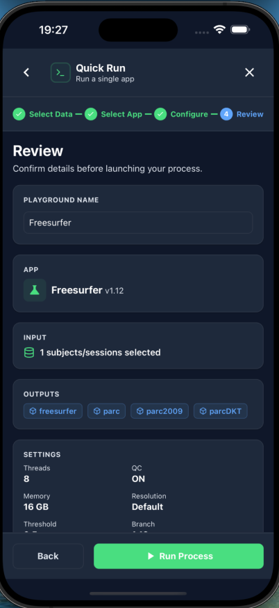
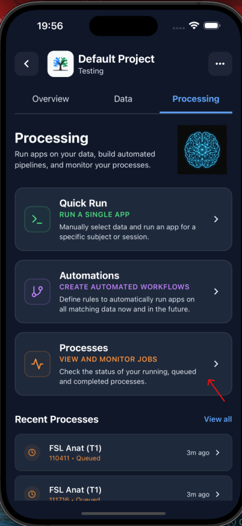
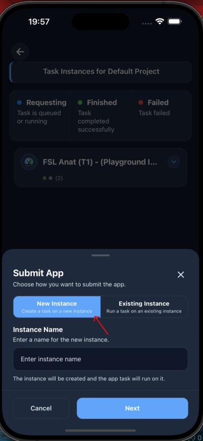

## brainlife.io Mobile App Tutorial

The brainlife.io mobile app is the official app for the brainlife.io platform. Use it to monitor and manage your projects, datasets, Apps and publications from your phone.

This page shows you how to do the key tasks in the mobile app: sign in, create a project, subscribe to notifications, import datasets, run Apps with Quick Run, run Apps from the process list, set up automations, check quality, and monitor playgrounds.

---

### A. Authenticate and Log In

Before you can manage and process your data, sign in to your brainlife.io account.

1. Open the brainlife.io mobile app on your device.
2. Choose your preferred authentication method:
    * **Username and Password**: Enter your brainlife.io credentials in the login form and tap **Sign In**.
    * **Third-Party Providers**: Tap **Google**, **GitHub**, **ORCID**, or **Apple**. The app will launch a secure system browser session to complete the authentication.

---

### B. Create a Project

To begin managing and processing datasets in the app, you need to create a project.

1. Open the sidebar navigation menu in the top-left corner.
2. Select **Projects** to navigate to the project browser.
3. Tap the **+** (plus) floating action button located at the bottom-right corner of the screen.
4. Enter the **Project Name** and **Description**.
5. Tap the **Create** button.

{: style="max-width: 200px; width: 100%;"}

*Upon completion, the app will automatically create your new project and navigate you directly to its Project Detail screen.*

---

### C. Manage Project Notifications

Stay informed of processing updates, failures, or completions by subscribing to project-specific notifications.

1. On your project detail page, scroll down under the **Overview** tab.
2. Locate the **Quick Actions** panel.
3. Find the **Notifications** toggle.
4. Toggle the switch to subscribe to or unsubscribe from notification alerts.

{: style="max-width: 200px; width: 100%;"}

---

### D. Copy Datasets

To run Apps in your project, first add datasets to it.

1. Navigate to the project page and tap the **Data** tab.
2. Tap either **Copy from Another Project** or **Import Public Dataset**.

{: style="max-width: 200px; width: 100%;"}

3. The app will prompt you to select datasets from either your existing projects or a list of open public datasets.
4. To copy project data:
    * Select the target project to open its details.
    * Tap the **Copy to Project** action button.
    * In the dialog, select the datatypes you want to copy.
    * Tap **Submit** to copy them.

{: style="max-width: 200px; width: 100%;"}

---

### E. Run a Task via Quick Run

For standard analyses, start a process directly with Quick Run.

1. Tap the **Processing** tab of your project.
2. Tap the **Quick Run** card.

{: style="max-width: 200px; width: 100%;"}

3. In the process creation view, select the input dataset you wish to analyze.

{: style="max-width: 200px; width: 100%;"}

4. On the **Select App** tab, the catalog recommends Apps that accept the datatype of your selected dataset.

{: style="max-width: 200px; width: 100%;"}

5. Select the App, configure its settings, and tap **Run**.

{: style="max-width: 200px; width: 100%;"}

---

### F. Run an App from View Processes

For custom workflows, add Apps directly from the project's list of processes.

1. Navigate to the **Overview** tab of your project detail screen.
2. Scroll to the **Quick Actions** section and tap **View Processes**.

{: style="max-width: 200px; width: 100%;"}

3. Tap the floating **Submit App** action button in the bottom-right corner.

{: style="max-width: 200px; width: 100%;"}

4. Browse or search the App catalog, choose the inputs, and submit.

---

### G. Create an Automation (Pipeline)

An automation runs an App on every subject that has matching data, as soon as that data is archived or copied to the project. A project's automations make up its pipeline.

1. Open the **Create Automation Rule** wizard from the project pipeline screen.
2. Follow the four steps:
    * **Step 1: Select App**: choose the App to run.
    * **Step 2: Configure Rule**: enter the automation's name, description, Git branch (defaults to `master`), and toggle parameters like **Cleanup on Success** or string matching criteria for subjects and sessions.
    * **Step 3: Configure Inputs**: set the datatype tags and annotations the inputs must have, and any project, subject or session overrides.
    * **Step 4: Configure Outputs**: choose whether to archive each output and add annotations to it.
3. Tap **Submit** to save the automation. From then on it processes every new matching dataset.

---

### H. Visual Quality Control and Validation

The mobile app has a **Validator** screen for quick quality control (QC) of finished jobs:

1. Find a finished job in the **Processing** tab.
2. Select it to open its dedicated **Validator** screen.
3. Inspect 2D cross-sectional slices of the resulting brain maps across three orthogonal planes: **Sagittal**, **Coronal**, and **Axial**.
4. Toggle between **Standard** and **ACPC** space orientations to visually inspect alignments.
5. Previews are generated as secondary PNG images for mobile efficiency. For full-resolution interactive exploration, download or view the primary dataset.

---

### I. Monitor Computational Playgrounds

Computational playgrounds provide interactive computing instances for custom tasks. You can monitor their active processes in real time:

1. On the project's **Overview** tab, scroll to **Quick Actions** and select **View Playground**.
2. Browse through all configured playgrounds, viewing their IDs, Instance IDs, and creation dates.
3. Tap on a playground card to open a slide-up modal showing all associated tasks.
4. The playground interface establishes real-time websocket connections to receive task status updates (such as *Finished*, *Running*, *Failed*, etc.) as they execute on the backend cluster.

---

### J. Real-Time Notification Feed

The global **Notification Feed** acts as a unified hub for tracking activity across all your brainlife.io projects.

* **Activity Summary**: Monitor task status changes (Success, Failure, Staged, etc.) in a consolidated feed.
* **Relative Timestamps**: Each card displays human-readable relative time (e.g., "now", "12m ago", "3h ago").
* **Color-Coded Statuses**: Left border colors match task status (Green for success/completed, Red for failed, Blue for running).
* **Deep Linking**: Tap any notification card to jump directly to the relevant **Project** page or the **Processes** timeline on your app to debug failures or review successful outputs.

---

### Technical Stack Overview

For developers interested in contributing or extending the app, the technical architecture consists of:

* **Core Framework**: React Native with Expo SDK 52
* **Navigation & Routing**: Expo Router (file-system based routing)
* **State Management**: Zustand
* **Local Credentials Security**: Expo SecureStore (encrypted on-device storage for JWT tokens)
* **Push Notifications**: Expo Notifications integrated with Firebase Cloud Messaging (FCM)
