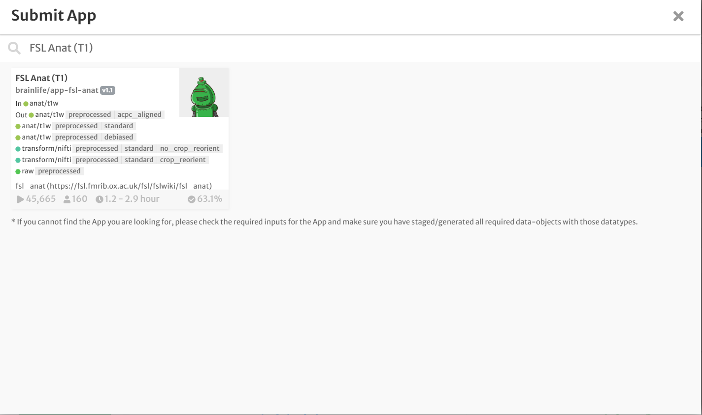
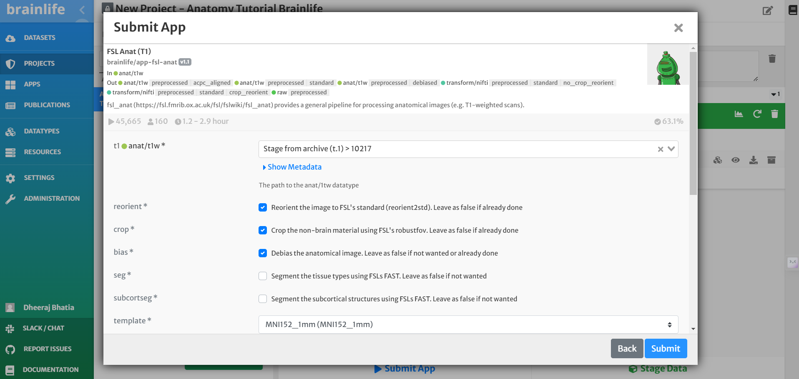
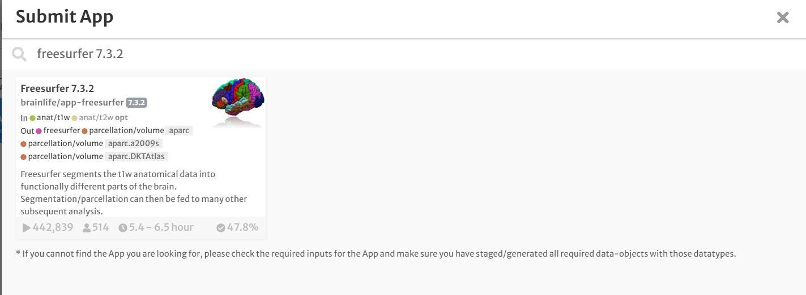
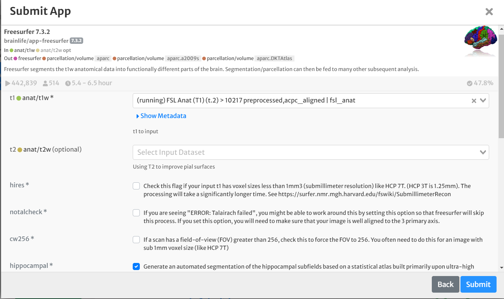
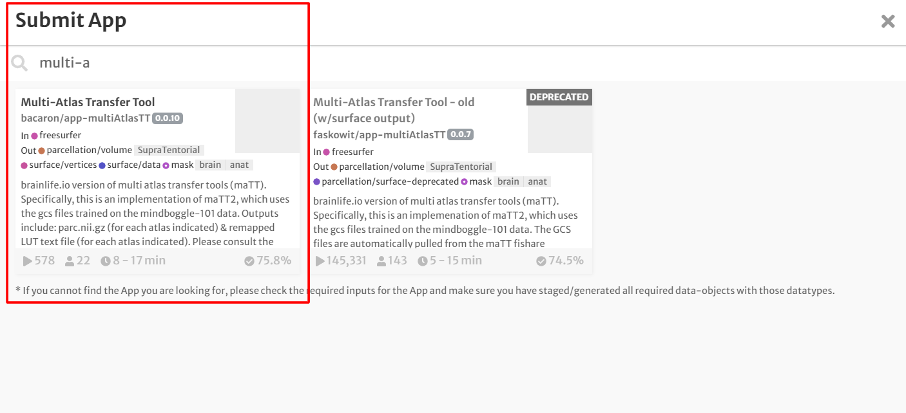
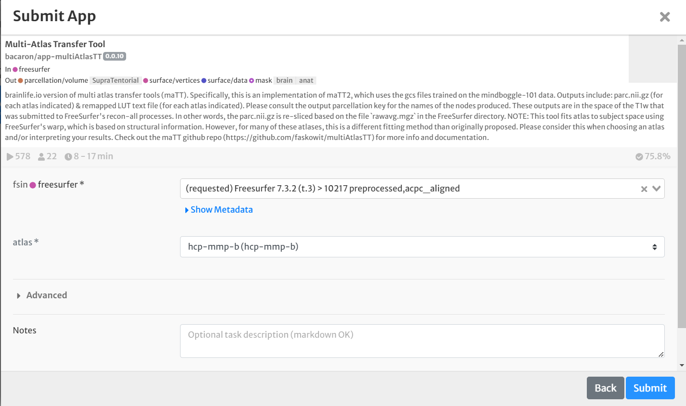
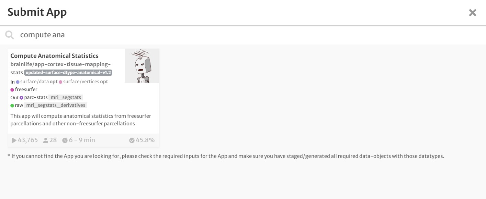

## Anatomical (T1w) Preprocessing on Brainlife Connects

This tutorial demonstrates the standard steps used to preprocess anatomical magnetic resonance imaging data (T1-weighted or T1w) on **Brainlife Connects** ([connects.brainlife.io](https://connects.brainlife.io/){target=\_blank}).

The goal of this tutorial is to process raw anatomical MRI scans into standardized, analysis-ready outputs for:

- **Volumetric and morphometric analyses** (cortical thickness, surface area, and subcortical volumes).
- **Multi-modal coregistration** needed for downstream diffusion MRI (dMRI / tractography) or functional MRI (fMRI) pipelines.

This tutorial builds on the foundations covered in the [Getting Started guide](/docs/user/started/).

---

## Anatomical Preprocessing Overview

Processing a T1-weighted image involves four standard stages:

```
[Raw T1w Data]
       │
       ▼
1. FSL Anat (T1)                 ──► Reorientation, ACPC alignment, bias correction, skull stripping
       │
       ▼
2. Freesurfer 7.3.2              ──► Cortical surface reconstruction, tissue segmentation, subcortical parcellation
       │
       ▼
3. Multi-Atlas Transfer Tool     ──► Maps modern multimodal cortical atlases (e.g., HCP-MMP, Yeo 17)
       │
       ▼
4. Anatomical Statistics (maTS)  ──► Extracts regional cortical thickness, area, & volume into summary CSV tables
       │
       ▼
[Interactive Analysis Tab]       ──► Group-level statistical analysis & visualization in Jupyter Notebooks
```

### 1. Orientation Standardization and ACPC Alignment

Raw anatomical images can vary considerably in head orientation, field of view, and acquisition artifacts across different MRI scanners. Standardizing orientation ensures that voxels are indexed correctly across neuroimaging toolboxes (with the brain upright, nose pointing right in sagittal views, and facing forward in axial/coronal views).

Next, the brain is aligned to the **Anterior Commissure - Posterior Commissure (ACPC)** plane. Linearly aligning the T1w image to a standard reference template (e.g., MNI152) centers the coordinates and aligns the interhemispheric fissure. This alignment is required by downstream tools such as FreeSurfer. On Brainlife, this entire process is handled by the **[FSL Anat (T1)](https://brainlife.io/app/5e3c87ae9362b7166cf9c7f4){target=\_blank}** App.

### 2. FreeSurfer Surface Reconstruction and Parcellation

Once ACPC-aligned, **[FreeSurfer 7.3.2](https://brainlife.io/app/5fe1056057aacd480f2f8e48){target=\_blank}** segments the brain into tissue classes (cerebral white matter, cortical gray matter, and subcortical structures) and reconstructs smooth 2D mesh models of the pial surface and white matter boundary. FreeSurfer also segments hippocampal subfields and thalamic nuclei, yielding parcellations used in structural connectivity and morphometry.

### 3. Mapping Additional Multimodal Parcellations

While FreeSurfer generates standard segmentations (such as Desikan-Killiany and DKT), modern connectomics often requires fine-grained multi-modal parcellations. The **[Multi-Atlas Transfer Tool (maTT)](https://brainlife.io/app/6016dcdc321a4aafce6decd5){target=\_blank}** maps specialized atlases—such as the Glasser Human Connectome Project Multi-Modal Parcellation (`hcp-mmp-b`) or the Yeo 17 resting-state networks—directly onto the subject's reconstructed cortical surface.

### 4. Computing Anatomical Statistics

Finally, morphological metrics (surface vertex count, surface area, cortical thickness, volume, and curvature) are collated across each region of interest (ROI) into standardized `.csv` spreadsheets using **[Compute Anatomical Statistics](https://brainlife.io/app/64a32d3a3a63cf17374f6e75){target=\_blank}** (or _FreeSurfer Statistics_). These tables feed directly into group-level statistical models.

---

## Step 1: Create an Anatomy Project

To begin on Brainlife Connects:

1. Open **Brainlife Connects** ([connects.brainlife.io](https://connects.brainlife.io/){target=\_blank}) and sign in.
2. From the sidebar navigation, select **My Projects** (under the **Me** section).
3. Click the **New Project** button.
4. In the creation dialog:
   - **Title**: Enter a project name, such as `Tutorial Project`.
   - **Description**: Provide a brief description (e.g. `Anatomy preprocessing tutorial project`).
5. Click **Create project**.


Your new project workspace will open, featuring the five Connects workspace tabs:

- **1. Overview**: ReadMe documentation, access control, and citations for all Apps used.
- **2. Data**: Interactive table of all project data-objects, metadata, and staging tools.
- **3. Processing**: Execution center featuring **Summary**, **Pipeline** automation, and **Processes** views.
- **4. Analysis**: Cloud Jupyter Notebooks for in-browser statistical modeling.
- **5. Publications**: Permanent DOI publishing for open data and reproducibility.

---

## Step 2: Add T1w Data to Your Project

Now, add raw anatomical data (`anat/t1w`) to your project:

1. Switch to the **2. Data** tab.
2. Click the **Add Project Data** button at the top right of the data table.
3. Choose your preferred source:
   - **Copy Data from Public Datasets**: Browse open repositories such as OpenNeuro (e.g. `ds000114` - _A test-retest fMRI dataset for motor, language and spatial attention functions_), DANDI, or the Brainlife Dataset Library, and import the subject's `anat/t1w` data with a single click.
   - **Copy Data From another Project**: Select an existing public demo project (such as the _Brainlife Demo_ project) and copy a subject's `anat/t1w` data object.
   - **Upload Data**: If using your own scans, convert them using [ezBIDS](/docs/using_ezBIDS/) or upload directly.

Your imported dataset will now be listed in the **Data** table with the datatype badge `anat/t1w`.

---

## Step 3: Preprocess and Align the T1w Image (FSL Anat)

1. In the **2. Data** tab, select the checkbox next to your `anat/t1w` dataset and click **Stage to process** (or click the List icon on the row).
2. Enter a process name (e.g., `Anatomical Preprocessing`) and confirm.
3. Navigate to the **3. Processing** tab and select the **Processes** view.
4. Click **Submit App** and search for **FSL Anat (T1)**.



5. Configure the parameters on the App submission page:
   - **t1**: Verify that your staged raw `anat/t1w` image is selected.
   - **crop**: Enable (crops non-brain neck tissue).
   - **reorient**: Enable (standardizes orientation).
   - **bias**: Enable (corrects RF field inhomogeneities).
   - **template**: Select `MNI152_1mm`.
6. Click **Submit**.



Brainlife dispatches the task to the optimal computing resource. While running, the task card displays a blue header. When finished, it turns green.

### Visualizing ACPC Alignment

To verify the alignment:

1. Click the **eye icon** (:fa-eye:) next to the output `anat/t1w` dataset.
2. Select **fsleyes** or **Volume Viewer**.
3. Confirm that the image is centered, the anterior/posterior commissures are aligned horizontally, and non-brain tissue has been appropriately stripped.

---

## Step 4: FreeSurfer Surface Reconstruction and Parcellation

With the ACPC-aligned T1w data ready, run FreeSurfer:

1. In your active process under **3. Processing > Processes**, click **Submit App**.
2. In the search bar, type `Freesurfer 7.3.2` and select the app card.



3. Configure the inputs and parameters:
   - **t1**: Select the ACPC-aligned `anat/t1w` dataset generated by FSL Anat in Step 3.
   - **hippocampal**: Enable to perform fine-grained hippocampal subfield segmentation.
   - **thalamicnuclei**: Enable to segment individual thalamic nuclei.
4. Click **Submit**.



_(Note: FreeSurfer surface reconstruction is computationally intensive and typically takes between 4 to 8 hours depending on cluster availability)._

### Visualizing Cortical Surfaces

Once completed, click the **eye icon** (:fa-eye:) on the FreeSurfer output and choose **freeview**. This loads cortical surfaces (pial and white matter), subcortical segmentations (`aseg`), and volumetric parcellations directly in your browser.

---

## Step 5: Map the Multimodal Atlas (Multi-Atlas Transfer Tool)

Next, project the Glasser Human Connectome Project Multi-Modal Parcellation (`hcp-mmp-b`) onto the FreeSurfer surfaces:

1. In the **Processes** view, click **Submit App**.
2. Search for and select **Multi-Atlas Transfer Tool** (maTT).



3. Configure the App:
   - **freesurfer**: Select the FreeSurfer output generated in Step 4.
   - **atlas**: Select `hcp-mmp-b`.
4. Click **Submit**.



This step will project the HCP multimodal parcellation onto the subject's cortical surfaces and output parcellated surface files and annotations.

---

## Step 6: Extract Regional Anatomical Statistics

The final processing step extracts ROI-by-ROI morphometric statistics into analysis-ready summary tables:

1. In the **Processes** view, click **Submit App**.
2. Search for and select **Compute Anatomical Statistics** (or _FreeSurfer Statistics_).



3. Configure the inputs:
   - **freesurfer**: Select the FreeSurfer output from Step 4.
   - **parc_surface** & **parc_surf_vertices**: Select the outputs from the Multi-Atlas Transfer Tool in Step 5.
4. Click **Submit**.

When finished, the task outputs a set of clean summary `.csv` files containing cortical thickness, surface area, and volume across all anatomical ROIs.

---

## Step 7: Group-Level Interactive Analysis

With your anatomical statistics generated, you can jump straight into statistical analysis without leaving Brainlife Connects:

1. Click the **4. Analysis** tab in your project.
2. Click **New analysis** to launch an in-browser cloud **Jupyter Notebook**.
3. Load the generated `.csv` files using `pandas`:

   ```python
   import pandas as pd
   import seaborn as sns
   import matplotlib.pyplot as plt

   # Load your extracted cortical thickness and volume statistics
   df = pd.read_csv('output_stats.csv')
   print(df.head())
   ```

4. Perform ANOVA, linear regressions, or plot regional cortical thickness distributions across subjects and groups directly in the notebook!

---

## Automated Cohort Processing via Pipelines

If you are processing multiple subjects (e.g. 20, 50, or 100+ scans), you do not need to submit each step manually. Navigate to **3. Processing > Pipeline** and configure an automation rule for each of the four apps.

As soon as raw T1w datasets are added to your project's **Data** tab, Brainlife Connects will automatically trigger the full pipeline in sequence from FSL Anat through to final anatomical statistics!
