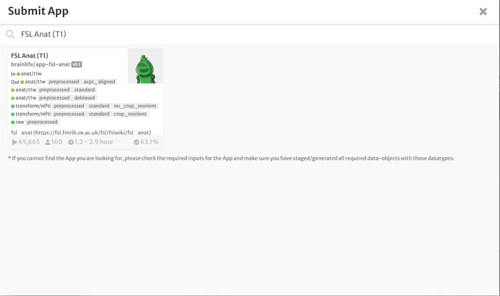
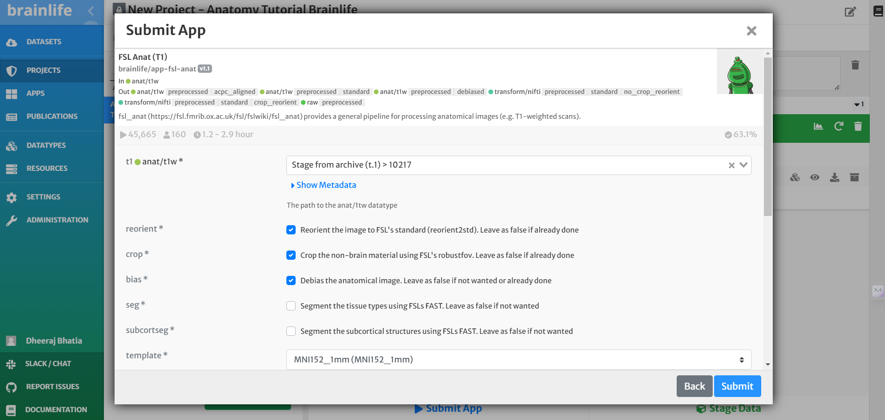
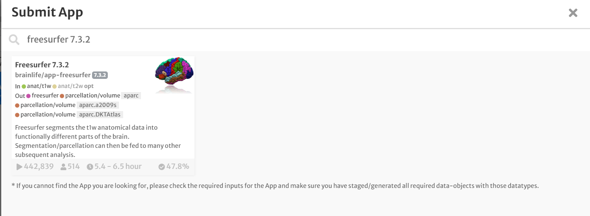
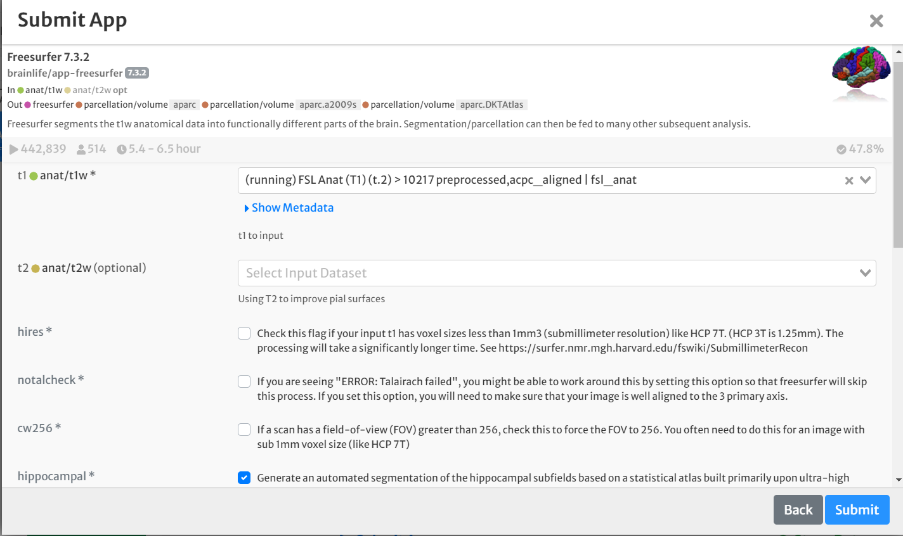
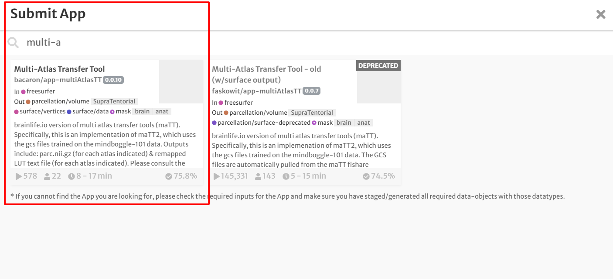
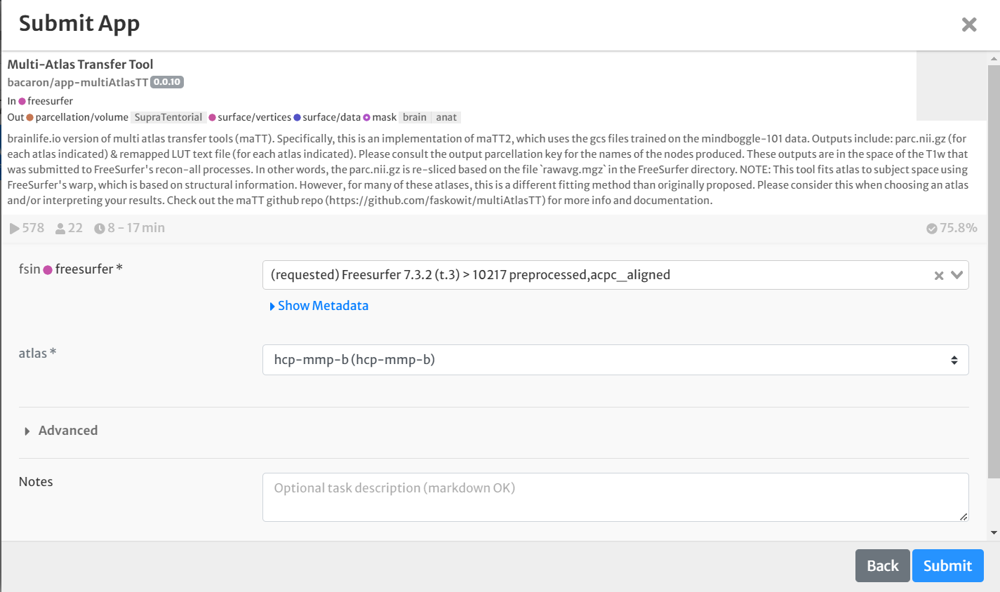
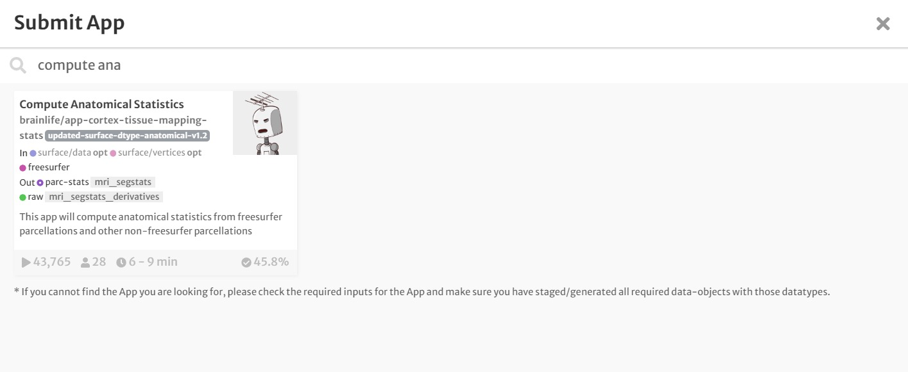

## Anatomical (T1w) Preprocessing on brainlife.io

This tutorial demonstrates the standard steps used to preprocess anatomical magnetic resonance imaging data (T1-weighted or T1w) on **brainlife.io** ([connects.brainlife.io](https://connects.brainlife.io/){target=\_blank}).

The goal of this tutorial is to process raw anatomical MRI scans into standardized, analysis-ready outputs for:

- **Volumetric and morphometric analyses** (cortical thickness, surface area, and subcortical volumes).
- **Multi-modal coregistration** needed for downstream diffusion MRI (dMRI / tractography) or functional MRI (fMRI) pipelines.

This tutorial builds on the [Getting Started guide](/docs/user/started/).

---

## Anatomical Preprocessing Overview

Processing a T1-weighted image involves four standard stages:

```
[Raw T1w Data]
       │
       ▼
1. FSL Anat (T1)                 ──► Reorientation, ACPC alignment, bias correction, skull stripping
       │
       ▼
2. Freesurfer 7.3.2              ──► Cortical surface reconstruction, tissue segmentation, subcortical parcellation
       │
       ▼
3. Multi-Atlas Transfer Tool     ──► Maps modern multimodal cortical atlases (e.g., HCP-MMP, Yeo 17)
       │
       ▼
4. Anatomical Statistics (maTS)  ──► Extracts regional cortical thickness, area, & volume into summary CSV tables
       │
       ▼
[Interactive Analysis Tab]       ──► Group-level statistical analysis & visualization in Jupyter Notebooks
```

### 1. Orientation Standardization and ACPC Alignment

Raw anatomical images can vary considerably in head orientation, field of view, and acquisition artifacts across different MRI scanners. Standardizing orientation ensures that voxels are indexed correctly across neuroimaging toolboxes (with the brain upright, nose pointing right in sagittal views, and facing forward in axial/coronal views).

Next, the brain is aligned to the **Anterior Commissure - Posterior Commissure (ACPC)** plane. Linearly aligning the T1w image to a standard reference template (e.g., MNI152) centers the coordinates and aligns the interhemispheric fissure. This alignment is required by downstream tools such as FreeSurfer. On brainlife.io, the **[FSL Anat (T1)](https://brainlife.io/app/5e3c87ae9362b7166cf9c7f4){target=\_blank}** App does all of this.

### 2. FreeSurfer Surface Reconstruction and Parcellation

Once ACPC-aligned, **[FreeSurfer 7.3.2](https://brainlife.io/app/5fe1056057aacd480f2f8e48){target=\_blank}** segments the brain into tissue classes (cerebral white matter, cortical gray matter, and subcortical structures) and reconstructs smooth 2D mesh models of the pial surface and white matter boundary. FreeSurfer also segments hippocampal subfields and thalamic nuclei, yielding parcellations used in structural connectivity and morphometry.

### 3. Mapping Additional Multimodal Parcellations

While FreeSurfer generates standard segmentations (such as Desikan-Killiany and DKT), modern connectomics often requires fine-grained multi-modal parcellations. The **[Multi-Atlas Transfer Tool (maTT)](https://brainlife.io/app/6016dcdc321a4aafce6decd5){target=\_blank}** maps specialized atlases—such as the Glasser Human Connectome Project Multi-Modal Parcellation (`hcp-mmp-b`) or the Yeo 17 resting-state networks—directly onto the subject's reconstructed cortical surface.

### 4. Computing Anatomical Statistics

Finally, morphological metrics (surface vertex count, surface area, cortical thickness, volume, and curvature) are collated across each region of interest (ROI) into standardized `.csv` spreadsheets using **[Compute Anatomical Statistics](https://brainlife.io/app/64a32d3a3a63cf17374f6e75){target=\_blank}** (or _FreeSurfer Statistics_). These tables feed directly into group-level statistical models.

---

## Step 1: Create an Anatomy Project

1. Open **brainlife.io** ([connects.brainlife.io](https://connects.brainlife.io/){target=\_blank}) and sign in.
2. In the sidebar, select **My Projects**.
3. Select **Project** (the plus button).
4. In **Create project**:
   - **Title**: enter a project name, such as `Tutorial Project`.
   - **Description**: enter a short description (for example, `Anatomy preprocessing tutorial project`).
5. Select **Create project**.


Your new project opens with five tabs:

- **1. Overview**: the project ReadMe, people and access, and citations for the Apps you used.
- **2. Data**: the **Project Data** table of all datasets in the project.
- **3. Processing**: the **Summary**, **Processes** and **Pipeline** sub-tabs.
- **4. Analysis**: Jupyter notebooks for statistics in your browser.
- **5. Publications**: publications with a DOI that share your data and results.

---

## Step 2: Add T1w Data to Your Project

Add raw anatomical data (`anat/t1w`) to your project:

1. Open the **2. Data** tab.
2. Open the **Project Data** menu above the table.
3. Choose a source:
   - "Copy Data from Public Datasets": browse open archives such as OpenNeuro (for example `ds000114`, _A test-retest fMRI dataset for motor, language and spatial attention functions_), DANDI or the brainlife.io Dataset Library, and copy a subject's `anat/t1w` data into your project.
   - "Copy Data From another Project": open a public demo project (such as the _brainlife.io Demo_ project) and copy a subject's `anat/t1w` dataset.
   - Your own scans: the upload items in the menu show "Currently unavailable". Convert your scans with [ezBIDS](/using_ezBIDS/) or upload them with the brainlife.io CLI.

The dataset now appears in the **Project Data** table with the datatype `anat/t1w`.

---

## Step 3: Preprocess and Align the T1w Image (FSL Anat)

1. On **2. Data**, select the checkbox next to your `anat/t1w` dataset and select **Stage to process** (or the **Add to process** icon on the row).
2. In **Add to process**, choose "Create a new process", enter a name (for example, `Anatomical Preprocessing`), and select **Add and open editor**.
3. In the process editor, select **Add App**.
4. **Select App**: search for **FSL Anat (T1)** and select it.



5. **Configure App Settings**:
   - **crop**: on (crops the neck and other non-brain tissue).
   - **reorient**: on (standardizes orientation).
   - **bias**: on (corrects RF field inhomogeneities).
   - **template**: select `MNI152_1mm`.
6. **Select Inputs**: for **t1**, choose the raw `anat/t1w` dataset you added.
7. **Configure Outputs**: keep **Archive Output** on, then select **Add App**.



brainlife.io sends the job to a compute resource. Follow its status (running, then finished) in **3. Processing** → **Processes**.

### Visualizing ACPC Alignment

To verify the alignment:

1. Select **Visualize** next to the output `anat/t1w` dataset.
2. Choose a viewer, such as **fsleyes** or **Volume Viewer**.
3. Check that the image is centered, the anterior/posterior commissures are aligned horizontally, and non-brain tissue has been appropriately stripped.

---

## Step 4: FreeSurfer Surface Reconstruction and Parcellation

With the ACPC-aligned T1w data ready, run FreeSurfer:

1. Open your process: go to **3. Processing** → **Processes**, select the process, and choose **Editor** in its side panel. Then select **Add App**.
2. **Select App**: search for `Freesurfer 7.3.2` and select it.



3. **Configure App Settings**:
   - **hippocampal**: on, to segment hippocampal subfields.
   - **thalamicnuclei**: on, to segment individual thalamic nuclei.
4. **Select Inputs**: for **t1**, choose the ACPC-aligned `anat/t1w` output of FSL Anat from Step 3.
5. **Configure Outputs**: keep **Archive Output** on, then select **Add App**.



_(Note: FreeSurfer surface reconstruction is computationally intensive and usually takes 4 to 8 hours, depending on compute availability.)_

### Visualizing Cortical Surfaces

When the job finishes, select **Visualize** on the FreeSurfer output and choose **freeview**. It loads the cortical surfaces (pial and white matter), subcortical segmentations (`aseg`) and volumetric parcellations in your browser.

---

## Step 5: Map the Multimodal Atlas (Multi-Atlas Transfer Tool)

Next, project the Glasser Human Connectome Project Multi-Modal Parcellation (`hcp-mmp-b`) onto the FreeSurfer surfaces:

1. In the process editor, select **Add App**.
2. **Select App**: search for **Multi-Atlas Transfer Tool** (maTT) and select it.



3. **Configure App Settings**: for **atlas**, select `hcp-mmp-b`.
4. **Select Inputs**: for **freesurfer**, choose the FreeSurfer output from Step 4.
5. **Configure Outputs**: keep **Archive Output** on, then select **Add App**.



This step projects the HCP multimodal parcellation onto the subject's cortical surfaces and outputs parcellated surface files and annotation files.

---

## Step 6: Extract Regional Anatomical Statistics

The final processing step extracts ROI-by-ROI morphometric statistics into analysis-ready summary tables:

1. In the process editor, select **Add App**.
2. **Select App**: search for **Compute Anatomical Statistics** (or _FreeSurfer Statistics_) and select it.



3. **Select Inputs**:
   - **freesurfer**: choose the FreeSurfer output from Step 4.
   - **parc_surface** and **parc_surf_vertices**: choose the outputs of the Multi-Atlas Transfer Tool from Step 5.
4. **Configure Outputs**: keep **Archive Output** on, then select **Add App**.

When the job finishes, it outputs summary `.csv` files containing cortical thickness, surface area, and volume across all anatomical ROIs.

---

## Step 7: Group-Level Interactive Analysis

With your anatomical statistics ready, you can analyze them without leaving brainlife.io:

1. Open the **4. Analysis** tab of your project.
2. Select **New analysis**, choose a notebook from **Blank Template Notebooks**, and select **Create** to launch a **Jupyter notebook** in your browser.
3. Load the generated `.csv` files using `pandas`:

   ```python
   import pandas as pd
   import seaborn as sns
   import matplotlib.pyplot as plt

   # Load your extracted cortical thickness and volume statistics
   df = pd.read_csv('output_stats.csv')
   print(df.head())
   ```

4. Perform ANOVA, linear regressions, or plot regional cortical thickness distributions across subjects and groups in the notebook.

---

## Automated Cohort Processing with Automations

If you process many subjects (for example 20, 50 or 100+ scans), you do not need to run each step by hand. Go to **3. Processing** → **Pipeline** and add an automation (**+ Automation**) for each of the four Apps. See the [Pipeline Automation](/docs/tutorial/anat-t1-pipeline-tutorial) tutorial.

When raw T1w datasets are added to your project's **2. Data** tab, the automations run the whole sequence, from FSL Anat to the anatomical statistics.
