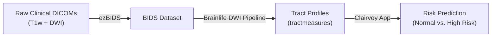

# Clairvoy Tutorial: Clinical Concussion Risk Prediction

## Welcome to Clairvoy

**Clairvoy** is an automated clinical research application hosted on [brainlife.io](https://brainlife.io). The Clairvoy App utilizes a machine learning classifier to predict whether an individual who has sustained a concussion is at high risk for prolonged symptoms or slow recovery (defined as the lack of clinical clearance for full return to sports/daily activity at >28 days). 

The underlying machine learning model evaluates diffusion-weighted (dMRI) and T1-weighted structural MRI acquired within 24–48 hours post-injury. This experimental tool is based on peer-reviewed research by [Bertó et al. 2024 (*NeuroImage: Clinical*, 43, 103646)](https://doi.org/10.1016/j.nicl.2024.103646). 

> [!IMPORTANT] Investigational Use Only
> Clairvoy was developed with support from the U.S. Department of Defense (award W81XWH-20-1-0717, PI: Nicholas L. Port) and the NCAA/DOD CARE Consortium (award W81XWH-14-2-0151, PI: Thomas W. McAllister). Clairvoy is an open-science research tool and has **not yet received FDA clearance or validation as a standalone diagnostic medical device**. We welcome clinical researchers and neuroscientists to evaluate Clairvoy and provide feedback.

---

## Workflow Overview

Clairvoy couples the browser-based **ezBIDS** conversion service with high-performance automated pipelines on Brainlife:
1. **ezBIDS**: Ingests raw DICOM or NIfTI series, automatically identifies imaging sequences, defaces anatomical images for participant privacy, and generates a valid BIDS-compliant dataset.
2. **DWI Pipeline**: Automated preprocessing, fiber orientation modeling, tractography, white matter anatomy segmentation, and tract profiling (microstructural metrics along major white matter tracts).
3. **Clairvoy ML Classifier**: Reads white matter tract profiles (`tractmeasures`) and classifies the subject's injury profile.

---

## Step-by-Step Instructions

### Step 1: Ingest and BIDSify Data with ezBIDS

1. Navigate to [ezBIDS](https://brainlife.io/ezbids) and sign in using your free Brainlife account. (If you don't have an account, see [Getting Started](/docs/user/started/)).
2. Under the **Upload Imaging Data** panel, drag and drop your DICOM folder or `.zip` archive.
3. Review the extracted metadata in `Dataset Description`:
   - Enter a descriptive `Dataset Name` (e.g., `Concussion_Evaluation_01`).
   - Check and adjust participant IDs to ensure de-identification.
4. **Defacing (Privacy Protection)**:
   - Run the automated `QuickShear` defacing step to remove facial features while preserving full intracranial volume.
   - Visually verify defacing and select **Use Defaced**.
5. Click **Finalize** to generate the BIDS directory structure.
6. Click **Send to Brainlife.io** and check **Run DWI Pipeline**.
7. Click **Submit**. This automatically creates a private project on Brainlife and initializes the preprocessing pipeline.

---

### Step 2: Monitor DWI Pipeline on Brainlife

1. Navigate to **Brainlife Connects** ([connects.brainlife.io](https://connects.brainlife.io)) and open your newly created project.
2. Click the **3. Processing** tab and select the **Pipeline** or **Summary** view.
3. Confirm that the pipeline is active. The pipeline will automatically execute:
   - T1w ACPC alignment and brain masking.
   - Diffusion denoising, eddy current, and motion correction.
   - Whole-brain probabilistic tractography and tract segmentation.
   - Tract profile measurement extraction (`tractmeasures`).

> [!NOTE] Processing Time
> Pipeline execution typically takes between 1 and several hours depending on available high-performance compute clusters connected to Brainlife.

---

### Step 3: Run the Clairvoy App

Once the DWI pipeline has completed and produced the `tractmeasures` dataset:

1. In your project, click the **2. Data** tab.
2. Locate and check the box next to the generated **`tractmeasures`** dataset.
3. In the action bar, click **Stage to process**.
4. In the dialog, select **Create New Process**, name it `Clairvoy Prediction`, and click **Submit**.
5. In the **3. Processing** tab, open the `Clairvoy Prediction` process and click **Execute / Submit App**.
6. In the App search box, type **Clairvoy** and select the official **Clairvoy App** card.
7. Verify that your staged `tractmeasures` dataset is bound to the input field, then click **Submit**.
8. Execution requires less than 2 minutes.

---

### Step 4: Interpreting Results

Once the App finishes, open the output by clicking the eye icon next to the result dataset:

- Normal Recovery Trajectory: The injury is predicted to recover in under 28 days.
- High Risk (PPCS): The injury is flagged as high risk for developing Persistent Post-Concussive Symptoms (PPCS), indicating potential benefit from proactive clinical follow-up.

---

## Video Walkthrough

Watch a complete demonstration of the Clairvoy workflow:

<iframe width="560" height="315" src="https://www.youtube.com/embed/TvVmsXITP_0?si=HBNc2dlK7mipZJY-" title="Clairvoy Walkthrough Video" frameborder="0" allow="accelerometer; autoplay; clipboard-write; encrypted-media; gyroscope; picture-in-picture; web-share" referrerpolicy="strict-origin-when-cross-origin" allowfullscreen style="border-radius: 8px;"></iframe>

---

## References & Funding

- **Bertó et al. (2024)**: *Machine learning predicts prolonged recovery following sport-related concussion from acute diffusion MRI.* NeuroImage: Clinical, 43, 103646. [DOI: 10.1016/j.nicl.2024.103646](https://doi.org/10.1016/j.nicl.2024.103646).
- **Nencka et al. (2018)**: *The NCAA-DoD CARE Consortium: dMRI protocol and harmonization.* Brain Imaging and Behavior, 12:1121–1140. [DOI: 10.1007/s11682-017-9775-y](https://doi.org/10.1007/s11682-017-9775-y).
- **Principal Investigators**: Nicholas L. Port (Indiana University, [nport@iu.edu](mailto:nport@iu.edu)) and Franco Pestilli (The University of Texas at Austin, [pestilli@utexas.edu](mailto:pestilli@utexas.edu)).
