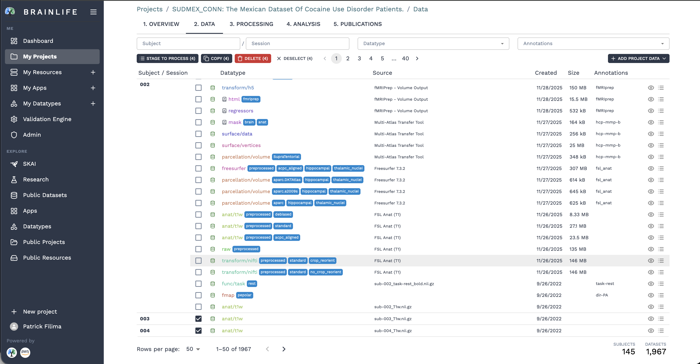
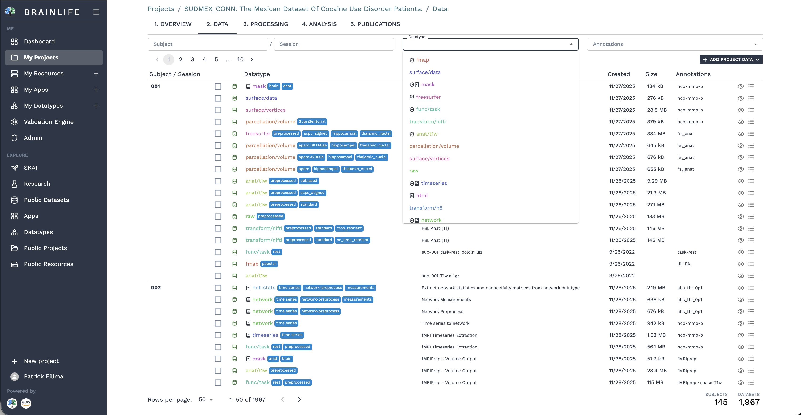
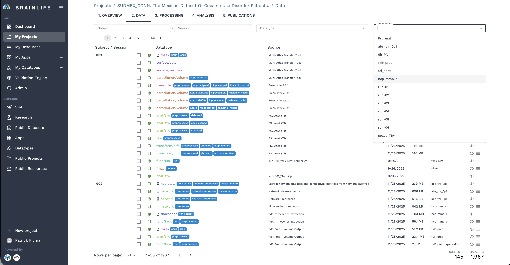
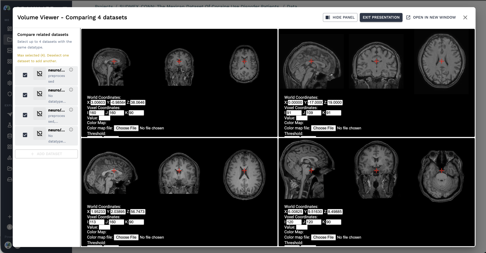

# Project data

A project's data lives on its **2. Data** tab, under the heading **Project Data**. It holds every dataset in the project: the data you brought in, and the outputs of Apps that you chose to archive.

A **dataset** is the files of one datatype for one subject (and session). Older pages call it a "data object", and the old interface had an "Archive" tab. Today "archive" is only a verb: when you run an App, you choose whether to archive each output, which saves it as a dataset in the project.

---

## How App outputs become datasets

- When you add an App to a process, the **Configure Outputs** step has an **Archive Output** switch. When it is on, the App's output is saved to the project when the job finishes.
- When you create an automation, the **Configure Outputs** step has "Archive this output". Archived outputs appear in **2. Data** and can be the input of the next automation.
- Each archived dataset records its provenance: the App, configuration and inputs that produced it. Open the dataset and select **Provenance (history)** to see it.

---

## The data table

The table lists datasets by subject and session. Switch between the **Datasets** and **Subjects** views at the top. For each dataset you see its datatype (a colored chip, for example `anat/t1w`), its datatype tags (for example `acpc_aligned`), and its annotations (your own labels, for example `control`).

Datasets copied from DANDI, EMBER or BossDB are marked as virtual: brainlife.io keeps a reference to the source instead of a copy.

### Filter datasets

Use the filters above the table: **Datatype**, **Subject**, **Session** and **Annotations**.

- **Datatype**: show only some datatypes (for example `neuro/anat/t1w` or `neuro/dwi`).

  

- **Annotations**: show only datasets with some annotations.

  

### Act on one dataset

In each row:

- **Visualize** (the eye icon): choose a viewer for the dataset's datatype.
- **Add to process** (the play icon): stage the dataset to a new or existing process.

### Act on several datasets

Tick the boxes on the left. A bar of actions appears above the table:

- **Visualize together**: overlay compatible datasets (for example a T1w image with a mask or parcellation) in a viewer. It appears only when the selection can be combined.
- **Stage to process (n)**: add the selected datasets to a process.
- **Copy (n)**: copy the selected datasets to another project.
- **Delete (n)**: delete the selected datasets.

Downloading several datasets at once is not available yet; download them one at a time from the dataset view.

### Open a dataset

Select a dataset to open it. The dataset view has three tabs:

- **Details**: subject, session, description, annotations, and validation results. You can edit the annotations here.
- **Provenance (history)**: how the dataset was made.
- **Metadata/Sidecar**: the dataset's metadata (the BIDS sidecar).

Its actions are **Visualize**, **Download**, **Stage to process** and **Delete**.

---

## Add data

Open the **Project Data** menu on **2. Data**:

| Menu item | What it does |
| :--- | :--- |
| "Copy Data from Public Datasets" | Copy data from BossDB, DANDI, OpenNeuro or the Dataset Library. See [Public Datasets](/docs/user/datasets/). |
| "Copy Data From another Project" | Search for a project and copy its datasets over. |
| "Upload Data From local Files" | Shown as "Currently unavailable". |
| "Upload Data from ezBIDS" | Shown as "Currently unavailable". |

To bring your own data into a project today:

- Convert DICOM (or MEG) data to BIDS with [ezBIDS](/docs/using_ezBIDS/) on the web, and send the result to brainlife.io from ezBIDS.
- Upload data with the brainlife.io command-line tool. See [Uploading data](/docs/cli/upload/). Each datatype page also shows **Upload Instructions** for that datatype.
- [aimport](/docs/using_aimport/) imports data from your own computer. It is new and not yet released.
