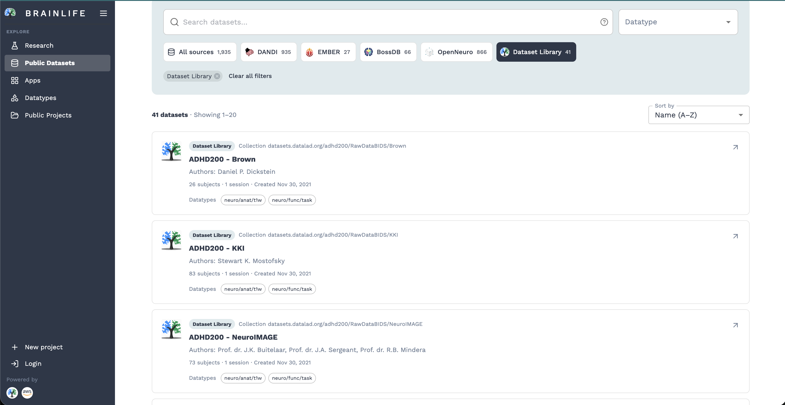
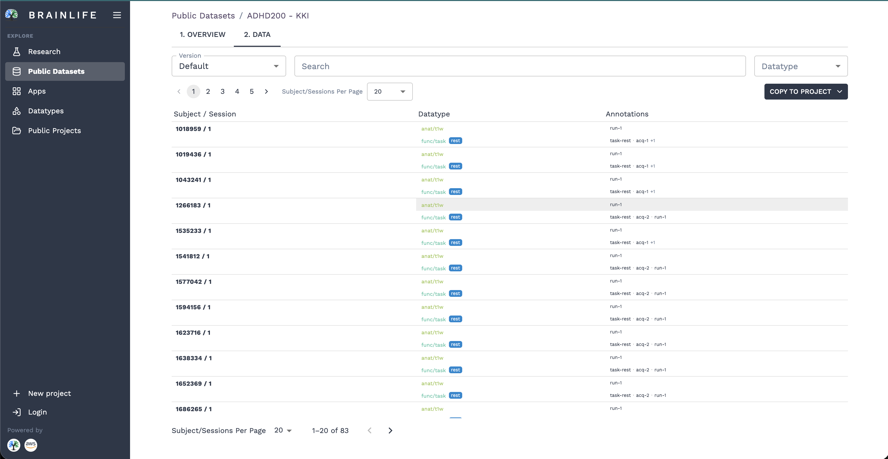
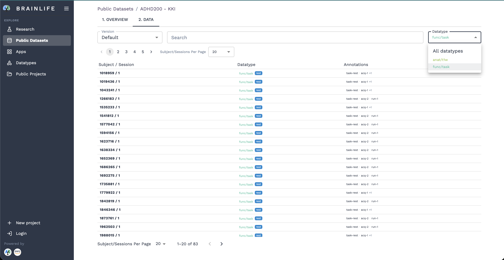
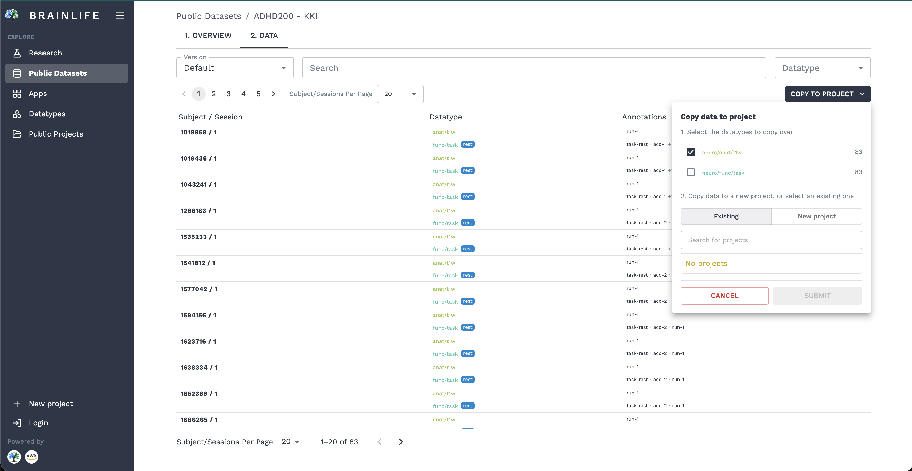

# Public Datasets

**Public Datasets** (in the sidebar, under **Explore**) is where you find open data and copy it into your projects: "Explore neuroscience data across DANDI, EMBER, BossDB, OpenNeuro, and the brainlife.io Dataset Library."

---

## Sources

| Source | What it holds | Browse page |
| :--- | :--- | :--- |
| **Dataset Library** | brainlife.io's own collection of public datasets, including datasets from OpenNeuro. | `/public-datasets/library` |
| **DANDI** | Cellular neurophysiology data from the [DANDI Archive](https://dandiarchive.org){target=_blank}, mostly NWB files. | `/public-datasets/dandi` |
| **BossDB** | Large-scale imaging and connectomics data (for example electron microscopy) from [BossDB](https://bossdb.org){target=_blank}, hosted on open cloud storage. | `/public-datasets/bossdb` |
| **EMBER** | Neurophysiology data from the [EMBER Archive](https://emberarchive.org){target=_blank}. | `/public-datasets/ember` |

OpenNeuro datasets are part of the Dataset Library; they appear under the **OpenNeuro** source filter.

---

## Find a dataset

1. In the sidebar, select **Public Datasets**.
2. Type in the search box ("Search datasets…"). Search covers titles, IDs, library paths, source names and reported datatypes.
3. Use **Filter by source** to show one or more sources, and **Datatype** to show only datasets that report a datatype.
4. Select a dataset to open it.

---

## Copy a Dataset Library dataset to a project

A Dataset Library dataset has two tabs: **1. Overview** (description, authors, license, versions) and **2. Data** (its subjects, sessions and datatypes).

1. Open **2. Data**. Use **Datatype**, **Version** and **Search** to see what the dataset contains.

    

2. Select **Copy to project**. **Copy data to project** opens.

    

3. Under "1. Select the datatypes to copy over", tick only the datatypes you need. Each shows how many datasets it has.
4. Under "Choose a project to copy this data to", choose:
    - **Existing**, then pick one of your projects, or
    - **New project**, then enter **Title (required)** and **Description (required)**.
5. Select **Submit**.

The datasets appear on the project's **2. Data** tab, ready for processing.

An OpenNeuro dataset also brings its tables into the project, read through the [OpenNeuro API](https://openneuro.org/crn/graphql) for the version you copy:

- **`participants.tsv`** is merged into the project's participants table. New subjects and columns are added; values already in the project are kept.
- **Other BIDS tables** (`phenotype/*.tsv`, `samples.tsv`, sessions and scans tables) are copied as [project tables](/docs/user/tables/), each row linked to its subject and session. Copying the same dataset again replaces the tables that came from it; tables you uploaded are kept.

You can also start from a project: on **2. Data**, open the **Project Data** menu and choose "Copy Data from Public Datasets".

---

## DANDI, EMBER and BossDB

Each source has its own dataset page with an overview and a data view.

- **DANDI**: browse a dandiset's files and versions, then select **Copy to project**. A **Datatype mapping** table shows which brainlife.io datatype each file becomes.
- **EMBER**: select the files you want, then **Copy *n* to project**.
- **BossDB**: select the channels you want, then **Copy *n* to project**.

Data copied from these sources is added to your project as a reference to the source, not as a copy. It is marked as virtual in the data table.

---

## After copying

- Look at the data with **Visualize** on **2. Data**.
- Run Apps on it in a process or a pipeline. See [Processes](/docs/user/process/) and [Pipelines](/docs/user/pipeline/).
