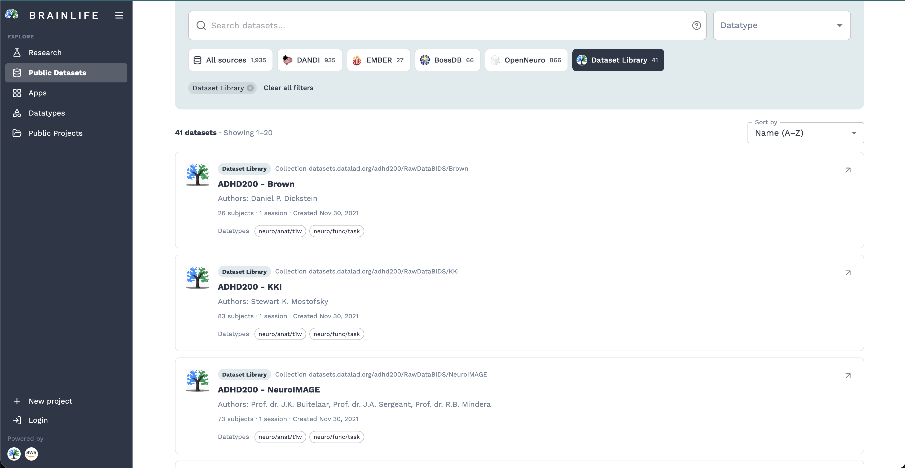
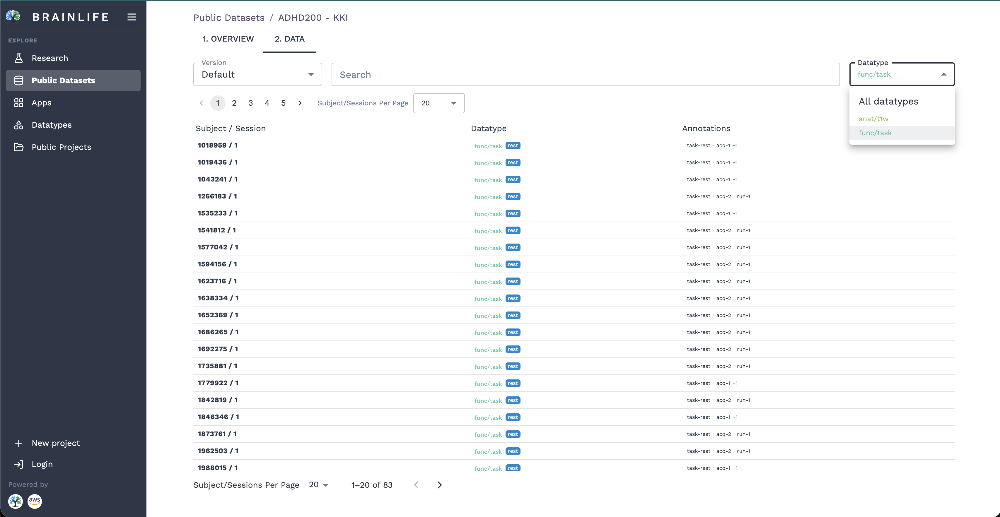
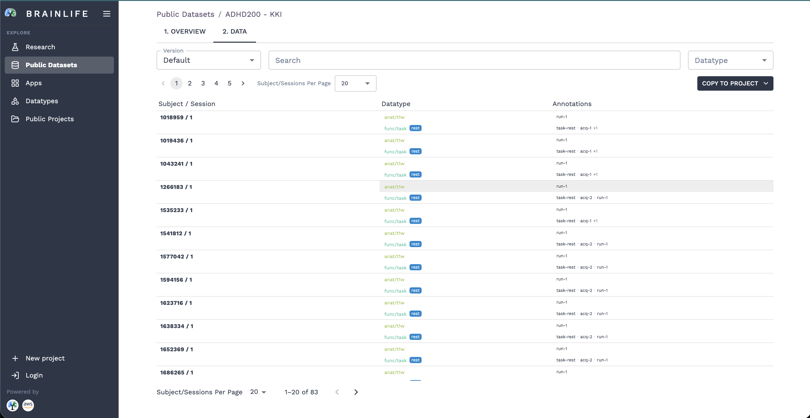

# Datasets

Brainlife provides seamless access to thousands of open neuroimaging and neurophysiology datasets published on **OpenNeuro**, **DANDI**, **BossDB**, **EMBER**, and curated collections in the **Brainlife Dataset Library**.

Powered by [DataLad](https://www.datalad.org/) and cloud-native virtual storage, datasets can be searched, explored, filtered by modality, and copied directly into your Brainlife projects without requiring manual downloads or consuming your local disk space.

---

## Supported Repositories

Brainlife integrates with major open-science data repositories:

- **Dataset Library**: Curated public dataset collections and benchmarks maintained directly on Brainlife.
- **OpenNeuro**: Open archive of BIDS-compliant neuroimaging datasets (MRI, MEG, EEG, iEEG, and PET) from researchers worldwide.
- **DANDI Archive**: Distributed Archives for Neurophysiology Data Integration, hosting cellular and extracellular neurophysiology datasets.
- **BossDB**: Brain Observatory Storage Service for petascale volumetric electron microscopy and connectomics data.
- **EMBER**: FAIR neurophysiology datasets providing standardized access for discovery, visualization, and reproducible computing.

---

## 1. Browsing and Filtering Public Datasets

To find datasets for your analysis:

1. Click on **Public Datasets** under the **EXPLORE** section in the left sidebar (or navigate to [brainlife.io/public-datasets](https://brainlife.io/public-datasets)).
2. Use the **Search datasets...** bar to search by dataset title, author, keyword, or accession ID (e.g., `ADHD200`, `ds002218`).
3. Click on repository chips (such as **All sources**, **DANDI**, **EMBER**, **BossDB**, **OpenNeuro**, or **Dataset Library**) to filter by a specific archive.
4. Use the **Datatype** dropdown filter in the search header to narrow down datasets that contain specific modalities (e.g., `neuro/anat/t1w`, `neuro/func/task`, `dwi`).

Each dataset card displays the study title, authors, accession identifier, number of subjects and sessions, publication date, and tags for all available datatypes.

---

## 2. Inspecting Dataset Content & Datatypes

Click on any dataset card to open its detailed view:

- **1. OVERVIEW**: Displays study abstract, author list, licensing information, participant demographics, and external repository links.
- **2. DATA**: Provides an interactive browser of all data objects, subjects, and sessions contained in the dataset.

Within the **DATA** tab, you can:

- **Select a Version**: Use the **Version** dropdown to select specific dataset releases or stick with the `Default` latest release.
- **Filter by Datatype**: Use the **Datatype** filter dropdown to isolate specific imaging modalities (e.g., `anat/t1w`, `func/task`).
- **Search Subjects**: Use the search field to find specific participants (e.g., `1018959`).
- **Review Annotations**: Inspect acquisition tags and BIDS metadata entities (e.g., `task-rest`, `acq-1`, `run-1`).

!!! info "BIDS Entity Preservation"
    Brainlife preserves all original BIDS entities and metadata tags associated with the dataset, ensuring full reproducibility when downstream Apps are executed.

---

## 3. Selecting Data for Your Project

Once you have identified the dataset and inspected the subjects and modalities you need:

1. Review the data table to verify that the required sessions and datatypes are present.
2. Click the **COPY TO PROJECT** button located in the top-right corner above the data table.

---

## 4. Copying Data into a Project

Clicking **COPY TO PROJECT** opens the **Copy data to project** dialog:

### Step 1: Select Datatypes to Copy

Check the boxes for the datatypes you want to bring into your project (e.g., `neuro/anat/t1w`, `neuro/func/task`).

!!! tip "Selective Importing Saves Storage and Compute"
    You do not need to copy an entire multi-terabyte dataset if your research only requires specific scans (such as anatomical T1w for Freesurfer). Brainlife lets you select only the modalities you need, keeping your project organized and efficient.

### Step 2: Choose Destination Project

Choose where to copy the data:

- **Existing Project**: Select the **Existing** tab, then search and select one of your existing Brainlife projects from the dropdown.
- **New Project**: Select the **New project** tab to create a brand new project on the spot:
  - Enter a **Title (required)**.
  - Enter a **Description (required)**.

### Step 3: Submit

Click **SUBMIT** (or **Submit**). Brainlife will register the virtual dataset linkages into the target project. You will be redirected to the project's **Data** tab, where your newly added datasets are immediately available to run Apps, configure automated Pipelines, or view in Brainlife's web visualizers.

---

## Working with Imported Datasets

Once datasets are copied into your project:

- **Run Processing Apps**: Navigate to the **Apps** tab to launch preprocessing pipelines (such as FSL Anat, Freesurfer, fMRIPrep, or QSIprep) on the imported subjects.
- **Automate with Pipelines**: Set up automated pipeline rules to process all current and future subjects imported from the dataset.
- **Visualize in 3D**: Open any data object to inspect surfaces, volumetric slices, or functional time series directly in your web browser.

!!! note "DataLad Virtual Files"
    Imported public datasets use DataLad pointers under the hood. Raw data files are downloaded on-demand by Brainlife computing resources only when a processing task or download request requires them.
