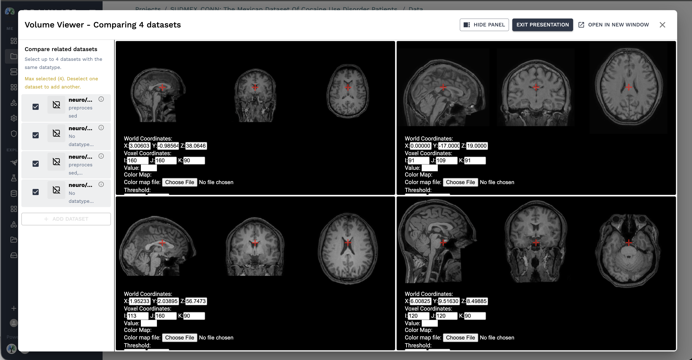

# Datatypes and visualization

Apps on brainlife.io do not exchange arbitrary files. They exchange **datatypes**. A datatype specifies which files and folders a dataset contains, so that "Apps process data, taking in specific datatypes as input and producing resulting datatypes." Because Apps agree on datatypes, the output of one App can be the input of another, even when the two Apps wrap different software (for example FSL, FreeSurfer, MRtrix3 or ANTs).

---

## What a datatype defines

A datatype has a name (for example `neuro/anat/t1w` or `neuro/dwi`), a description, and a list of the files and folders a dataset of that type contains. For example, a `neuro/dwi` dataset contains `dwi.nii.gz`, `dwi.bvecs` and `dwi.bvals`.

The definition is stored as JSON. This example, for the `neuro/life` datatype, lists two files and one folder:

```json
{
    "name": "neuro/life",
    "desc": "Linear Fascicle Evaluation (LiFE) output structure",
    "files": [
        { "id": "fe", "filename": "output_fe.mat", "required": true },
        { "id": "life_results", "filename": "life_results.json", "required": true },
        { "id": "tracts", "dirname": "tracts", "required": true }
    ]
}
```

### Datatypes and BIDS

Datatypes and [BIDS](https://bids-specification.readthedocs.io/en/stable/){target=_blank} both standardize data, for different purposes:

- **BIDS** organizes a whole dataset on disk: folders, subjects, sessions and metadata.
- **Datatypes** describe one item of data, raw or derived, so that an App receives exactly the files it expects, whoever produced them.

---

## Browse datatypes

- **Datatypes** (sidebar, under **Explore**): the catalog of all datatypes.
- **My Datatypes**: datatypes you administer.

Search by name or description, and filter by **Supports validation** (the datatype has a validator that checks new datasets) or **Supports Jupyter notebooks**.

A datatype's page shows:

- **About**: what the datatype is.
- **Files & directories**: the files and folders a dataset of this type contains.
- **Official tags**: the datatype tags officially supported for this datatype.
- **Apps**: Apps that take this datatype as input or produce it as output.
- **Maintainers**, **Sample Data** and **Visualizers**: who maintains the datatype, example datasets, and the viewers that can open it.
- **Upload Instructions**: how to upload data of this type with the command-line tool.

To create a datatype, open **My Datatypes**, select **Datatype** (the button with a plus sign), enter a **Name** and **Description**, and select **Create datatype**. You can add files, tags and a validator after it is created.

---

## Datatype tags

brainlife.io has two kinds of labels on datasets.

| | Datatype tags | Annotations |
| :--- | :--- | :--- |
| **Purpose** | Narrow a datatype, so Apps get compatible input. | Organize and filter datasets in a project. |
| **Examples** | `acpc_aligned`, `preprocessed`, `single-shell`, `defaced` | `control`, `patient`, `baseline` |
| **Who sets them** | The App that produced the dataset, or the uploader. | You and your project members, at any time. |
| **Effect on Apps** | An App can require an input datatype tag (for example `neuro/dwi` with `single-shell`). | Automations can use them to choose between several matching datasets. |

Older pages call annotations "tags". In the app, filters are labeled **Datatype** and **Annotations**, and a pipeline uses "Filter by Datatype Tag" and "Filter by Annotation" to resolve ambiguous inputs.

---

## Look at a dataset

Datasets open in your browser; you do not need to download them.

1. On a project's **2. Data** tab, select **Visualize** (the eye icon) in the dataset's row, or open the dataset and select **Visualize**.
2. Choose a viewer. The list shows the viewers registered for that datatype (see **Visualizers** on the datatype's page). Examples:
    - **NiiVue**: volumes, surfaces and streamlines (for example NIfTI images, tractography, OME-Zarr).
    - **Neuroglancer**: large volumes such as microscopy and electron microscopy.
    - **Neurosift**: NWB files.
    - Some datatypes also offer desktop programs, such as MrView or ITK-SNAP, that run on a server and stream to your browser.
3. To overlay compatible datasets, for example a T1w image with a mask or parcellation, select them in the table and choose **Visualize together**, then **MrView** or **ITK-SNAP**.


