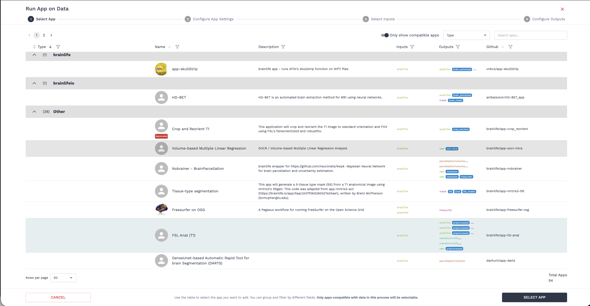
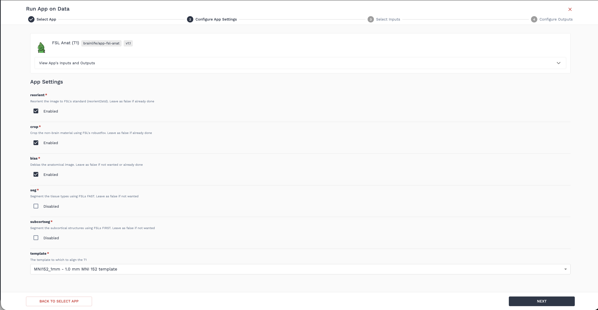
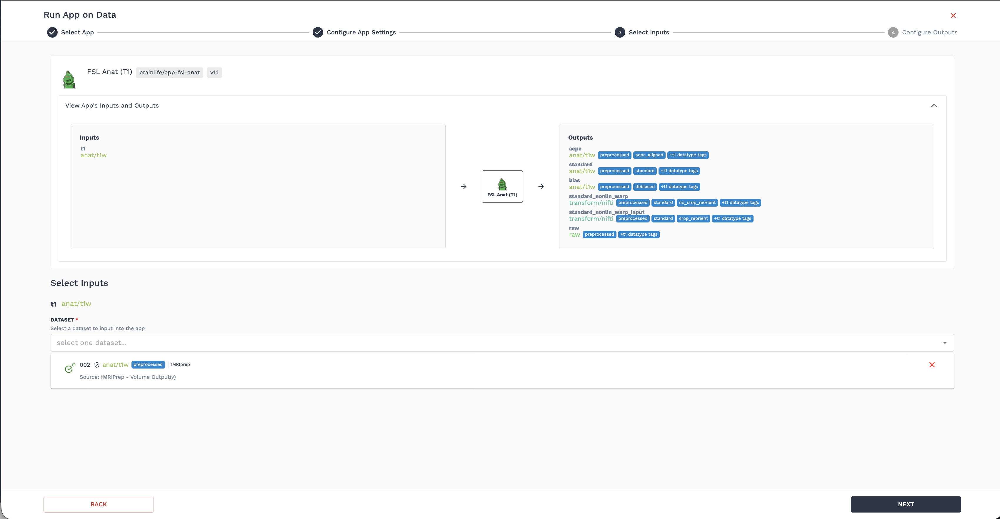
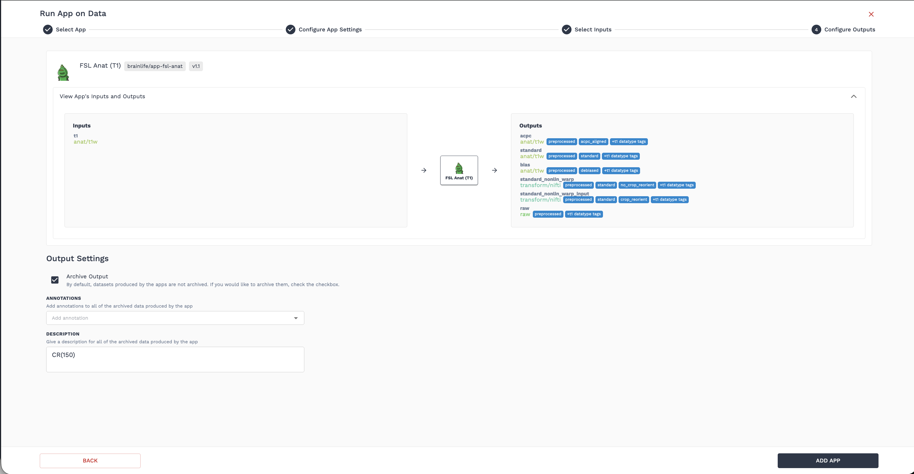

# Pipelines

A [process](/docs/user/process/) runs Apps one at a time, by hand. That suits trying an App on one subject. To run the same Apps on tens or hundreds of subjects, build a **pipeline**.

A pipeline is the set of **automations** in a project. An automation runs an App for every subject and session that has the inputs and does not yet have the output. (Older pages call automations "rules".)

---

## How automations work

```
[ Input datasets ] ──> ( Automation 1: App A ) ──> [ Output 1 ] ──> ( Automation 2: App B ) ──> [ Results ]
```

1. Each automation names an App, its settings, the inputs it needs (datatypes, tags, subject and session filters) and the outputs it archives.
2. brainlife.io checks each subject and session in the project. When a subject or session has all the inputs and lacks the output, the automation submits the App for it.
3. When the job finishes, the archived output is a dataset in the project, and it can be the input of the next automation.
4. If one subject fails, only that subject stops at that step. The rest continue. When you fix the problem and the missing output appears, the next automations pick that subject up.

---

## Open the pipeline

1. Open your project.
2. Select **3. Processing**.
3. Select **Pipeline**.

!!! note "Add data first"
    If the project has no datasets yet, you see "No datasets have been added to the project yet. To get started, go to Data". Add or copy data on **2. Data** before you create automations.

---

## Create an automation

Select **Automation** (the button with a plus sign). **Add New Automation to Pipeline** opens with four steps. Select **Next** to move between steps.

### 1. Select App

Search the App catalog and choose the App to automate.



### 2. Configure App Settings

Set the parameters the App runs with. Less common options are under **Advanced Settings**.



### 3. Configure Inputs

Say which data the automation uses for each subject and session.

- **Use this input**: optional inputs can be left out.
- **Expected dataset count**: for an input that accepts several datasets, how many to expect per subject and session.
- Datatype tag and annotation filters: when a subject or session has more than one matching dataset, use these to choose the right one.
- **Project override**: take this input from another project instead of the current one.
- **Subject** and **Session** overrides: for every subject or session, use the data of one specific subject or session instead (for example a template).
- **Global Subject & session filters**: limit the automation to some subjects and sessions with a **Subject Filter** and a **Session Filter**. A filter is a pattern: `^100` matches all subjects that start with `100`; `02` matches all sessions that contain `02`. Green rows show the subjects and sessions included.



### 4. Configure Outputs

Choose which outputs to archive. For each output:

- Tick "Archive this output". The automation submits the App only where this output does not already exist for the subject or session.
- Add **Annotations** and a **Description** to the archived datasets.



!!! tip "Annotate your outputs"
    Annotations tell the outputs of this automation apart from other datasets of the same datatype. They also let the next automation pick exactly these outputs.

Select **Complete** to add the automation to the pipeline.

---

## Organize automations into groups

1. Select **Automation Group** (the button with a plus sign).
2. In **Create automation group**, enter a **Group name** (for example "Structural preprocessing").
3. To move an automation into a group, open its menu and choose **Switch group**.

To rename, recolor or delete a group, select **Edit group** in the automations list.

---

## The pipeline canvas

The pipeline is shown as a graph.

- Each card is an automation. Lines connect an automation to the next one when its output matches the next one's input.
- Pan by dragging and zoom with the mouse wheel or the controls.
- Open the automations list (**Show automations list**) to search automations and groups, reorder them, and focus one on the canvas.
- **View Settings** sets how the canvas is drawn.

Each automation's menu offers **View details**, **View processes**, **Edit** and **Switch group**.

---

## Check an automation's progress

Select an automation, or choose **View details**, to open its details. The switch at the top shows whether it is **Active** or **Inactive**. Subjects and sessions are sorted into four tabs:

| Tab | What it lists |
| :--- | :--- |
| **Waiting for data** | Subjects and sessions that do not have the inputs yet. |
| **Requires attention** | Failed jobs, or issues that must be fixed before processing can continue, such as ambiguous inputs. |
| **Processing in progress** | Jobs submitted and running. |
| **Complete** | Subjects and sessions whose outputs are archived. |

The **Summary** view of **3. Processing** collects the items that need action across all automations.

---

## Change an automation

1. Open the automation and turn its switch to **Inactive**, so no new jobs start with the old settings.
2. Choose **Edit**. Change the **Settings**, **Inputs** or **Outputs**, and select **Save Automation**.
3. If the change affects the outputs, remove the outputs made with the old settings on **2. Data** or **Processes**.
4. Turn the switch back to **Active**.

!!! note "Automations resubmit missing outputs"
    An active automation submits the App wherever the inputs exist and the archived output does not. If you delete an output or a job while the automation is active, it runs that subject again. Make the automation **Inactive** first if you do not want that.

To delete an automation, use **Delete Automation**. Deleting an automation also removes all jobs it is processing, and cannot be undone.
