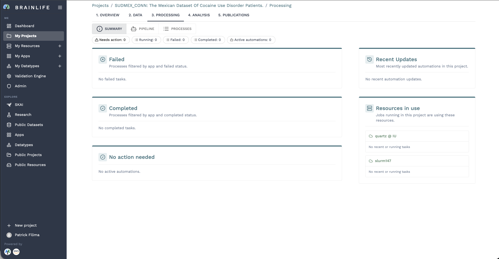
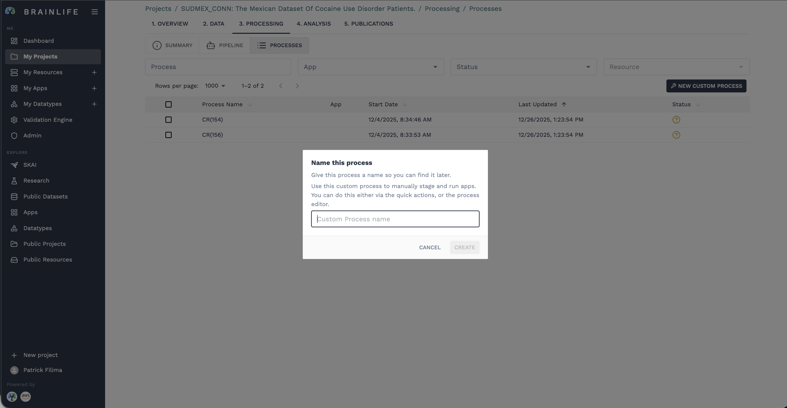
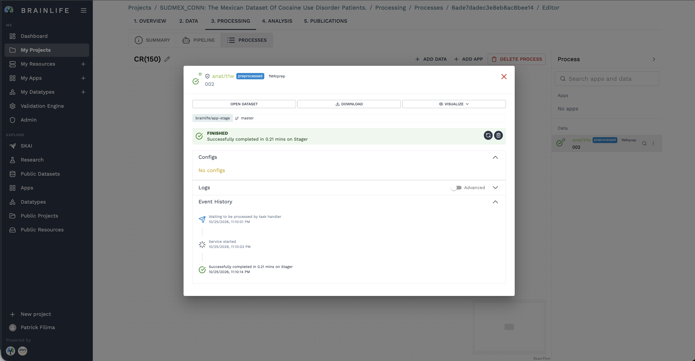
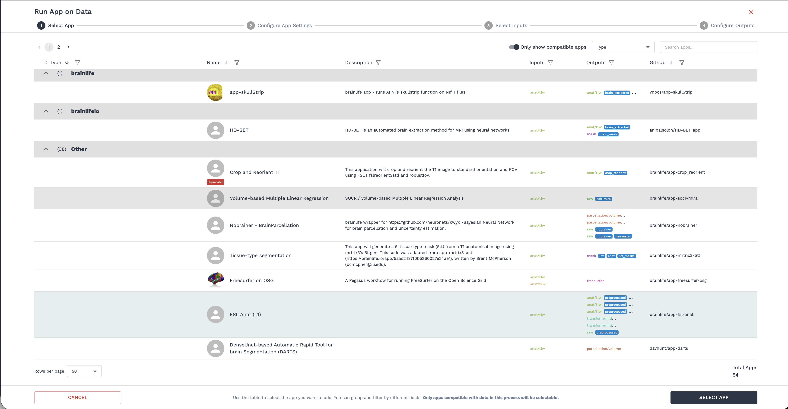
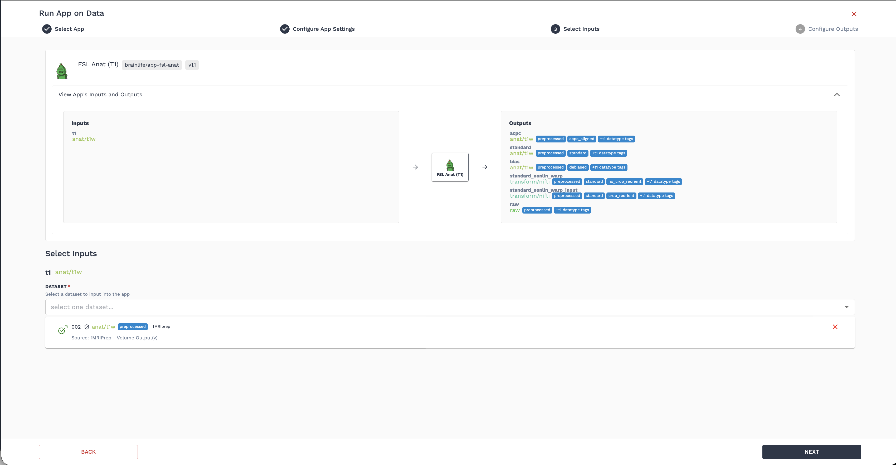
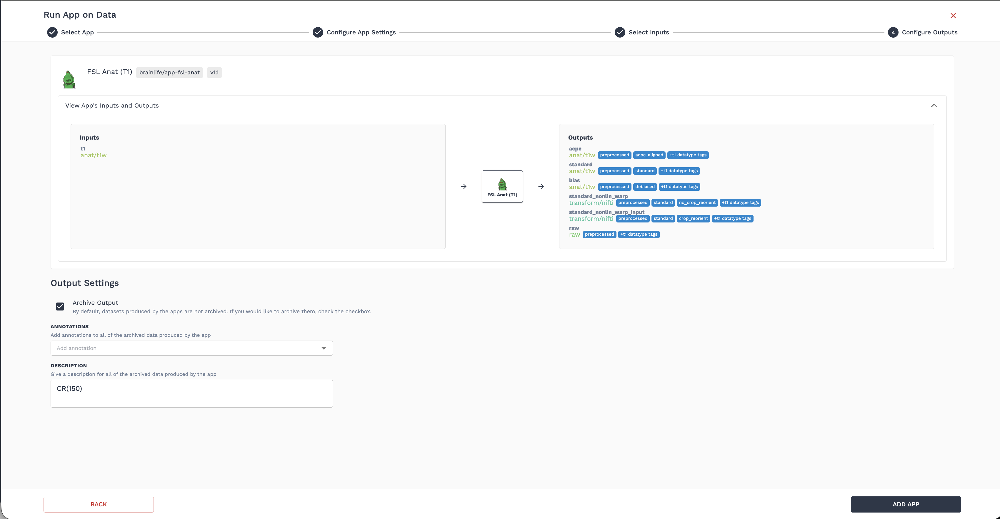
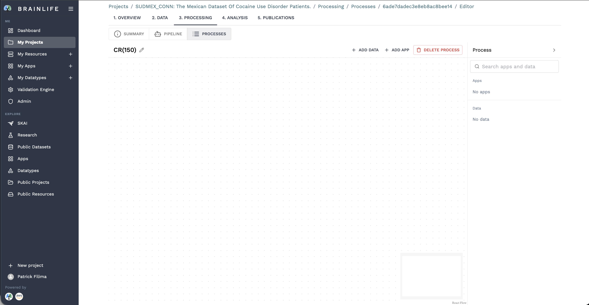
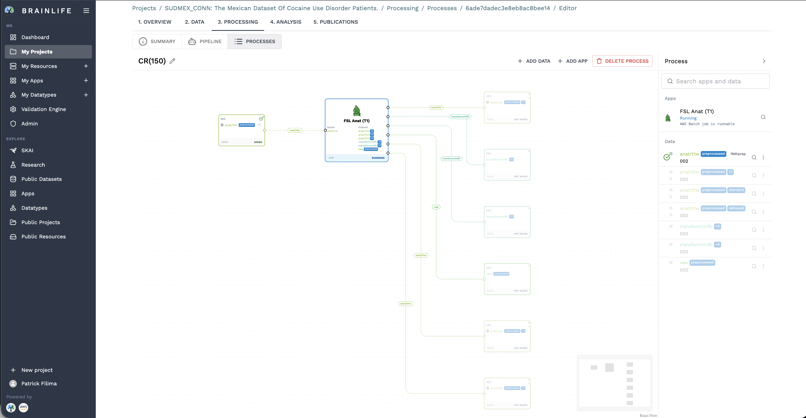

# Processes & Task Execution

While **Pipelines** are designed for automated batch processing across large cohorts, the **Processes** interface allows for hands-on, on-demand execution. A Process is a workspace instance where you stage specific input datasets, execute Apps one at a time, inspect intermediate results, and link tools together into custom analysis workflows.

---

## Accessing Processes & Processing Summary

To manage on-demand tasks in your project:

1. Open your project on Brainlife.
2. Select the **`3. Processing`** tab from the top navigation bar.
3. In the sub-navigation toggle bar, switch between **`Summary`**, **`Pipeline`**, and **`Processes`**.

```
[ Summary ] ── [ Pipeline ] ── [ Processes (active) ]
```

The **Summary** view provides an operational overview of all compute activity across your project:



- **Action Status Counters**: Real-time status cards tracking tasks that **Need action**, **Running** jobs, **Failed** runs, **Completed** tasks, and **Active automations**.
- **Resources in Use**: Direct visibility into cluster queue allocations and resource utilization across connected HPC environments.

---

## Running an On-Demand Task

A typical process workflow consists of creating a process, staging data, running an App through the 4-step wizard, and tracking execution:

### Step 1: Creating a Process & Staging Input Data
Processing begins by staging the datasets you want to analyze:

1. From the **Processes** sub-tab, click **+ New Process** to open the creation dialog.
2. Enter a descriptive **Name** (e.g., `Preprocess Anatomical`) and optional description.



3. In the **Add Data to Process** modal, check the boxes next to the participant datasets you wish to import from your project's repository.


4. Click **Import Data Objects** (e.g., `IMPORT 1 DATA OBJECTS`). Brainlife stages the selected data into your process workspace.
5. Click on the staged dataset node or task entry to inspect its metadata, staging logs, and event history in the task inspector dialog:



### Step 2: The 4-Step App Execution Wizard
Once input data is staged, click **+ Add App** on the process canvas or action toolbar to launch the execution wizard:

#### 1. Select App
Search or filter the Brainlife App catalog. You can toggle **"Only show apps compatible with staged data"** to immediately identify algorithms that accept your staged datatypes (e.g., *FSL Anat (T1)*, *FreeSurfer*, *fMRIPrep*).



#### 2. Configure App Settings
Adjust default algorithmic parameters, threshold values, and processing flags required for your experiment.


#### 3. Select Inputs
Map your staged input datasets to the specific input slots required by the App. The wizard verifies datatype compatibility and tags automatically.



#### 4. Configure Outputs
Specify user-defined output tags and annotations (e.g., `acpc_aligned`, `preprocessed`) so the resulting derivatives are clearly labeled when archived into your project repository.



Click **Submit** to dispatch the task to the compute orchestrator.


---

## Monitoring Job Status

Brainlife's orchestrator, **Amaretti**, dispatches your task to an optimal computing resource (HPC cluster, cloud VM, or campus grid) and monitors its lifecycle:

| Status | Meaning |
| :--- | :--- |
| **Requested** | The job is queued in Brainlife's system and waiting for an available computing resource that matches the task's hardware requirements. |
| **Running** | A compute resource has been assigned, input data has been transferred, and the job is actively executing in a containerized environment (Singularity/Docker). |
| **Finished** | The job completed with return code `0`. All output datasets are automatically validated, cataloged, and archived into your project's **`2. Data`** tab. |
| **Failed** | The job exited with an error. You can inspect the execution logs (`stdout`, `stderr`) in the side panel to troubleshoot the issue. |
| **Removed** | To conserve cluster storage, the temporary scratch work directory on the remote cluster is automatically purged after 25 days. Your archived output datasets remain safe and permanently stored. |

---

## The Processes Table & Side-Panel Inspector

The **Processes** view provides a high-density, faceted table designed for tracking multiple tasks:

- **Faceted Filters**: Quickly filter jobs by status (**Requested**, **Running**, **Finished**, **Failed**), App name, submitter, execution resource, or date.
- **Batch Selection**: Select multiple tasks to restart or delete failed jobs.
- **Side-Panel Inspector**: Clicking on any process row opens a sliding drawer on the right side of the screen containing:
  - **Live Log Stream**: View real-time terminal output, standard output (`stdout`), and error output (`stderr`).
  - **Task Files & Raw Output**: Browse and download all intermediate log files, configuration files, and script outputs.
  - **Compute Resource Information**: Details about the host cluster, walltime duration, memory consumption, and exit code.

---

## Interactive Process DAG Editor

For complex, multi-step workflows that involve chaining multiple Apps together, Brainlife Connects provides the **Interactive Process Editor**:

1. In the Processes table, click the **Process Editor** link or navigate to `/projects/:projectId/processing/processes/:instanceId/editor`.
2. The editor launches a visual, interactive **ReactFlow canvas** representing the workflow Directed Acyclic Graph (DAG) for that specific process instance:



- **Data Nodes**: Represent staged raw input datasets or intermediate derivatives generated by Apps.
- **App Nodes**: Represent individual tool executions (e.g., App 1: Skull Stripping $\rightarrow$ App 2: Registration $\rightarrow$ App 3: Tractography).
- **Dependency Edges**: Visually map the flow of data objects from App outputs to downstream App inputs.



3. You can click on any node in the graph to inspect intermediate outputs, check task status, configure parameters, or attach new Apps directly into the pipeline graph.


