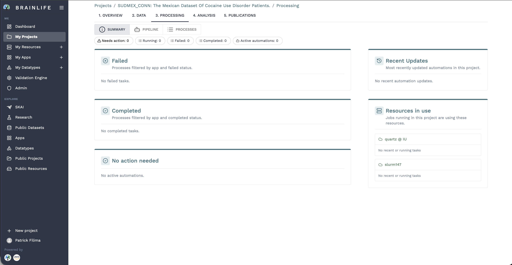
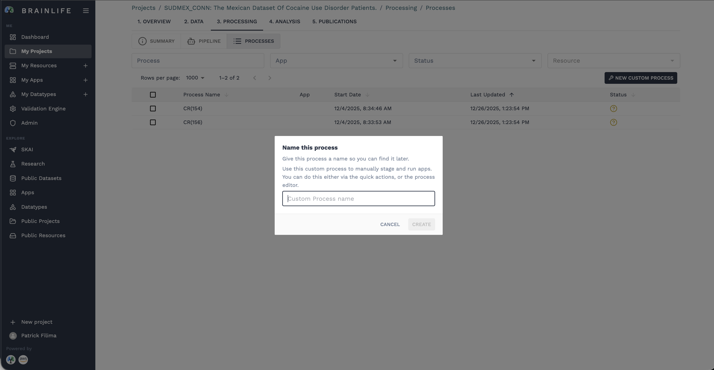
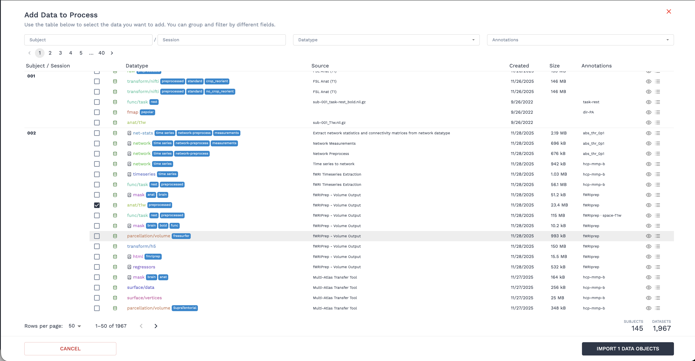
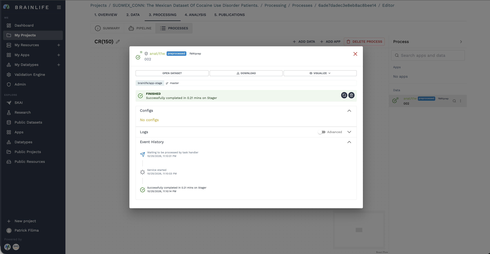
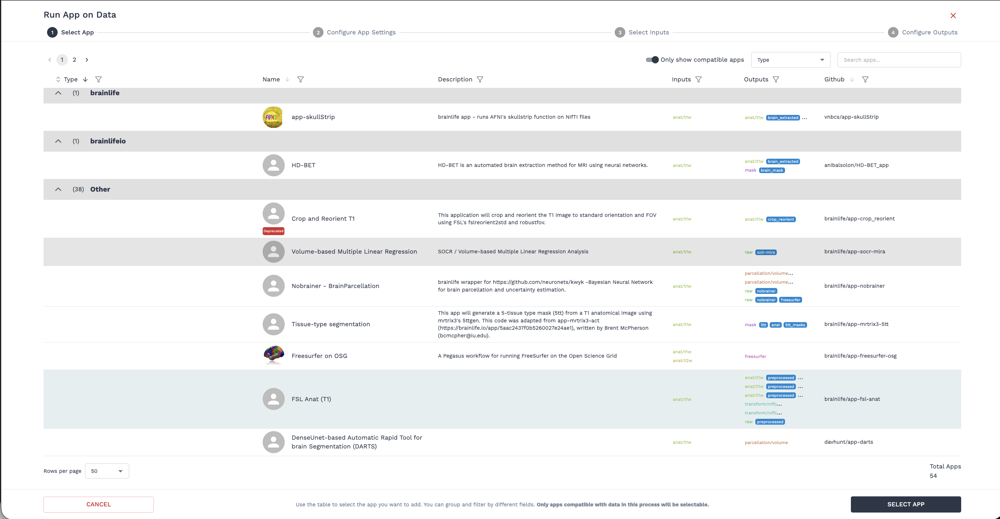
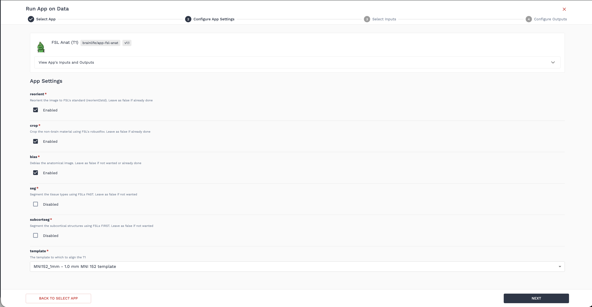
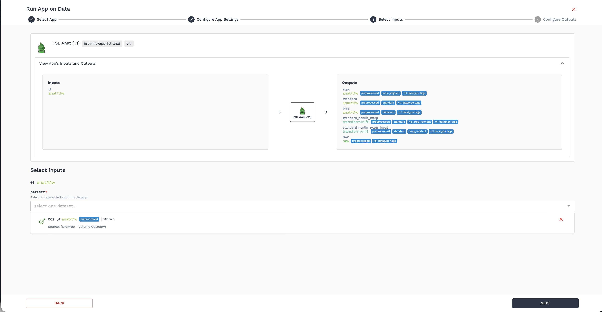
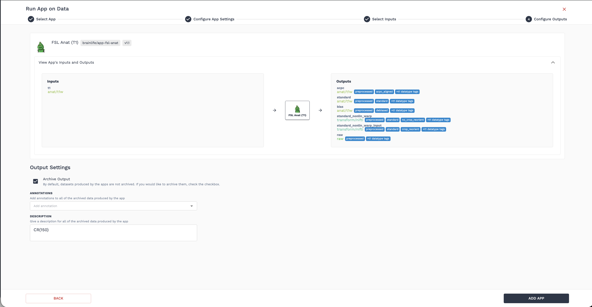
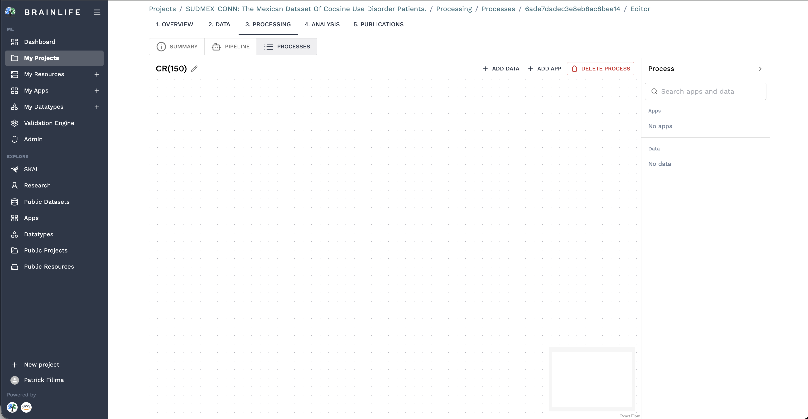
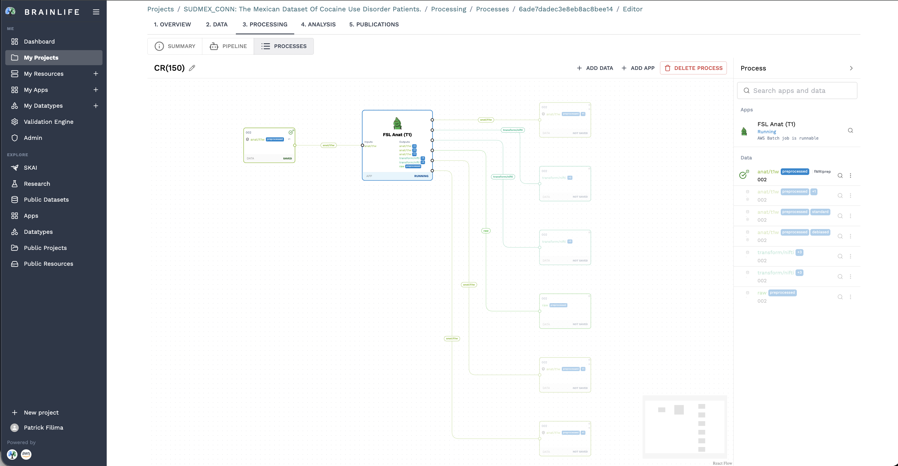

# Processes

A **process** is a workspace in a project where you add data and Apps and run them by hand. Use a process to try an App on one subject, look at intermediate results, or chain a few Apps together. When you know which Apps you want to run on every subject, use a [pipeline](/docs/user/pipeline/) instead.

Each run of one App is a **job**.

---

## Find processing in a project

1. Open your project.
2. Select the **3. Processing** tab.
3. Choose a view: **Summary**, **Processes** or **Pipeline**.

If the project has no datasets yet, you see "No datasets have been added to the project yet. To get started, go to Data". Add data first; see [Project data](/docs/user/archive/).

### Summary

**Summary** shows what is happening across the project.

- **Needs Action**: blockers that stop your automations on some subjects and sessions, for example "Ambiguous input" or missing data. Select **Resolve** to fix an ambiguous input with "Filter by Datatype Tag" or "Filter by Annotation".
- **No action needed**: automations that are running normally.
- **Completed** and **Failed**: processes by App and status.
- **Recent Updates**: the automations updated most recently.
- **Resources in use**: the resources running this project's jobs.

---

## Run an App in a process

### 1. Create a process and add data

You can start from your data or from **Processes**.

**From the data table**

1. On **2. Data**, tick the datasets you want and select **Stage to process**.
2. In **Add to process**, choose "Create a new process" and enter a name, or "Add to an existing process" and pick one.
3. Select **Add and open editor**. The process editor opens with your data in it.

**From Processes**

1. On **3. Processing** → **Processes**, select **New Custom Process**.
2. Give the process a name so you can find it later, and select **Create**. The process editor opens.

    

3. Select **Add Data**. In **Add Data to Process**, tick the datasets you want and select **Import *n* data objects**.

    

4. Select a data item in the editor to see its details.

    

### 2. Add an App

In the process editor, select **Add App**. **Run App on Data** opens with four steps.

**Select App.** Search the App catalog. Only Apps compatible with the data in this process can be selected.

**Configure App Settings.** Set the parameters the App runs with. Less common options are under **Advanced Settings**.

**Select Inputs.** Choose which data in the process feeds each of the App's inputs.

**Configure Outputs.** Choose whether to **Archive Output**, which saves the result as a dataset in the project. You can add **Annotations** and a **Description** to the archived datasets.

Select **Add App**. The App appears in the editor and its job is submitted.

---

## The process editor

The editor shows a process as a graph.

- **Data** items are datasets in the process: data you added, and outputs of Apps.
- **App** items are the Apps you added. Lines connect each App to its inputs and outputs, so you can chain Apps: the output of one becomes the input of the next.
- The side list shows the process's **Apps** and **Data**. From it you can **Visualize**, **Download** or **View Dataset**.
- Select an App to see its settings, inputs, outputs and result.
- Use **Add Data** and **Add App** to extend the process, and **Delete Process** to remove it.

---

## Follow your jobs

**3. Processing** → **Processes** lists the project's processes. Filter by **Process**, **App** or **Status**. The **Resource** filter is not available yet. Processes created by an automation are marked.

Select a process to open its side panel:

- **Quick add app**, **Quick add data**, **Editor** and **Delete** act on the whole process.
- Each App in the process has three steps: **Setup** (its inputs), **Run & logs** (logs and configuration) and **Results** (its outputs).
- From the results you can **Visualize**, **Open Dataset** or **Download** an output.

A job's status is one of:

| Status | Meaning |
| :--- | :--- |
| **REQUESTED** | The job is waiting for a resource. |
| **RUNNING** | The job is running on a resource. |
| **FINISHED** | The job completed. Outputs you chose to archive are on **2. Data**. |
| **FAILED** | The job stopped with an error. Open its logs. |
| **STOPPED** | Someone stopped the job. |
| **REMOVED** | The job and its working files were removed. Archived datasets are kept. |

Next to the status, use **Rerun task**, **Stop task** or **Delete task** (icon buttons) when they apply. To find out why a job failed, see [Troubleshooting](/docs/user/failure/).
