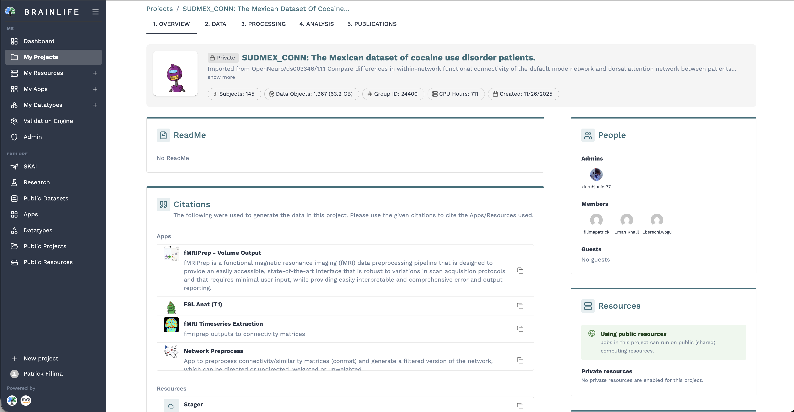

# Projects

A project is your workspace on brainlife.io: data, processing, notebooks and publications, shared with a team.

To see your projects, select **My Projects** in the sidebar ("Search and filter projects you administer, contribute to, or follow as a guest."). To browse projects others share, select **Public Projects** ("Browse public projects shared with the brainlife.io community.").

---

## Create a project

1. In the sidebar, select **My Projects**.
2. Select **Project** (the button with a plus sign).
3. In **Create project**, enter:
   - **Title** (required): a clear name for the project.
   - **Description**: what the project is about.
4. Select **Create project**.

brainlife.io creates the project and opens it.

---

## Project tabs

Every project has five numbered tabs:

```
[ 1. Overview ] ── [ 2. Data ] ── [ 3. Processing ] ── [ 4. Analysis ] ── [ 5. Publications ]
```

### 1. Overview

A summary of the project.



- **About**: the project's readme, written in Markdown.
- **Citations**: citations for the **Apps** and **Resources** used to produce the project's data. Use them when you cite your work.
- **Related Articles**: journal articles related to the project, found from its name and description.
- **Admins**, **Members**, **Guests**: the people in the project.
- **Data Agreements**: the data use agreements members must accept.
- **Resources**: whether the project uses public resources, and which private resources are enabled.

### 2. Data

The **Project Data** table lists every dataset in the project, by subject and session. You can switch between the **Datasets** and **Subjects** views and filter by **Datatype**, **Subject**, **Session** and **Annotations**. From here you add data, look at datasets, stage them to a process, copy them to another project, or delete them. See [Project data](/docs/user/archive/).

### 3. Processing

Where you run Apps. It has three views:

- **Summary**: what needs your attention, what failed, what completed, and which resources are in use.
- **Processes**: the processes in the project, each a set of data and Apps you run by hand. See [Processes](/docs/user/process/).
- **Pipeline**: the automations that run Apps for every subject and session. See [Pipelines](/docs/user/pipeline/).

### 4. Analysis

Jupyter notebooks launched against the project's data, from a blank template or a published notebook. See [Analysis with notebooks](/docs/user/groupanalysis/).

### 5. Publications

The publications made from this project. Each publication has a DOI, assigned when you create it. See [Publications](/docs/user/publication/).

!!! note "Projects stored on S3"
    Some projects keep their data on S3 object storage. They have the same five tabs, but **2. Data** opens as a file browser: you search files and folders, preview them, and select **Use with apps** to use them in processing.

---

## Project settings

Project admins open the settings by selecting **Edit** in the project header. Settings have five tabs. Select **Save Changes** to keep your edits.

### Details

- **Details**: the project name, description and avatar.
- **ReadMe**: the Markdown shown under **About** on **1. Overview**.
- **Delete project**: permanently deletes the project. This cannot be undone.

### Access

**Access policy** controls who can read the project's details and datasets:

| Policy | Who can read |
| :--- | :--- |
| **Public** | All users can read the datasets. Only admins and members can change the project. |
| **Private** | Only admins, members and guests can read the datasets. |

For a private project, tick "Publicly list this private project" to make its name, description and readme searchable while its data stays hidden.

Under **Project collaborators**, use **Edit Admins**, **Edit Members** and **Edit Guests** to add people:

| Role | What they can do |
| :--- | :--- |
| **Admin** | Edit the project settings and everything members can do. The project owner cannot be removed from admins. |
| **Member** | Process data: add and stage datasets, run Apps, edit automations, launch notebooks. |
| **Guest** | View the project. |

### Data Use Agreements

Add agreements that people must accept before they can open the project's data. Select **Add new agreement** and write the text (Markdown is supported), or start from the brainlife.io template. The tab title shows how many agreements the project has, for example **Data Use Agreements (1)**.

When someone opens **2. Data** on a project with agreements, they see "You must consent to the following agreement(s) before accessing data on this project". They tick **I agree** for each agreement to continue.

### Participants Info

Per-subject information for the project (the BIDS participants table). Tick "Make participant info public" to treat it as public project data that may be included in publications. Only include information authorized by your IRB or consented by your participants, and no personally identifiable information.

### Resources

- **Public resources**: tick "Allow this project to use public resources" to let jobs run on shared resources. When unticked, jobs run only on the private resources you enable.
- **Private resources**: add resources you own or administer so they can run jobs for this project. Changes are saved immediately.

See [Registering a resource](/docs/resources/register/) to add your own compute resource.
