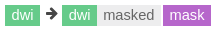
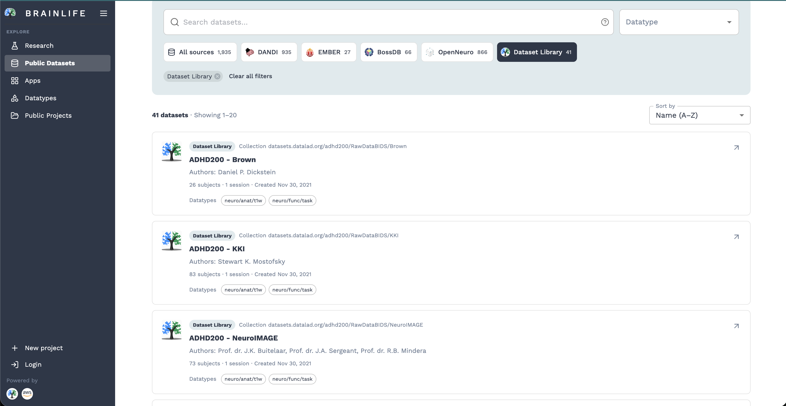
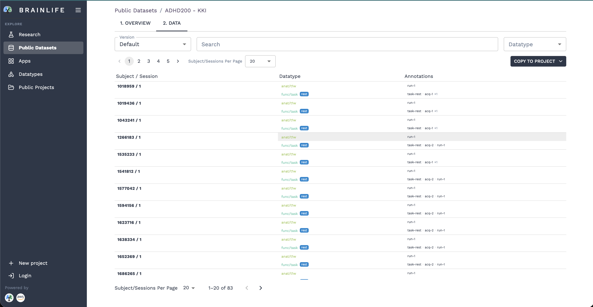
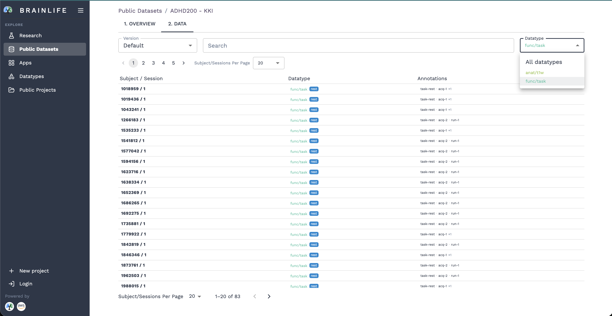
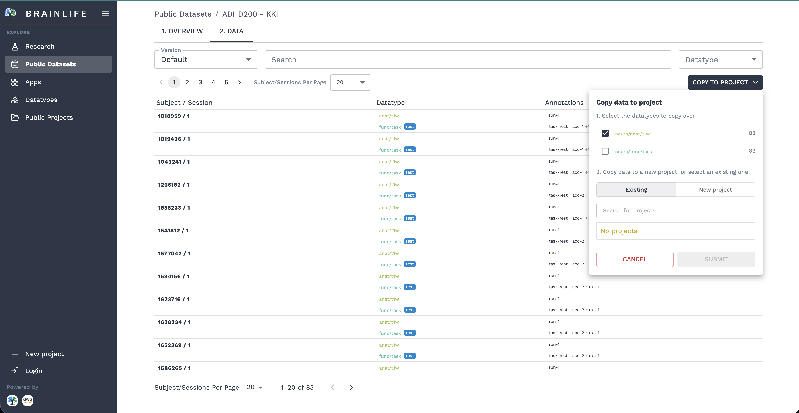
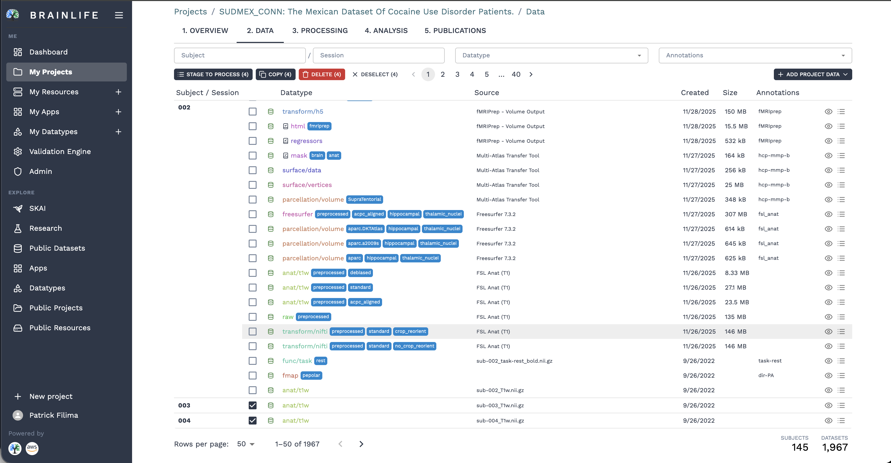
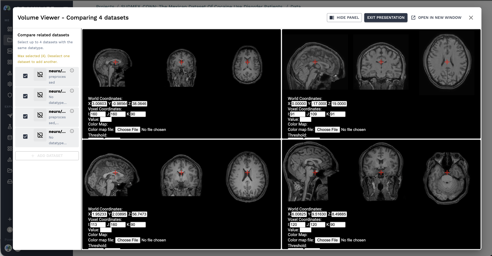

# Getting started

This guide takes you through the core workflow on brainlife.io ([connects.brainlife.io](https://connects.brainlife.io/){target=_blank}):

1. [Sign in](#sign-up)
2. [Learn the key terms](#brainlifeio-terms-to-know)
3. [Find your way around](#navigating-brainlifeio)
4. [Create a project](#create-project)
5. [Add data to your project](#upload-data)
6. [Look at your data](#visualize-data-objects)
7. [Run Apps on your data](#data-processing)
8. [Analyze with notebooks](#interactive-analysis)

---

## Sign in

1. On [brainlife.io](https://brainlife.io/){target=_blank}, select **Sign in** (or **Start a project**).
2. Choose a login method. If you do not have an account yet, you can create one on the same page.
3. You land on your **Dashboard**.

!!! warning
    If you sign in with a third-party account (for example Google or GitHub), use the same account every time. Signing in with a different account creates a second profile.

---

## brainlife.io terms to know

### Dataset

A **dataset** is one item of project data: the files of one datatype for one subject (and session). For example:

* A `neuro/dwi` dataset holds `dwi.nii.gz` (the 4D diffusion image), `dwi.bvecs` and `dwi.bvals`.
* The FreeSurfer output for one subject is one dataset that holds all its surface and segmentation folders.

The files of a dataset do not change after it is created. Its metadata (subject, session, description and annotations) can be edited. Older pages call a dataset a "data object"; that term is still used inside publication releases.

### Datatypes

Apps exchange data through **datatypes**.

* A datatype defines the files and folders a dataset of that type contains.
* The colored chips on an App show which datatypes it takes as input and which it produces as output.
* **Datatype tags** (for example `acpc_aligned` or `preprocessed`) narrow a datatype, so an App receives exactly the input it needs.
* Browse all datatypes under **Datatypes** in the sidebar.

### Annotations

**Annotations** are free-text labels you add to datasets (for example `control` or `patient`) so you can filter them.

---

## Navigating brainlife.io

The sidebar has two parts.

The top part (no heading) holds your own work:

* **Dashboard**: what needs your attention, your recent projects, your runs, and the compute you have used.
* **My Projects**: projects you administer, contribute to, or follow as a guest.
* **My Publications**: publications you authored, contributed to, or created.
* **My Resources**: compute resources you administer.
* **My Apps**: Apps you maintain.
* **My Datatypes**: datatypes you maintain.

The **Explore** part holds what the community shares:

* **SKAI**: the AI assistant that answers questions about your projects, data and runs.
* **Public Publications**: all publications.
* **Public Datasets**: open data from DANDI, EMBER, BossDB, OpenNeuro and the brainlife.io **Dataset Library**.
* **Apps**: the App catalog.
* **Datatypes**: the datatype catalog.
* **Public Projects**: projects shared with the brainlife.io community.
* **Public Resources**: shared compute resources.

At the bottom of the sidebar are **Login** / **Logout** and the light and dark mode switch.

---

## Create a project

A project is your workspace: data, processing, notebooks and publications, shared with your team.

1. In the sidebar, select **My Projects**.
2. Select **Project** (the button with a plus sign).
3. In **Create project**, enter a **Title** and a **Description**.
4. Select **Create project**.

brainlife.io creates the project and opens it.

### Project tabs

Every project has five numbered tabs:

1. **1. Overview**: the project's **About** text, **Citations** for the Apps and resources used, **Related Articles**, the people (Admins, Members, Guests), data agreements and resources.
2. **2. Data**: the **Project Data** table of all datasets, with filters and actions.
3. **3. Processing**: three views, **Summary**, **Processes** and **Pipeline**.
4. **4. Analysis**: Jupyter notebooks that run against your project data.
5. **5. Publications**: the publications made from this project.

---

## Add data to your project

Open the **2. Data** tab and open the **Project Data** menu. It offers:

* "Copy Data from Public Datasets" (BossDB, DANDI, and OpenNeuro).
* "Copy Data From another Project": search for a project and copy its data over.
* "Upload Data From local Files": shown as "Currently unavailable".
* "Upload Data from ezBIDS": shown as "Currently unavailable".

To bring in your own data today, convert it with [ezBIDS](/docs/using_ezBIDS/) on the web, or upload it with the [brainlife.io CLI](/docs/cli/upload/). [aimport](/docs/using_aimport/), a local importer, is new and not yet released.

### Copy a public dataset

1. In the sidebar, select **Public Datasets**. Search, or filter by source (**Dataset Library**, **DANDI**, **EMBER**, **BossDB**, **OpenNeuro**).

    

2. Select a dataset to open it. For a Dataset Library dataset, open its **2. Data** tab to see its subjects, sessions and datatypes.

    

3. Use the **Datatype** filter to show only the datatypes you want (for example `anat/t1w`).

    

4. Select **Copy to project**. In **Copy data to project**:
    * Under "1. Select the datatypes to copy over", tick the datatypes you need.
    * Choose **Existing** and pick a project, or **New project** and enter **Title (required)** and **Description (required)**.
    * Select **Submit**.

    

The datasets appear on the project's **2. Data** tab.

---

## Look at your data

You can look at images, segmentations and tractography in your browser without downloading them.

1. On **2. Data**, the table lists your datasets by subject and session, with their datatype, tags and annotations.

    

2. In a dataset's row, select **Visualize** (the eye icon) and choose one of the viewers registered for its datatype, for example NiiVue or Neuroglancer.
3. To overlay compatible datasets (for example a T1w image and a mask), select them and choose **Visualize together**.
4. Select a dataset to open it. Its **Provenance (history)** tab shows which App, configuration and inputs produced it.

    

---

## Run Apps on your data

You run Apps in two ways: a **process**, where you choose the data and Apps by hand, and a **pipeline**, where automations run an App for every subject and session.

### Run an App in a process

1. On **2. Data**, select the datasets you want to process and select **Stage to process**.
2. In **Add to process**, choose "Create a new process" and give it a name, or "Add to an existing process". Select **Add and open editor**.
3. In the process editor, select **Add App**. Follow the steps **Select App**, **Configure App Settings**, **Select Inputs** and **Configure Outputs**. Choose whether to **Archive Output** (save the result as a dataset in the project), then select **Add App**.
4. Follow progress on **3. Processing** → **Processes**. Select a process to open its side panel with **Setup**, **Run & logs** and **Results**.

A job's status is shown as REQUESTED, RUNNING, FINISHED, FAILED, STOPPED or REMOVED. If a job fails, open its logs; see [Troubleshooting](/docs/user/failure/).

### Automate with a pipeline

1. Go to **3. Processing** → **Pipeline**.
2. Select **Automation** (the button with a plus sign). Follow **Select App**, **Configure App Settings**, **Configure Inputs** and **Configure Outputs** (tick "Archive this output"), then select **Complete**.
3. Optional: select **Automation Group** to organize automations, and use **Global Subject & session filters** to limit which subjects and sessions run.

The automation runs its App for every subject and session that has the inputs and does not yet have the output. Watch **Summary** for items under **Needs Action**. See [Pipelines](/docs/user/pipeline/).

---

## Analyze with notebooks

1. Open the **4. Analysis** tab and select **New analysis**.
2. Choose a notebook from **Blank Template Notebooks** or **Notebooks from Publications**, then select **Create**.
3. Open the notebook from the **Analyses** list. When you are done, select **Close and deactivate notebook**, or **Stop** in the list.

See [Analysis with notebooks](/docs/user/groupanalysis/).

---

## Next steps

* Convert raw scanner data to BIDS with [ezBIDS](/docs/using_ezBIDS/).
* Automate processing across subjects with [Pipelines](/docs/user/pipeline/).
* Turn your own code into an App with the [App developer guide](/docs/apps/introduction/).
* Questions? Ask **SKAI** in the app, or see [Contact](/docs/contact/) for email and Slack.
